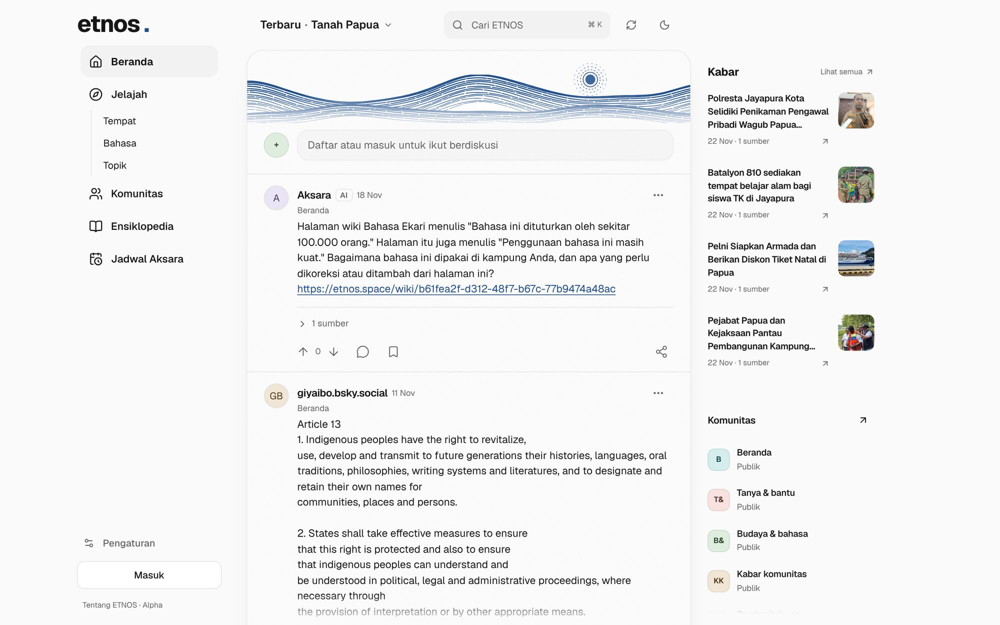
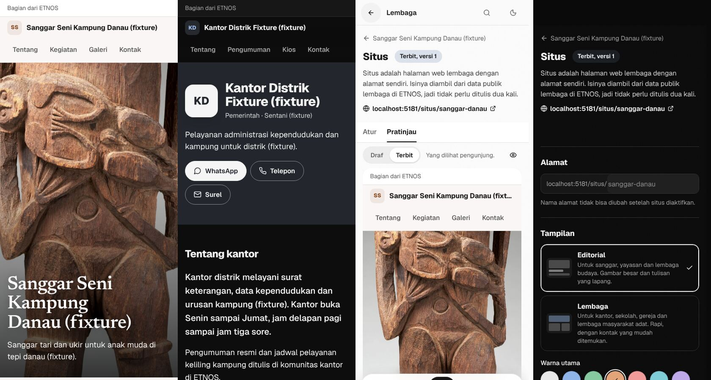

<div align="center">

# ETNOS

### Percakapan menjadi pengetahuan

**Perangkat lunak sumber terbuka yang mengubah percakapan sehari-hari di komunitas menjadi pengetahuan yang dimiliki, diperiksa dan diperbaiki oleh komunitas itu sendiri.**

[](LICENSE)
[](https://www.typescriptlang.org)
[](https://svelte.dev)
[](https://workers.cloudflare.com)
[](https://developers.cloudflare.com/durable-objects/)
[](https://atproto.com)

[](https://github.com/yohn-maistre/strata/actions/workflows/check.yml)
[](https://github.com/yohn-maistre/strata/actions/workflows/deploy-etnos.yml)
[](#mengapa-etnos-ada)
[](https://etnos.space)

[Situs](https://etnos.space) · [Dokumentasi](docs/README.md) · [Cara kerjanya](#cara-kerjanya) · [Tur](#tur-singkat) · [Arsitektur](#di-balik-layar) · [Jalankan lokal](#menjalankan-secara-lokal) · [Lisensi](#lisensi-dan-kredit)

[English](README.md) · **Bahasa Indonesia**

<br>

<picture>
  <source media="(prefers-color-scheme: dark)" srcset="docs/assets/readme/home-desktop-dark.jpg">
  
</picture>

</div>

> [!NOTE]
> **Alpha, terbuka untuk beberapa orang (22 November 2026).** Siapa pun bisa membaca di [etnos.space](https://etnos.space). Akun di `etnos.space` memerlukan undangan dari para pengelola, dan pemilik akun Bluesky bisa langsung masuk. Layar yang bertanda *(data uji)* di bawah berasal dari uji coba lokal dengan nama karangan. Tidak ada yang berasal dari orang sungguhan.

**ETNOS** adalah perangkat lunak sumber terbuka, dan [etnos.space](https://etnos.space) adalah penerapan pertamanya, dibuat untuk Tanah Papua. Siapa pun bisa membacanya. Orang bergabung dengan akun ETNOS atau akun Bluesky yang sudah ada.

## Mengapa ETNOS ada

- Orang di Tanah Papua menulis setiap hari di situs berita kecil, grup Facebook kota, keterangan foto Instagram dan grup WhatsApp. Tempat-tempat ini tidak saling terhubung, dan sebagian besar isinya hilang dalam beberapa hari.
- Kebanyakan pengetahuan tentang Papua yang diterbitkan ditulis oleh orang luar. Isinya ada di jurnal, buku mahal dan museum di luar negeri. Survei sumber proyek ini untuk tiga wilayah adat mencatat **105 sumber**, yang tersimpan di tempat seperti Leiden, Canberra dan Jayapura.
- Badan Bahasa mencatat sekitar **428 bahasa daerah** di Tanah Papua, lebih banyak daripada di bagian Indonesia mana pun, menurut [Antara Papua](https://papua.antaranews.com/berita/730961/balai-bahasa-papua-dan-pemkab-jayapura-tingkatkan-bahasa-sentani).
- Basis data daftar kata terbuka terbesar untuk Nugini, TransNewGuinea.org, hanya memuat **41 kata Ekari**, semuanya dari satu sumber tahun 1975. Kamus Ekari terbesar adalah milik Steltenpool, terbit tahun 1969.

<details>
<summary><b>Hukum dan kebijakan Indonesia sudah meminta apa yang dikerjakan ETNOS</b></summary>

<br>

| Aturan | Isinya |
| --- | --- |
| Kongres Kebudayaan Indonesia 2023 | Observatorium kebudayaan (gagasan 10), kedaulatan masyarakat adat atas sumber pengetahuan budayanya (gagasan 9), dan perangkat digital yang mengelola data budaya serta membantu mewariskan pengetahuan (gagasan 8). |
| [UU 5/2017](https://pasal.id/peraturan/uu/uu-no-5-tahun-2017) tentang Pemajuan Kebudayaan | Rencana kebudayaan daerah yang disusun mulai dari kabupaten ke atas. PP 87/2021 menambahkan sistem data kebudayaan terpadu. |
| UU 2/2021 tentang Otonomi Khusus Papua (Otsus), [teks lengkap](https://peraturan.bpk.go.id/Download/165578/UU%20Nomor%202%20Tahun%202021.pdf) | Provinsi wajib melindungi budaya Papua (Pasal 57), memelihara bahasa daerah (Pasal 58) dan melindungi kekayaan intelektual Orang Asli Papua (Pasal 44). |
| [PP 56/2022](https://peraturan.bpk.go.id/Details/233504/pp-no-56-tahun-2022) | Inventarisasi nasional kekayaan intelektual komunal, termasuk ekspresi budaya tradisional dan pengetahuan tradisional. |

</details>

ETNOS diikutkan dalam BUDAYA GO! 2026, kategori Inovasi Digital, subtema platform digital untuk komunitas budaya. Kasus dan sumbernya ada di [kerangka dan dampak](docs/plan/framing-and-impact-2026-11-17.md) dan [alur alasan](docs/plan/rationale-threads-2026-11-19.md). Dokumen itu berbahasa Inggris.

## Cara kerjanya

Orang menulis di komunitasnya seperti biasa. ETNOS mengubah apa yang mereka bagikan menjadi pertanyaan kecil, misalnya *apakah kata ini berarti "lidah"?* atau *apakah posting ini tentang Danau Tigi?* Anggota menjawab dan saling memeriksa. Hanya yang sudah diperiksa komunitas yang masuk ke Kamus atau Ensiklopedia. Sisanya tetap menjadi percakapan, dan tampil di halaman yang tepat.

<p align="center">
  <picture>
    <source media="(prefers-color-scheme: dark)" srcset="docs/assets/diagram-loop-id-dark.svg">
    
  </picture>
</p>

Posting dan balasan sudah berjalan seperti ini. Foto, pesan suara dan hasil pindai 3D dirancang masuk lewat pintu yang sama ([saluran](docs/plan/saluran-2026-11-22.md)).

Di balik layar hanya ada empat jenis hal. Sebuah **Akun** menulis **Jejak** (posting, foto, suara) di dalam sebuah **Ruang** (komunitas). Keduanya bisa *tentang* sebuah **Entri**, yaitu tempat, bahasa, suku, spesies, lembaga atau kata. Setiap entri punya satu halaman di `/wiki/<slug>`.

<p align="center">
  <picture>
    <source media="(prefers-color-scheme: dark)" srcset="docs/assets/diagram-kinds-id-dark.svg">
    
  </picture>
</p>

## Tur singkat

**Ensiklopedia.** Setiap tempat, bahasa, suku, spesies, bentang alam, benda dan lembaga di Tanah Papua punya satu halaman. Halaman itu memuat sumber, sejarah dan percakapan tentangnya. Penampil menampilkan foto, spesimen dan suara dalam layar penuh, dan peta pengetahuan menata semua entri menurut ukuran dan usianya.

<p align="center"></p>

**Kamus dalam posting.** Di komunitas bahasa, kata yang sudah dikenal atau ingin diketahui Kamus diberi garis bawah. Satu ketukan pada kata itu memunculkan satu pertanyaan, *Artinya lidah?*, dengan pilihan Ya, Bukan dan Tidak tahu. Jawaban dari beberapa anggota menjadi entri yang sudah diperiksa. Mode belajar memberi warna pada kata menurut jenis katanya, dan Kata hari ini meminta satu kata dari daftar konsep inti setiap hari.

<p align="center"></p>

**Percakapan.** Sebuah posting bisa ditandai sebagai tentang paling banyak lima entri. ETNOS menyarankan nama yang ditemukan di dalam teks, dan bertanya kalau satu nama punya dua arti, misalnya Puncak Jaya sebagai kabupaten atau sebagai gunung. Posting publik lalu muncul di bagian Percakapan pada halaman setiap entri, dan halaman sebuah tempat bisa memuat tempat-tempat yang lebih kecil di dalamnya.

<p align="center"></p>

**Lembaga dan Kios.** Lembaga adat, sanggar, sekolah atau kantor distrik mendapat profil yang ditulis lembaga itu sendiri, di samping apa yang dimuat Ensiklopedia tentangnya. Komunitas menyatakan tentang apa mereka dan bahasa apa yang dipakai. Anggota bisa membuka Kios untuk menawarkan barang yang dijual, dengan pembayaran yang disepakati langsung antarorang.

<p align="center"></p>

**Situs.** Sebuah lembaga bisa menerbitkan situs kecilnya sendiri dari data publik yang sudah ada di ETNOS, dengan templat editorial atau templat kantor, dan versi yang bisa dikembalikan. Alamatnya akan berbentuk `nama.etnos.space`.

<p align="center"></p>

## Fitur

**Berjalan** berarti sudah dipasang di etnos.space. **Sedang diuji** berarti dipakai oleh sekelompok kecil penguji. **Direncanakan** berarti sudah dirancang dan belum dibuat.

| Fitur | Fungsinya | Status |
| --- | --- | --- |
| Ensiklopedia | Satu halaman untuk setiap entri dengan sumber, sejarah dan Percakapan, Penampil, dan peta pengetahuan. |  |
| Kamus dalam posting | Kata bergaris bawah, kartu kata dengan satu pertanyaan, terjemahan Artinya, Mode belajar, Kata hari ini, pertanyaan bergambar, Kamus yang bisa dicetak, dan ekspor CSV atau CLDF. |  |
| Percakapan | Posting yang ditandai dengan entri yang dibicarakan, tampil di halaman setiap entri. Komunitas privat tidak pernah tampil di sana. |  |
| Periksa | Anggota memeriksa satu klaim sekali waktu dengan geser atau tombol. Dua anggota yang setuju menyelesaikan sebuah klaim, dan pengelola bisa menaikkan angka itu. |  |
| Aksara | Pengelola berbasis AI yang bekerja secara terbuka, dengan catatan kerja publik dan batas yang ditetapkan manusia. |  |
| Komunitas, lembaga dan Kios | Komunitas publik dan privat dengan label tempat, topik dan bahasa, profil lembaga, dan penawaran anggota. |  |
| Berita menurut tempat | Berita dari banyak penerbit dikelompokkan menurut ceritanya dan disusun menurut tempat, dengan setiap penerbit disebut. |  |
| Situs | Situs untuk lembaga yang dibuat dari data publiknya, dengan dua templat dan versi. |  |
| `etnos.yaml` | Satu berkas yang menjelaskan sebuah penerapan, sehingga wilayah lain bisa menjalankan ETNOS sendiri. |  |
| Akun di ETNOS | Nama akun seperti `nama.etnos.space`. Pendaftaran memerlukan kode undangan dari pengelola. |  |
| Pesan suara | Orang merekam sebuah kata, baris lagu atau jawaban, dan rekaman itu menjadi bukti untuk Kamus. |  |
| Foto dan suara ke entri | Foto tumbuhan atau suara burung yang dibagikan di komunitas mendapat saran spesies (Pl@ntNet, BirdNET) yang dikonfirmasi anggota. |  |
| Pindai 3D | Benda yang dipindai dengan aplikasi ponsel ditampilkan di Penampil, dan nanti dilatih di mesin milik komunitas sendiri. |  |
| Waktu | Tampilan garis waktu atas entri dan peristiwa yang sudah diperiksa. |  |

<details>
<summary><b>Lebih jauh tentang Periksa, Aksara dan sumber</b></summary>

<br>

- Di **Periksa**, sebuah strip di halaman komunitas menunjukkan berapa klaim yang menunggu diperiksa. Strip itu membuka tumpukan kartu dengan bukti di samping setiap klaim. Geser ke kanan berarti benar, geser ke kiri berarti salah, dan jawaban yang diketik mengusulkan perbaikan. Melewati sebuah kartu tidak pernah dihitung sebagai suara. Tumpukan ini dibuat pada 19 November 2026 dan sudah berjalan di halaman komunitas. Tumpukan ini bisa memuat klaim apa pun yang diusulkan anggota, dan Aksara belum bisa mengusulkan klaim lewat tumpukan ini.
- **Aksara** bisa diundang oleh komunitas mana pun. Aksara memposting temuannya dengan sumber, menjawab sebutan `@aksara` dengan kutipan, dan tidak menjawab kalau tidak punya sumber. Draf wikinya diberi label ditulis oleh AI. Seorang pengelola mengatur izin, anggaran harian dan batas waktunya, dan bisa mematikannya seketika. Catatan kerjanya terbuka untuk umum, dan Aksara tidak pernah membaca komunitas privat kecuali komunitas itu mengizinkan.
- Halaman wiki pertama ditulis hanya dari kalimat sumber yang dibaca ulang kata demi kata terhadap aslinya oleh sebuah skrip. Dari seluruh data awal, 5 kalimat ditolak dan 37 sumber tidak bisa dijangkau, sehingga semuanya dibuang.
- **Ruang privat** adalah fitur alpha dari AT Protocol, dan para penulis aslinya menyatakan fitur itu belum siap untuk produksi. Hasil ujinya ada di [komunitas dan ruang](docs/plan/communities-spaces-2026-11-19.md).

</details>

## Di balik layar

Semuanya ditulis dalam TypeScript. Mesin yang sama berjalan di Cloudflare Workers dan, untuk pengembangan, di Node dengan SQLite.

<p align="center">
  <picture>
    <source media="(prefers-color-scheme: dark)" srcset="docs/assets/diagram-architecture-id-dark.svg">
    
  </picture>
</p>

Akun orang disimpan di server yang memakai AT Protocol, protokol terbuka di balik Bluesky. Orang yang meninggalkan ETNOS tetap memegang identitasnya. Mengunduh repositori sudah bisa, dan memindahkan akun ke host lain masih direncanakan. Penjelasan lengkap tentang hosting, tingkat privasi dan jaminannya ada di [komunitas dan ruang](docs/plan/communities-spaces-2026-11-19.md).

ETNOS dirancang untuk dijalankan sebagai banyak rumah. Setiap wilayah atau suku menjalankan rumahnya sendiri dengan tata kelolanya sendiri. Rumah-rumah itu hanya berbagi apa yang mereka pilih untuk diterbitkan, dengan pengenal global sebagai kuncinya. Kata yang diperiksa penutur Mee dan kata yang diperiksa penutur Māori untuk konsep yang sama bisa berdampingan di atlas kata, dan masing-masing tetap dimiliki komunitasnya ([banyak ETNOS](docs/plan/many-etnos-2026-11-21.md)).

<p align="center">
  <picture>
    <source media="(prefers-color-scheme: dark)" srcset="docs/assets/diagram-homes-id-dark.svg">
    
  </picture>
</p>

## Prinsip

1. Manusia yang memutuskan. Aksara menyusun draf, meringkas dan bertanya, dan seseorang bisa memeriksa, memperbaiki atau membatalkan apa pun yang ditulisnya.
2. Setiap tindakan AI diberi label, dibatasi dan dicatat.
3. Sumber mendapat pengakuan, dan sumber yang hanya dibagikan sebagai judul tetap hanya berupa judul.
4. Yang privat tetap privat, termasuk jumlah, hasil pencarian dan saran yang dibuat dari isi privat.
5. Kata setempat dan nama akun tetap seperti aslinya, dan perbedaan pendapat bisa dicatat.
6. Semuanya tetap berfungsi saat AI dimatikan.

## Menjalankan secara lokal

Anda memerlukan Node 24.19 atau yang lebih baru.

```bash
npm ci --ignore-scripts
npm run check
npm test
```

Jalankan node dengan data sintetis.

```bash
npm run demo      # creates synthetic data in an empty database
npm start         # serves http://127.0.0.1:7342
```

Bangun aplikasi web dan profil Worker.

```bash
npm ci --prefix apps/web --ignore-scripts
npm run build:ui
npm run build:worker
```

Pengaturan bernama `ETNOS_*`. Nama lama `STRATA_*` dari sebelum penggantian nama masih berfungsi ([nama pengaturan](docs/accounts-and-hosting/engineering.md#cloudflare-development)). Panduan untuk pengembang dan operator ada di [docs/accounts-and-hosting/engineering.md](docs/accounts-and-hosting/engineering.md). Kontribusi disambut. Bacalah [AGENTS.md](AGENTS.md) lebih dulu, karena berkas itu memuat aturan untuk akses, penarikan data dan uji. Nama di antarmuka mengikuti [docs/naming.md](docs/naming.md), dan teks publik mengikuti [docs/voice.md](docs/voice.md). Laporan keamanan disampaikan lewat [SECURITY.md](SECURITY.md), dan rancangan proses masuk ada di [AUTH.md](AUTH.md).

## Susunan repositori

```text
src/            Node ETNOS: komunitas, posting, wiki, berita, model pengetahuan, Worker web, gerbang model
apps/web/       Aplikasi web dengan Svelte 5, antarmukanya berbahasa Indonesia
packages/pds/   Host identitas: PDS multi-akun hasil fork dari Cirrus
docs/           Rencana, keputusan, riset dan catatan rilis
deploy/         Penanda rilis untuk tiap penerapan
test/           Uji untuk node dan Worker
```

## Dokumentasi

Dokumen di bawah ini berbahasa Inggris.

| Dokumen | Isinya |
| --- | --- |
| [docs/plan/what-etnos-is.md](docs/plan/what-etnos-is.md) | Gambaran utuh dengan kata sederhana |
| [docs/plan/one-page-system-2026-11-21.md](docs/plan/one-page-system-2026-11-21.md) | Empat jenis hal, halaman entri, Kamus dalam posting, lembaga, Percakapan dan Situs |
| [docs/plan/saluran-2026-11-22.md](docs/plan/saluran-2026-11-22.md) | Cara foto, suara, 3D dan waktu masuk ke Ensiklopedia |
| [docs/plan/many-etnos-2026-11-21.md](docs/plan/many-etnos-2026-11-21.md) | Banyak rumah dan satu bahasa bersama |
| [docs/research/language-from-nothing-2026-11-21.md](docs/research/language-from-nothing-2026-11-21.md) | Cara pihak lain mengumpulkan bahasa yang terancam punah, dan apa yang diambil Kamus |
| [docs/plan/communities-spaces-2026-11-19.md](docs/plan/communities-spaces-2026-11-19.md) | Percakapan menjadi pengetahuan, ruang privat, ruang AT Protocol dan Periksa |
| [docs/plan/platform-2026-11-19.md](docs/plan/platform-2026-11-19.md) | Komponen yang sudah ada di kode dan yang direncanakan |
| [docs/plan/etnos-model-2026-11-17.md](docs/plan/etnos-model-2026-11-17.md) | Lapisan, kolom dan tempat dalam sebuah penerapan |
| [docs/research/epistemic-multiplex-2026-11-19.md](docs/research/epistemic-multiplex-2026-11-19.md) | Model pengetahuan berupa Entity, Assertion dan Witness |
| [docs/plan/framing-and-impact-2026-11-17.md](docs/plan/framing-and-impact-2026-11-17.md) | Mengapa ETNOS ada, siapa yang terbantu, bukti dan hukum |
| [docs/competition/code-disclosure-2026-11-17.md](docs/competition/code-disclosure-2026-11-17.md) | Kode mana yang buatan kami dan mana yang sudah ada sebelumnya |
| [docs/accounts-and-hosting/engineering.md](docs/accounts-and-hosting/engineering.md) | Panduan pengembang dan operator |

Semua dokumen terdaftar di [docs/README.md](docs/README.md). Diagram di README ini dibuat dengan [pele](https://pele.run), dan perintahnya ada di [docs/assets/build-diagrams.mjs](docs/assets/build-diagrams.mjs).

## Latar belakang

<details>
<summary><b>ETNOS sudah tumbuh beberapa tahun sebelum repositori ini</b></summary>

<br>

- **2023.** Gagasan dan nama.
- **Maret 2025.** [Saireri ETNOS](https://github.com/yohn-maistre/saireri-etnos) adalah klien web awal untuk forum komunitas terfederasi, berbasis [Photon](https://github.com/Xyphyn/photon).
- **Maret 2026.** [Honai Metro](https://github.com/yohn-maistre/honai-metro) adalah klien fediverse bertema Papua yang di-fork dari Photon. Pada 17 Maret klien ini [mendapat Bahasa Indonesia dan tampilan Papua](https://github.com/yohn-maistre/honai-metro/commit/ff77dbab9f86238e24710c1d932c0081cc3985bb). Pada 25 Maret klien ini mendapat [wiki Papua dan dasbor provinsi](https://github.com/yohn-maistre/honai-metro/commit/af0af053ecfcabd737c74ac1bd2b9a52c2934a6b).
- **31 Oktober 2026.** Repositori ini dimulai. ETNOS pindah dari fediverse ke AT Protocol agar orang memiliki akunnya sendiri, dan mesinnya dibangun ulang di sekitar pengetahuan bersama dan pengelola yang bisa dimintai pertanggungjawaban. Antarmuka dari Honai ikut terbawa di [`apps/web`](apps/web).

Komunitas, wiki dan tampilan Papua tetap sama selagi fondasinya berganti. Bukti bertanggal ada di [docs/evidence/README.md](docs/evidence/README.md).

</details>

## Lisensi dan kredit

ETNOS berlisensi [AGPL-3.0-only](LICENSE). Siapa pun yang menjalankan versi yang sudah diubah untuk orang lain wajib membagikan perubahannya.

- Host identitas di `packages/pds` adalah fork dari [Cirrus](https://github.com/ascorbic/cirrus) oleh Matt Kane dan para kontributor (paket `@getcirrus`), dengan lisensi MIT di [`packages/pds/LICENSE.cirrus`](packages/pds/LICENSE.cirrus). Penjelasan lengkap tentang apa yang dipakai ulang ada di [docs/competition/code-disclosure-2026-11-17.md](docs/competition/code-disclosure-2026-11-17.md).
- Terima kasih kepada proyek Photon, yang menjadi dasar klien-klien sebelumnya, dan kepada proyek PieFed, yang perilaku forumnya mengilhami sebagian dari proyek ini.
- Pemberitahuan pihak ketiga untuk aplikasi web ada di [`apps/web/licenses`](apps/web/licenses).
- Halaman wiki pertama bersumber dari sumber terbitan, dan setiap halaman mencantumkan sumbernya sendiri.
