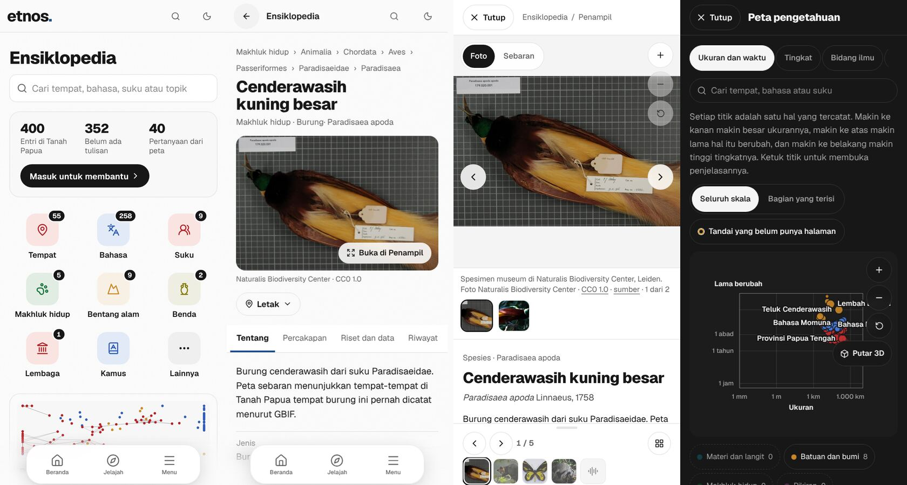
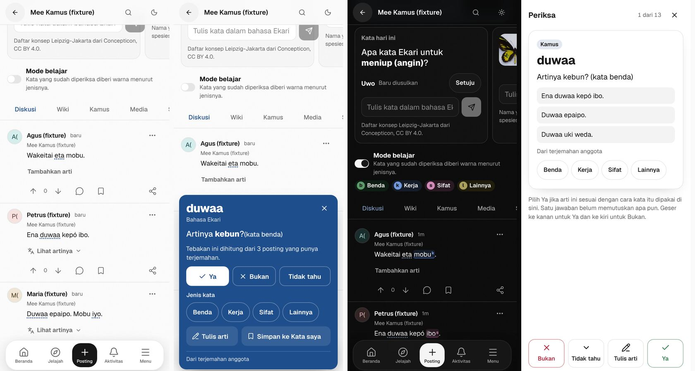
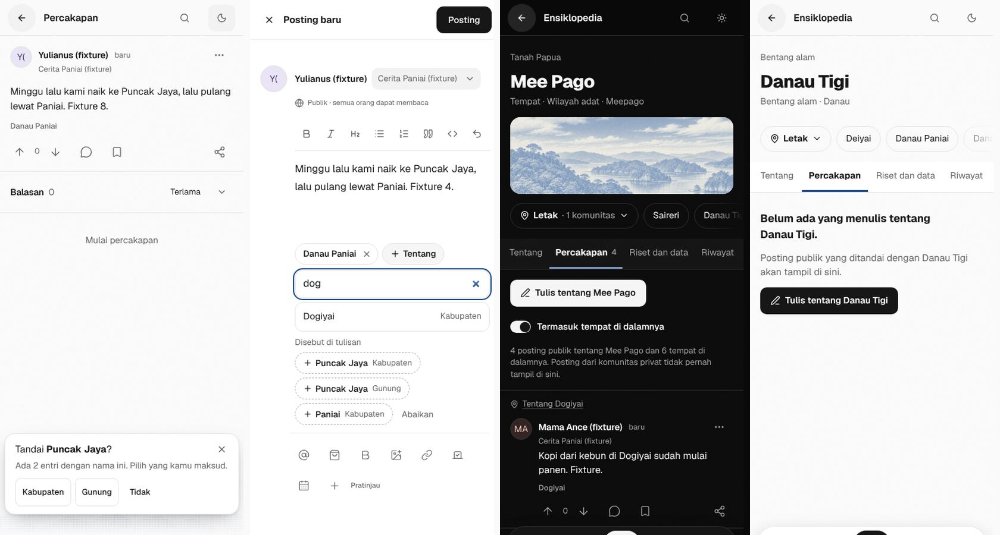
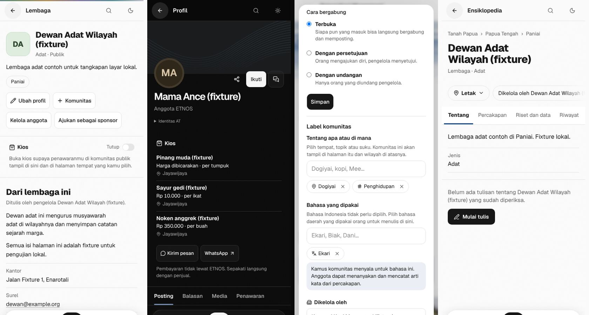

<div align="center">

# ETNOS

### Percakapan menjadi pengetahuan

**Perangkat lunak sumber terbuka yang mengubah percakapan sehari-hari di komunitas menjadi pengetahuan bersama yang dimiliki, diperiksa dan diperbaiki oleh komunitas itu sendiri.**

[](LICENSE)
[](https://www.typescriptlang.org)
[](https://svelte.dev)
[](https://workers.cloudflare.com)
[](https://developers.cloudflare.com/durable-objects/)
[](https://atproto.com)

[](https://github.com/yohn-maistre/etnos/actions/workflows/check.yml)
[](https://github.com/yohn-maistre/etnos/actions/workflows/deploy-etnos.yml)
[](https://etnos.space)

[Situs](https://etnos.space) · [Peta Kata](https://etnos.space/peta-kata) · [Dokumentasi](docs/README.md) · [Cara kerjanya](#cara-kerjanya) · [Tur](#tur-singkat) · [Arsitektur](#di-balik-layar) · [Jalankan lokal](#menjalankan-secara-lokal) · [Lisensi](#lisensi-dan-kredit)

[English](README.md) · **Bahasa Indonesia**

<br>

<picture>
  <source media="(prefers-color-scheme: dark)" srcset="docs/assets/readme/home-desktop-dark.jpg">
  
</picture>

</div>

> [!NOTE]
> Siapa pun dapat membaca ETNOS secara terbuka di [etnos.space](https://etnos.space). Orang bergabung memakai akun ETNOS di `etnos.space` (dengan kata sandi atau Passkey WebAuthn) atau memakai akun Bluesky yang sudah ada. Layar yang bertanda *(data uji)* di bawah berasal dari uji coba lokal dengan nama rekaan, tidak berasal dari orang sungguhan.

**ETNOS** adalah perangkat lunak komunitas bersumber terbuka, dan [etnos.space](https://etnos.space) adalah penerapan pertamanya untuk Tanah Papua. Warga berbincang, mengirim pesan suara, berdagang lewat Kios, berbagi peluang, serta menyusun kamus dan ensiklopedia yang tetap berada di tangan komunitas.

## Mengapa ETNOS ada

Orang di seluruh Tanah Papua sudah menulis dan merekam pengetahuan setiap hari, tetapi wadah yang ada memisahkannya dan membuatnya cepat hilang.

- Tulisan sehari-hari tersebar di situs berita kecil, grup Facebook kota, keterangan foto Instagram dan grup WhatsApp yang tidak saling terhubung lalu tenggelam dalam beberapa hari.
- Sebagian besar catatan terbitan tentang Papua ditulis oleh orang luar dan tersimpan di jurnal, buku mahal serta museum di luar negeri. Survei sumber proyek ini pada tiga wilayah adat mencatat **105 sumber** yang tersebar di tempat seperti Leiden, Canberra dan Jayapura.
- Badan Bahasa mencatat sekitar **428 bahasa daerah** di Tanah Papua, jumlah terbanyak di Indonesia menurut [Antara Papua](https://papua.antaranews.com/berita/730961/balai-bahasa-papua-dan-pemkab-jayapura-tingkatkan-bahasa-sentani).
- Basis data daftar kata terbuka terbesar untuk Nugini, TransNewGuinea.org, hanya memuat **41 kata Ekari** dari satu sumber tahun 1975, sedangkan kamus Ekari terbitan terbesar masih berasal dari Steltenpool tahun 1969.

<details>
<summary><b>Hukum dan kebijakan Indonesia sudah meminta apa yang dibangun ETNOS</b></summary>

<br>

| Aturan | Isinya |
| --- | --- |
| Kongres Kebudayaan Indonesia 2023 | Observatorium kebudayaan (gagasan 10), kedaulatan masyarakat adat atas sumber pengetahuan budayanya (gagasan 9), serta perangkat digital yang mengelola data budaya dan membantu mewariskan pengetahuan (gagasan 8). |
| [UU 5/2017](https://pasal.id/peraturan/uu/uu-no-5-tahun-2017) tentang Pemajuan Kebudayaan | Rencana kebudayaan daerah yang disusun mulai dari kabupaten ke atas, dilengkapi PP 87/2021 untuk sistem data kebudayaan terpadu. |
| UU 2/2021 tentang Otonomi Khusus Papua (Otsus), [teks lengkap](https://peraturan.bpk.go.id/Download/165578/UU%20Nomor%202%20Tahun%202021.pdf) | Kewajiban provinsi untuk melindungi budaya Papua (Pasal 57), memelihara bahasa daerah (Pasal 58) dan melindungi kekayaan intelektual Orang Asli Papua (Pasal 44). |
| [PP 56/2022](https://peraturan.bpk.go.id/Details/233504/pp-no-56-tahun-2022) | Inventarisasi nasional kekayaan intelektual komunal yang mencakup ekspresi budaya tradisional dan pengetahuan tradisional. |

</details>

Rincian latar belakang dan daftar sumbernya tersimpan di [framing and impact](docs/plan/framing-and-impact-2026-11-17.md) dan [rationale threads](docs/plan/rationale-threads-2026-11-19.md).

## Cara kerjanya

Anggota menulis, merekam pesan suara dan membagikan foto di komunitasnya seperti biasa. ETNOS mengubah apa yang dibagikan menjadi pertanyaan kecil, misalnya *apakah kata ini berarti "lidah"?* atau *apakah posting ini tentang Danau Tigi?* Anggota saling memeriksa di Periksa, sehingga hanya hasil yang disepakati komunitas yang masuk ke Kamus atau Ensiklopedia. Sisanya tetap tersimpan sebagai percakapan di halaman tempat atau topik yang sesuai.

<p align="center">
  <picture>
    <source media="(prefers-color-scheme: dark)" srcset="docs/assets/diagram-loop-id-dark.svg">
    
  </picture>
</p>

Di balik layar hanya ada empat jenis catatan utama. Sebuah **Akun** menulis **Jejak** (posting, foto, suara, pindai 3D) di dalam sebuah **Ruang** (komunitas). Keduanya dapat ditandai *tentang* sebuah **Entri**, yaitu tempat, bahasa, suku, spesies, lembaga atau kata yang masing-masing punya satu halaman di `/wiki/<slug>`.

<p align="center">
  <picture>
    <source media="(prefers-color-scheme: dark)" srcset="docs/assets/diagram-kinds-id-dark.svg">
    
  </picture>
</p>

## Tur singkat

Halaman **Ensiklopedia** memberi setiap tempat, bahasa, suku, spesies, bentang alam, benda dan lembaga di Tanah Papua satu alamat tetap yang memuat sumber, riwayat tinjauan dan percakapan publiknya. **Penampil** layar penuh membuka foto spesimen, suara dan model 3D (`.glb`, `.spz`, `.ply`) lengkap dengan pin spasial 3D yang dapat diklik, sementara peta pengetahuan menata seluruh entri menurut ukuran dan rentang waktunya.

<p align="center"></p>

Fitur **Kamus dalam posting** menggarisbawahi kata bahasa daerah di komunitas bahasa sehingga anggota cukup mengetuk kata itu untuk menjawab satu pertanyaan (*Artinya lidah?*). Anggota dapat menambahkan rekaman suara pelafalan, berlatih lewat Mode belajar, mencetak **Lembar Ajar** ber-QR untuk sekolah, dan mendengar padanan kata di 256 bahasa Papua lewat [Peta Kata](https://etnos.space/peta-kata).

<p align="center"></p>

Tab **Percakapan** menautkan posting publik ke paling banyak lima entri, menyarankan nama yang muncul di dalam teks, dan menanyakan pilihan saat satu nama punya dua arti (misalnya Kabupaten Puncak Jaya dan Gunung Puncak Jaya). Posting publik lalu tampil di setiap halaman entri terkait, dan halaman wilayah adat menghimpun percakapan dari tempat-tempat di dalamnya.

<p align="center"></p>

Profil **Lembaga dan Kios** memberi dewan adat, sanggar, sekolah dan kantor distrik ruang resmi dengan suara mereka sendiri di samping halaman Ensiklopedianya. Anggota dapat membuka Kios dengan cetakan **Kartu Asal** ber-QR untuk menautkan hasil kerajinan atau pangan ke pembuatnya, serta membuat kartu **Peluang** (beasiswa, hibah, lowongan kerja) dan **Titip bagasi** antar kota.

<p align="center"></p>

Layanan **Situs** memungkinkan lembaga menerbitkan situs web ringan dari data publik yang sudah tersimpan di ETNOS, lengkap dengan dua pilihan templat, riwayat versi dan alamat subdomain `nama.etnos.space`.

<p align="center"></p>

## Fitur

Tabel berikut mencatat fitur utama ETNOS beserta statusnya di [etnos.space](https://etnos.space).

| Fitur | Fungsinya | Status |
| --- | --- | --- |
| Ensiklopedia & Penampil | Satu halaman per entri dengan sumber, bilah tinjauan wiki langsung, riwayat, Percakapan, peta pengetahuan, katalog data dan Penampil spesimen/3D layar penuh. |  |
| Kamus & Peta Kata | Kata bergaris bawah dalam posting, kartu kata, terjemahan Artinya, Mode belajar, Kata hari ini, ekspor CSV/CLDF, cetakan Lembar Ajar ber-QR dan atlas suara `/peta-kata` di 256 bahasa. |  |
| Pesan suara & Bantu tulis | Perekam suara di peramban, pemutar kecepatan 0,75x untuk belajar, kontrol protokol budaya, Bantu tulis transkrip komunitas, transkrip Whisper opsional, pelafalan Kamus dan penerimaan audio WhatsApp lewat PWA. |  |
| Pindai 3D Gaussian Splat & pin spasial | Penampil WebGL murni untuk berkas `.glb`, `.spz` dan `.ply` dengan pin spasial 3D yang dapat diklik, dilengkapi pekerja GPU Modal opsional (`packages/splat-worker`) untuk mengubah video menjadi `.spz`. |  |
| Periksa & Saluran | Kartu geser pemeriksaan klaim, saluran opt-in Pl@ntNet untuk foto tumbuhan publik, dan Kurasi Balik catatan komunitas pada koleksi museum IIIF dengan ekspor W3C JSON-LD. |  |
| Aksara terjadwal | Asisten AI publik yang berjalan terjadwal menurut WIT untuk merangkum kabar harian, menulis draf Ensiklopedia bersumber yang langsung ditandai belum ditinjau, dan menjawab sebutan `@aksara` lewat Google AI Studio, OpenRouter atau Workers AI. |  |
| Komunitas, Lembaga, Kios, Peluang & Bagasi | Ruang publik dan privat, profil lembaga, Kios dengan cetakan Kartu Asal ber-QR, serta kartu terstruktur Peluang (beasiswa, hibah, kerja) dan Titip bagasi. |  |
| Kabar menurut tempat | Berita dari berbagai penerbit Papua yang dikelompokkan menurut ceritanya dan disaring menurut tempat, dengan sumber aslinya dicantumkan. |  |
| Host identitas ETNOS & Passkey | PDS AT Protocol multi-akun (`nama.etnos.space`) dengan Passkey WebAuthn, batas pendaftaran harian, cadangan CAR di R2 dan sinkronisasi izin AT Protocol Spaces alfa untuk komunitas privat. |  |
| Situs & `etnos.yaml` | Situs web mandiri untuk lembaga dari data publiknya di ETNOS, serta satu berkas konfigurasi agar wilayah lain dapat menjalankan rumahnya sendiri. |  |
| Pesan langsung terenkripsi | Pesan langsung terenkripsi ujung ke ujung antar perangkat. |  |

## Di balik layar

Seluruh mesin inti dan aplikasi web ditulis dengan TypeScript. Mesin yang sama berjalan di Cloudflare Workers (di dalam Durable Object SQLite dengan cache tepi khusus pembaca anonim untuk halaman publik) serta berjalan secara lokal di Node 24 dengan SQLite.

<p align="center">
  <picture>
    <source media="(prefers-color-scheme: dark)" srcset="docs/assets/diagram-architecture-id-dark.svg">
    
  </picture>
</p>

Akun pengguna disimpan di host identitas AT Protocol, yaitu protokol terbuka yang juga dipakai Bluesky. Pemilik akun sudah dapat mengunduh repositorinya, pengelola dapat mencadangkan arsip CAR ke R2, dan data komunitas privat tidak pernah masuk ke catatan AT publik, cache publik, hasil pencarian, atau layanan pihak luar.

ETNOS dirancang untuk dijalankan sebagai banyak rumah mandiri di berbagai wilayah. Setiap wilayah menjalankan penerapannya dengan tata kelolanya sendiri dan hanya membagikan data publik yang dipilih lewat pengenal terbuka (Glottolog, Concepticon, GBIF, Wikidata, W3C Web Annotations). Panduan pemindahan ke akun Cloudflare Free terpisah tersedia di [docs/ops/fresh-cloudflare-migration.md](docs/ops/fresh-cloudflare-migration.md).

<p align="center">
  <picture>
    <source media="(prefers-color-scheme: dark)" srcset="docs/assets/diagram-homes-id-dark.svg">
    
  </picture>
</p>

## Prinsip

Enam aturan dasar berikut berlaku untuk setiap fitur di dalam kode ETNOS.

1. Manusia memegang keputusan akhir, karena pengurus dan anggota dapat memeriksa, memperbaiki atau mengembalikan setiap draf yang ditulis Aksara.
2. Setiap tindakan AI membawa label AI yang jelas, berjalan dalam batas harian yang diatur pengurus, dan tercatat di log kerja publik.
3. Sumber selalu mendapat kredit, dan sumber yang dibagikan sebatas judul tetap ditampilkan sebatas judul.
4. Data privat tetap privat pada hitungan, pencarian, cache publik, saluran luar dan saran AI.
5. Istilah lokal dan nama akun dipertahankan apa adanya, dan perbedaan pendapat di komunitas tetap ditampilkan tanpa dipaksa seragam.
6. Seluruh fungsi inti komunitas tetap berjalan saat AI dimatikan.

## Menjalankan secara lokal

Pasang Node 24.19 atau yang lebih baru, lalu jalankan pemeriksaan tipe dan uji otomatis.

```bash
npm ci --ignore-scripts
npm run check
npm test
```

Jalankan simpul lokal dengan data contoh sintetis.

```bash
npm run demo      # membuat data contoh di basis data kosong
npm start         # melayani http://127.0.0.1:7342
```

Bangun aplikasi web Svelte 5 dan uji bundel Cloudflare Worker.

```bash
npm ci --prefix apps/web --ignore-scripts
npm run build:ui
npm run build:worker
```

Pengaturan memakai awalan `ETNOS_*`, sementara nama lama `STRATA_*` tetap berfungsi ([nama pengaturan](docs/accounts-and-hosting/engineering.md#cloudflare-development)). Bacalah [AGENTS.md](AGENTS.md) sebelum berkontribusi karena berkas itu memuat aturan wajib untuk isolasi akses, penarikan data dan uji. Penamaan antarmuka mengikuti [docs/naming.md](docs/naming.md), gaya tulisan publik mengikuti [docs/voice.md](docs/voice.md), laporan keamanan melalui [SECURITY.md](SECURITY.md), dan rincian masuk akun ada di [AUTH.md](AUTH.md).

## Susunan repositori

```text
src/                   Simpul ETNOS: komunitas, posting, suara, pindai 3D, Saluran, Peta Kata, wiki, cache tepi, Worker
apps/web/              Aplikasi web PWA Svelte 5 berbahasa Indonesia dengan penampil 3DGS WebGL murni
packages/pds/          Host identitas AT Protocol multi-akun (Passkey, Spaces alfa, cadangan CAR R2)
packages/splat-worker/ Pekerja GPU Modal opsional untuk mengubah video menjadi 3DGS (.spz)
docs/                  Rencana, keputusan, riset, panduan operasi dan catatan rilis
scripts/               Skrip pemasangan, migrasi dan utilitas
deploy/                Penanda rilis untuk pemicu deploy GitHub Actions
test/                  Uji unit, batas akses dan integrasi workerd
```

## Dokumentasi

Dokumen teknis berikut berbahasa Inggris.

| Dokumen | Isinya |
| --- | --- |
| [docs/plan/what-etnos-is.md](docs/plan/what-etnos-is.md) | Gambaran utuh dengan kata sederhana |
| [docs/plan/one-page-system-2026-11-21.md](docs/plan/one-page-system-2026-11-21.md) | Empat jenis catatan, halaman entri, Kamus dalam posting, lembaga, Percakapan dan Situs |
| [docs/plan/saluran-2026-11-22.md](docs/plan/saluran-2026-11-22.md) | Cara foto, suara, 3D dan waktu masuk ke Ensiklopedia |
| [docs/plan/many-etnos-2026-11-21.md](docs/plan/many-etnos-2026-11-21.md) | Banyak rumah dan satu bahasa bersama |
| [docs/ops/fresh-cloudflare-migration.md](docs/ops/fresh-cloudflare-migration.md) | Panduan migrasi ke akun Cloudflare Free terpisah |
| [docs/accounts-and-hosting/engineering.md](docs/accounts-and-hosting/engineering.md) | Panduan pengembang dan operator |

Semua dokumen terindeks di [docs/README.md](docs/README.md). Diagram di README ini dibuat dengan [pele](https://pele.run) lewat [docs/assets/build-diagrams.mjs](docs/assets/build-diagrams.mjs).

## Latar belakang

<details>
<summary><b>ETNOS tumbuh beberapa tahun sebelum repositori ini</b></summary>

<br>

- Pada **2023**, gagasan dan nama ETNOS mulai disusun.
- Pada **Maret 2025**, [Saireri ETNOS](https://github.com/yohn-maistre/saireri-etnos) hadir sebagai klien web awal untuk forum komunitas terfederasi berbasis [Photon](https://github.com/Xyphyn/photon).
- Pada **Maret 2026**, [Honai Metro](https://github.com/yohn-maistre/honai-metro) bercabang dari Photon sebagai klien fediverse bertema Papua dengan antarmuka bahasa Indonesia, wiki Papua dan dasbor provinsi.
- Pada **31 Oktober 2026**, repositori ini dimulai di atas AT Protocol agar setiap orang memiliki akunnya sendiri sementara mesinnya dibangun di sekitar pengetahuan komunitas dan pengelola yang transparan.

</details>

## Lisensi dan kredit

ETNOS berlisensi [AGPL-3.0-only](LICENSE), sehingga siapa pun yang menjalankan versi ubahan untuk orang lain wajib membagikan perubahan kodenya.

- Host identitas di `packages/pds` adalah cabang dari [Cirrus](https://github.com/ascorbic/cirrus) karya Matt Kane dan para kontributor dengan lisensi MIT di [`packages/pds/LICENSE.cirrus`](packages/pds/LICENSE.cirrus).
- Klien web ETNOS sebelumnya bertumpu pada [Photon](https://github.com/Xyphyn/photon) (AGPL-3.0-only; lihat [`apps/web/licenses/photon-AGPL.txt`](apps/web/licenses/photon-AGPL.txt)) dan terinspirasi dari perilaku forum PieFed.
- Pemberitahuan lisensi pihak ketiga untuk aplikasi web tersedia di [`apps/web/licenses`](apps/web/licenses) dan [`apps/web/public/third-party-notices.txt`](apps/web/public/third-party-notices.txt).
