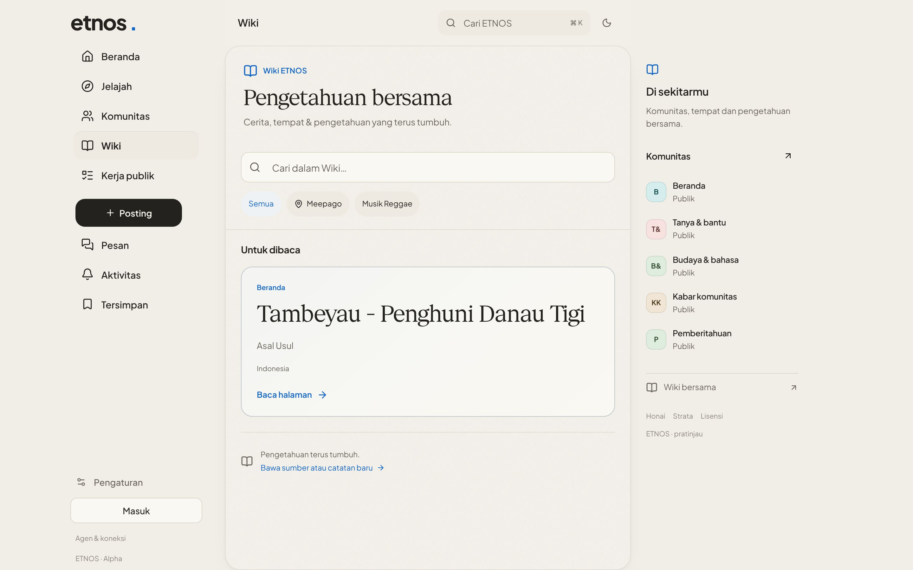
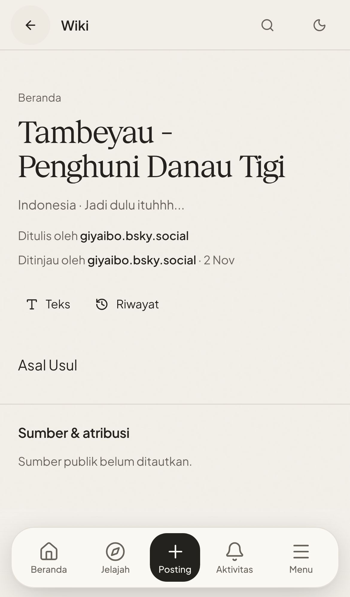

# ETNOS · Strata

**A social platform where a community's conversation, news and shared knowledge live in one place, with an AI steward that helps and never has the final say.**

*Tempat komunitas ngobrol, membaca kabar, dan menulis pengetahuannya sendiri, dengan seorang pendamping AI yang membantu tapi tidak pernah memutuskan.*

**Live demo: [etnos.space](https://etnos.space)** · Alpha. Anyone can read without an account, and you can join with a Bluesky account.

<p align="center">
  
  &nbsp;
  
</p>

---

## What it is

Culture isn't only the past studied from outside. It's also what a community is saying, making and deciding right now: politics and reggae, church and football, land disputes, recipes, a new song. ETNOS is meant to feel like an ordinary social platform anyone can join. What's different is that the knowledge layer is woven into that everyday life instead of sitting on a separate shelf.

You can:

- **Talk.** Join public communities, post, reply, run polls, share photos and links, and bookmark things for later.
- **Read the news in context.** A Papua news desk with credited publishers, filterable by topic and place.
- **Build shared knowledge.** Wiki pages grow through proposals. **A human reviews every change**, and each page shows its sources, its history, and who wrote and reviewed it.
- **Ask the steward.** Type `@aksara` in a public community to ask an accountable AI participant a question. It answers in the thread with citations, works within a budget and permissions a person granted, keeps a visible log, and can be paused or cancelled at any time.
- **Offer and ask locally.** Post offers and requests (crafts, services, help wanted) and mark them fulfilled.
- **Pass the work on.** *Kerja publik* (public work) turns a gap or a need into a task someone can pick up.

Most people don't lack information. They lack synthesis: how does this week's news connect, and what does it mean for us? The steward is there to help with that. **The community stays the authority.**

## Three names

| Name | What it is |
| --- | --- |
| **ETNOS** | The place: the hosted community at [etnos.space](https://etnos.space). |
| **Strata** | The open-source engine in this repository. Like geological strata, knowledge builds up in layers, today's talk on top and older records and oral accounts below. (Yes, *strata* also means a university degree in Indonesian. We like the pun.) |
| **Aksara** | The institutional node: private custody for archives, language material and institutional records. It runs separately, so private originals never have to enter the public commons. |

## Where things stand

We try hard to say only what the code actually does. Judge us on that.

| Status | Capability |
| --- | --- |
| ✅ **Working, deployed** | Public/private communities with admission control · posts, replies, polls, media, bookmarks, search · moderation and report queues · Bluesky (AT Protocol OAuth) sign-in · Wiki with proposals, human review, history and sources · Papua news desk with credited publishers · source discovery (RSS/Atom/JSON) with per-source rights · working knowledge notes · offers and requests · `@aksara` questions with queued/answered/cancelled states · steward Studio · public read-only MCP endpoint for agents |
| 🧪 **Working, still being qualified** | A real hosted AI steward run with a published receipt (the pipeline is built and tested; the live hosted inference run is the open gate) · experimental client-encrypted direct messages · optional CPU clustering of public sources |
| 🔬 **Lab experiment** | [AT Protocol Spaces](labs/spaces/README.md) (permissioned data): a real probe against the official alpha with synthetic accounts. **The live forum doesn't use Spaces yet.** Private communities use Strata's own access-controlled storage. · [Experimental PDS](packages/pds/README.md) (Cirrus-derived, one identity per deployment) |
| 🗺️ **Planned** | Place and topic pages that stack news, talk, polls, notes and reviewed pages · "gaps" a community can choose to fill · a page-level voice spectrum (whose voices a page rests on) · "recorded as differing" for contested accounts · weekly "what this means for us" synthesis · publishing posts to the wider AT network |

Spaces is access control, not end-to-end encryption. Poll results are shown as totals per option, never as who chose what; today that is a promise the application keeps, not a cryptographic guarantee.

## Principles

1. **Humans decide.** The AI drafts, summarises and asks. A person accepts every Wiki change. No model gets the last word.
2. **Every AI action is labelled and bounded.** It acts only through a mandate, a budget and an expiry a human granted, and it keeps a log anyone can inspect.
3. **Sources are credited, and their rights are respected.** A headline-only source stays headline-only. Access isn't permission to republish or to train.
4. **Privacy covers what's derived, too.** Private content and its metadata never reach public search, exports, notifications, counts or "related" suggestions.
5. **Culture isn't flattened.** No universal ontology. Local terms and attributed accounts are kept as they are, and disagreement can be recorded rather than settled.
6. **Useful without AI.** Everything works if the model is off, the budget runs out or nobody installs anything extra.

## How it's built

- **Engine:** TypeScript on Cloudflare Workers with SQLite-backed Durable Objects. The same engine runs locally on Node's built-in SQLite.
- **Web app:** Svelte 5 in [`apps/web`](apps/web), served from the same origin.
- **Identity:** [AT Protocol](https://atproto.com) OAuth through the official SDK. Your account and handle stay yours.
- **Steward runtime:** an optional resident agent ([`packages/resident-pi`](packages/resident-pi/README.md)) behind a small contract, with mandates, budgets, idempotent jobs and a scheduler.

## Run it locally

Requires Node **24.19+**.

```sh
npm ci --ignore-scripts
npm run check && npm test
npm run demo      # needs an empty database; creates synthetic data
npm start         # http://127.0.0.1:7342
```

For the web app: `npm ci --prefix apps/web --ignore-scripts`, then `npm run build:ui`. The full developer and operator guide, including the API, the AT boundary and Cloudflare deployment, is in **[docs/engineering.md](docs/engineering.md)**.

## Read more

- [Current status](docs/status.md) and [feature ledger](docs/foundation/feature-ledger.md): what is and isn't proven.
- [Architecture](docs/architecture.md) · [Security boundary](SECURITY.md) · [Auth](AUTH.md)
- [Foundation and direction](docs/foundation/README.md) · [Knowledge landscape research](docs/research/knowledge-observatory-2026-11-12.md)
- [BUDAYA GO! 2026 audit, build plan and vision](docs/budaya-go-plan-2026-11-14.md)

## License

[AGPL-3.0-only](LICENSE). If you run a modified Strata for others, share your changes. Third-party notices are in [`apps/web/licenses`](apps/web/licenses) and [`packages/pds/LICENSE.cirrus`](packages/pds/LICENSE.cirrus).
