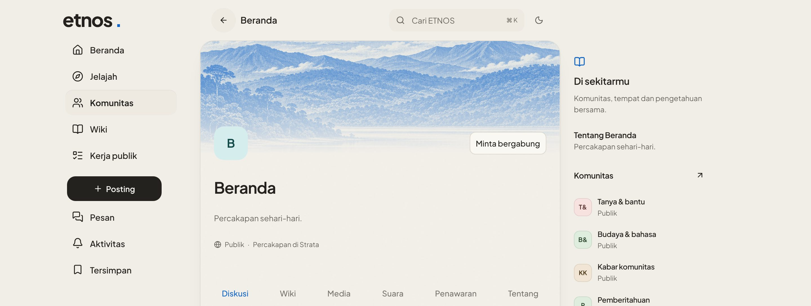
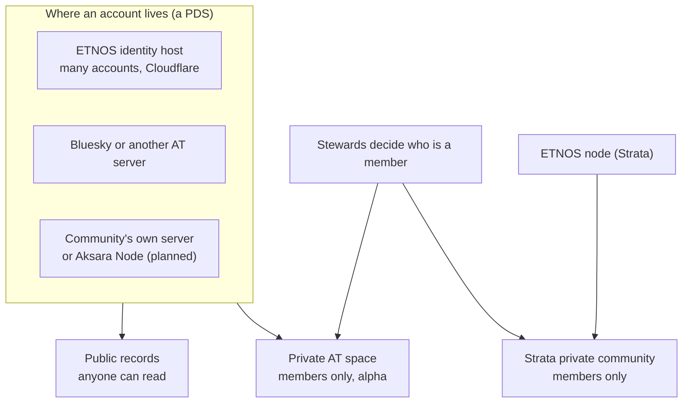
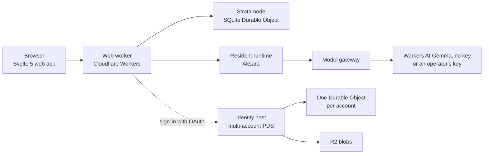
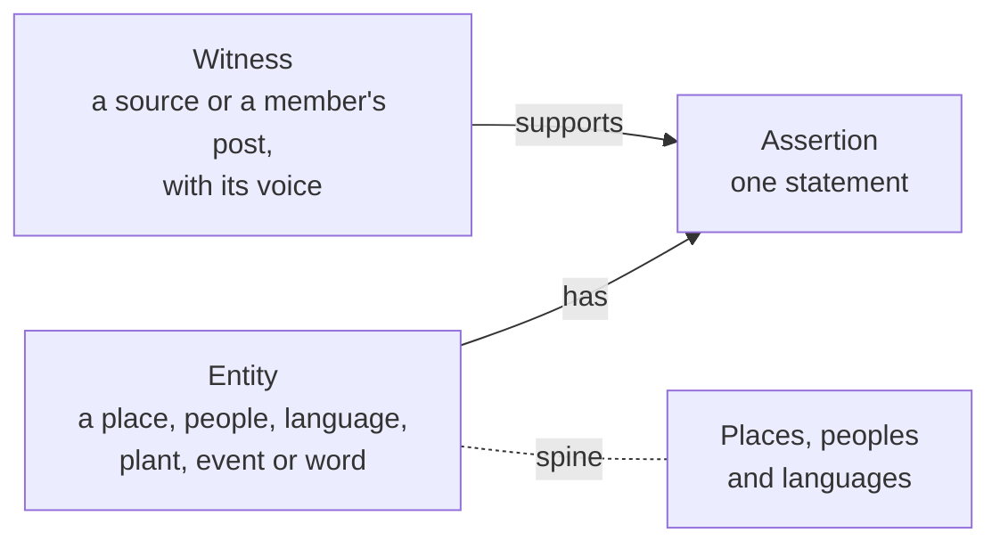

# Strata

Strata is open-source software that lets the people of a region turn their everyday conversations into a record that they own, check and correct. **ETNOS** at [etnos.space](https://etnos.space) is the first deployment, built for Tanah Papua. Anyone can read it, and people join with an ETNOS account or an existing Bluesky account.

**Dalam bahasa Indonesia sehari-hari,** ETNOS adalah tempat orang Papua mengobrol seperti biasa di komunitas, dan obrolan itu diolah menjadi pengetahuan yang dimiliki komunitasnya sendiri. Sebuah lembaga adat bisa membuka komunitas bahasa. Asisten AI bernama Aksara mengusulkan kata, arti dan catatan tata bahasa dari obrolan itu, dan anggota memeriksanya satu per satu. Setiap halaman wiki menyebut sumbernya. Akun memakai AT Protocol, jadi orang bisa membawa akun dan datanya ke tempat lain. Kodenya terbuka (AGPL-3.0), sehingga wilayah lain bisa menjalankannya sendiri.

<p align="center">
  
  &nbsp;
  
</p>

## Papuan culture is alive in conversation and written down elsewhere

People in Tanah Papua write every day in small news sites, city Facebook groups, Instagram captions and WhatsApp groups. These places do not connect, and most of what is said in them is lost within days.

The written record sits in another place. Most published knowledge about Papua was written by outsiders. It is kept in journals, expensive books and museums abroad, and the people it describes can rarely read it or answer it. The project's own source survey of three customary regions lists 105 sources, held in places such as Leiden, Canberra and Jayapura.

Language shows the gap clearly. Badan Bahasa counts about 428 regional languages in Tanah Papua, more than in any other part of Indonesia, according to [Antara Papua](https://papua.antaranews.com/berita/730961/balai-bahasa-papua-dan-pemkab-jayapura-tingkatkan-bahasa-sentani). The largest open wordlist database for New Guinea, TransNewGuinea.org, holds 41 words of Ekari, all taken from one source of 1975. The largest Ekari dictionary is Steltenpool's, published in 1969.

Indonesian law and policy already ask for what Strata does:

- The Kongres Kebudayaan Indonesia 2023 asks for a cultural observatory (idea 10), and says that masyarakat adat are sovereign over the sources of their cultural knowledge (idea 9). It also asks for digital tools that handle cultural data and help pass knowledge on (idea 8).
- [UU 5/2017 on cultural advancement](https://pasal.id/peraturan/uu/uu-no-5-tahun-2017) sets up regional cultural plans that are drafted from the regencies upward. PP 87/2021 adds an integrated cultural data system.
- UU 2/2021 on Special Autonomy for Papua (the Otsus law) requires the province to protect Papuan culture (Article 57), to preserve regional languages (Article 58), and to protect the intellectual property of Orang Asli Papua (Article 44). The [full text](https://peraturan.bpk.go.id/Download/165578/UU%20Nomor%202%20Tahun%202021.pdf) is published by BPK.
- [PP 56/2022](https://peraturan.bpk.go.id/Details/233504/pp-no-56-tahun-2022) sets up a national inventory of communal intellectual property, which includes traditional cultural expressions and traditional knowledge.

Strata is entered in BUDAYA GO! 2026, in the Inovasi Digital category, under the subtheme of digital platforms for cultural communities. The cases and sources behind this section are in [docs/framing-and-impact-2026-11-17.md](docs/framing-and-impact-2026-11-17.md) and [docs/rationale-threads-2026-11-19.md](docs/rationale-threads-2026-11-19.md).

## What ETNOS gives a community

The flagship idea is that talk in a community becomes structured knowledge that the community owns. A lembaga adat opens a private language community, and its members talk as they always do. Aksara proposes words, their meanings, example sentences and grammar notes from that talk. Members check each proposal with one swipe, and the community decides what to publish. The same method applies to plants, places, events and customs. The map groups these things into clusters, so that a community can see how its knowledge connects and where it is thin.

Each feature below carries one of three marks. **Live** means it is deployed on etnos.space. **Being tested** means it runs for a small group of testers. **Planned** means that it is designed and not yet built.

| Feature | What it does | Status |
| --- | --- | --- |
| Periksa | Members check one claim at a time with a swipe or a button. A claim is settled when two members agree, and stewards can raise that number. | Live |
| Knowledge model | Every statement is stored with the source that supports it and the voice that speaks. A seed of 110 entities is built from checked quotes and the place catalogue. | Built and tested, with a map prototype |
| Kamus and Tata bahasa | A community dictionary and grammar sketch, grouped by context of use and seeded from published wordlists. | Planned |
| Aksara | An AI steward that works in the open, with a public log and limits set by people. | Live |
| Communities and lembaga | Public and private communities, joined openly, by request with a written reason, or by invitation. Organisations hold one or more communities. | Live |
| Wiki with sources | Pages are written from cited sources, show their history and author, and say whether a person has reviewed them. | Live |
| News by place | Stories from many publishers are grouped by story and sorted by place, with every publisher credited. | Live |
| Accounts on ETNOS | A person can create an account with a handle such as `name.etnos.space`. Sign-up needs an invite code from the stewards. | Being tested |
| Voice notes and uploaded video | People record a word, a song line or an answer. | Planned |

### Periksa turns checking into a short habit

A strip on the community page shows how many claims wait for a check. It opens a deck of cards, one claim per card, with the evidence beside it. Right means correct, left means wrong, and a typed answer proposes a correction. Skipping is never counted as a vote.

The deck was built on 19 November 2026 and is live on community pages. It can already hold any claim that a member proposes. Aksara cannot yet propose claims through it.

### Aksara works in the open and answers to people

Any community can invite Aksara. It posts what it finds with sources, and members can tag `@aksara` to get a cited answer in the thread. It stays silent when it has no source. It drafts wiki pages from sentences that were checked against their sources, and each draft is labelled as written by AI.

A steward grants its permissions, its daily budget and its time limit, and can switch it off at once. Its work log is public. A community chooses whether Aksara's pages wait for review or go live marked as not yet reviewed. Aksara never reads a private community unless that community allows it.

Studio lets a steward turn Aksara on, pick its model and add a model key. The web app also shows Aksara's findings as cards, such as charts, tables and questions.

### Communities and lembaga hold knowledge together

A lembaga is an organisation such as a church, a school, a customary council or a sanggar. It can hold several communities, and each community sets its own visibility and its own way of joining.

Communities can also post offers and requests, and turn a need into *kerja publik*, which is public work that someone can pick up. Poll results show totals only, and the app never shows who chose what.

### The wiki and the news keep their sources

The first wiki pages were written only from source sentences that a script re-read word for word against the original. Across the seed, 5 sentences were rejected and 37 sources could not be reached, so those were left out.

News comes from many publishers and is sorted by place. A source that shares only headlines stays headlines only. News alone never starts a wiki page.

## Data ownership depends on where a record lives

People hold their accounts on a server that speaks the AT Protocol, the open protocol behind Bluesky. That server can be ETNOS's own identity host, a Bluesky server, or later a community's own machine. Because the account is separate from the app, a person who leaves ETNOS keeps their identity. Downloading a repository works today, and moving an account to another host is planned.



The three ways to keep something give different guarantees.

| Kind | Who can read it | What it guarantees | Status |
| --- | --- | --- | --- |
| Public record on the author's server | Everyone | The author signs it, and the author can delete it. | Planned, because ETNOS keeps outward publishing switched off and stores posts in its own node |
| Strata private community | Members, and technically the operator of the deployment | It never reaches public records, search, notifications, exports or assistants. The interface says that the operator can read it. | Live |
| Private AT space | Members through access control, and technically the host operator | Removal takes effect at once, because the host checks membership on every read. It is access control and not encryption. | Being tested on the identity host |
| A community's own server | Members and the operator the community chooses | The community holds its own data. | Planned |

Membership is a decision of the community, and it is not a fact about identity. An AT account does not give anyone a place in a community. Labels for places, languages and topics attach to posts and pages and are never attached to people. The platform does not record anyone's ethnicity or clan.

Spaces are an alpha feature of the AT Protocol, and the upstream authors say they are not ready for production. The reasoning and the test results are in [docs/communities-spaces-2026-11-19.md](docs/communities-spaces-2026-11-19.md).

## Architecture runs on Cloudflare and can run on one machine

Everything is written in TypeScript. The same engine runs on Cloudflare Workers and, for development, on Node with SQLite.



| Part | What it does | Where |
| --- | --- | --- |
| Web worker | Serves the web app and the API, and applies each community's rules. | `src/web-worker.ts` |
| Strata node | Stores communities, posts, wiki, news and the knowledge model in SQLite inside one Durable Object. | `src/` |
| Identity host | Hosts many AT accounts. Each account has its own Durable Object, keys wrapped under a master key, and OAuth sign-in. Images and other blobs go to R2. | `packages/pds` |
| Model gateway | Sends model calls to Workers AI Gemma without a key, or to one OpenAI-compatible provider whose key the operator holds. It falls back to Workers AI when the keyed provider fails. | `src/models.ts` |
| Web app | The interface in Indonesian, built with Svelte 5. | `apps/web` |
| Resident runtime | Runs Aksara's jobs one at a time inside bounds for budget, time and sources, and abstains when a bound is reached. | `packages/resident-pi` |

The identity host is a fork of the MIT-licensed Cirrus project, extended to serve many accounts and AT Protocol spaces. The full account of what was reused is in [docs/code-disclosure-2026-11-17.md](docs/code-disclosure-2026-11-17.md).

## The knowledge model records who said what

Strata does not store a wiki as flat text. It stores things, statements about them, and the sources behind those statements.



- An **Entity** is a thing that people talk about, such as a mountain, a people, a language or a word.
- An **Assertion** is one statement about an entity, with its predicate, its layer and its status.
- A **Witness** is the source that supports an assertion, such as a published quote or a member's post. Each witness records whose voice it carries.
- A statement without a supporting excerpt is refused. A person who wrote a post can withdraw it, and every statement that rested only on that post leaves every view at once.
- Where two voices disagree, both statements stand side by side.

Places, peoples and languages form the spine of the model, so that every other kind of knowledge can be found through where it is from and who holds it. The model and its measures are described in [docs/strata-model-2026-11-17.md](docs/strata-model-2026-11-17.md) and [docs/research/knowledge-model-build-2026-11-19.md](docs/research/knowledge-model-build-2026-11-19.md).

## Run Strata yourself

You need Node 24.19 or newer.

```sh
npm ci --ignore-scripts
npm run check
npm test
npm run demo      # creates synthetic data in an empty database
npm start         # serves http://127.0.0.1:7342
```

Build the web app with `npm ci --prefix apps/web --ignore-scripts` and then `npm run build:ui`. The Worker profile is built with `npm run build:worker`. The developer and operator guide is [docs/engineering.md](docs/engineering.md).

Contributions are welcome. Please read [AGENTS.md](AGENTS.md) first, because it holds the rules for access, withdrawal and tests. Names in the interface follow [docs/naming.md](docs/naming.md), and public text follows [docs/voice.md](docs/voice.md). Run `npm run check` and `npm test` before sending a change. Every document is indexed in [docs/README.md](docs/README.md). Security reports go through [SECURITY.md](SECURITY.md), and the sign-in design is in [AUTH.md](AUTH.md).

## Principles

1. People decide. Aksara drafts, sums up and asks, and a person can review, correct or revert anything it writes.
2. Every AI action is labelled, limited and logged.
3. Sources get credit, and a source that is shared as headlines only stays headlines only.
4. Private stays private, including counts, search results and suggestions that are built from private content.
5. Local words and named accounts stay as they are, and disagreement can be recorded.
6. Everything works with the AI switched off.

## ETNOS has grown for several years before this repository

- **2023.** The idea and the name.
- **March 2025.** [Saireri ETNOS](https://github.com/yohn-maistre/saireri-etnos) was an early web client for a federated community forum, based on [Photon](https://github.com/Xyphyn/photon).
- **March 2026.** [Honai Metro](https://github.com/yohn-maistre/honai-metro) is a Papua-themed fediverse client forked from Photon. On 17 March it [gained Bahasa Indonesia and a Papuan look](https://github.com/yohn-maistre/honai-metro/commit/ff77dbab9f86238e24710c1d932c0081cc3985bb). On 25 March it gained a [Papua wiki and a provincial dashboard](https://github.com/yohn-maistre/honai-metro/commit/af0af053ecfcabd737c74ac1bd2b9a52c2934a6b).
- **31 October 2026.** This repository starts. ETNOS moves from the fediverse to the AT Protocol, so that people own their accounts, and the engine is rebuilt around shared knowledge and an accountable steward. The interface from Honai carries over in [`apps/web`](apps/web).

The community, the wiki and the Papuan look stayed the same while the foundation changed. Thank you to the Photon project, whose work the earlier clients were built on, and to the PieFed project, whose forum behaviour inspired parts of this one. The dated evidence is in [docs/evidence/README.md](docs/evidence/README.md).

## Licence and credits

Strata is licensed under [AGPL-3.0-only](LICENSE). Anyone who runs a changed version for other people must share their changes.

The identity host in `packages/pds` is a fork of Cirrus by Matt Kane and contributors, under the MIT licence in [`packages/pds/LICENSE.cirrus`](packages/pds/LICENSE.cirrus). Third-party notices for the web app are in [`apps/web/licenses`](apps/web/licenses). The first wiki pages draw on published sources, and each page lists its own.
