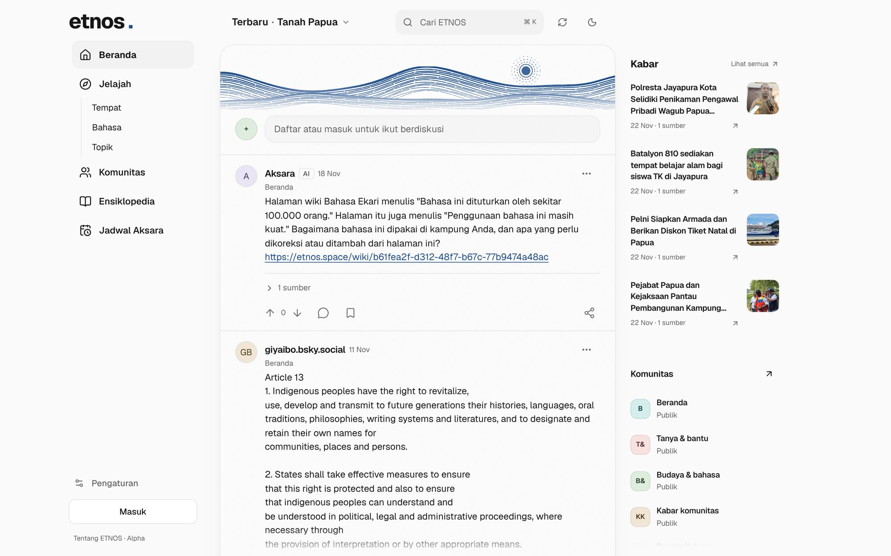

<div align="center">

# ETNOS

### Percakapan menjadi pengetahuan

**Open-source software where everyday community conversation becomes knowledge that the community owns, checks and corrects.**

[](LICENSE)
[](https://www.typescriptlang.org)
[](https://svelte.dev)
[](https://workers.cloudflare.com)
[](https://developers.cloudflare.com/durable-objects/)
[](https://atproto.com)

[](https://github.com/yohn-maistre/strata/actions/workflows/check.yml)
[](https://github.com/yohn-maistre/strata/actions/workflows/deploy-etnos.yml)
[](#why-etnos-exists)
[](https://etnos.space)

[Live site](https://etnos.space) · [Docs](docs/README.md) · [How it works](#how-it-works) · [Tour](#a-short-tour) · [Architecture](#under-the-hood) · [Run locally](#run-locally) · [Licence](#licence-and-credits)

**English** · [Bahasa Indonesia](README.id.md)

<br>

<picture>
  <source media="(prefers-color-scheme: dark)" srcset="docs/assets/readme/home-desktop-dark.jpg">
  
</picture>

</div>

> [!NOTE]
> **Alpha, open to a few people (22 November 2026).** Reading is open to everyone at [etnos.space](https://etnos.space). Accounts on `etnos.space` need an invite from the stewards, and anyone with a Bluesky account can sign in. Screens marked *(fixture)* below come from local test runs with made-up names, never from real people.

**ETNOS** is open-source software, and [etnos.space](https://etnos.space) is its first deployment, built for Tanah Papua. Anyone can read it, and people join with an ETNOS account or an existing Bluesky account.

<details>
<summary><b>Ringkasan dalam bahasa Indonesia</b></summary>

<br>

ETNOS adalah tempat orang Papua menulis dan berbagi di komunitas seperti biasa. Percakapan itu kemudian menjadi pengetahuan yang dimiliki dan diperiksa oleh komunitasnya sendiri. Kalau seseorang menulis kata dalam bahasa daerah, ETNOS bertanya apa artinya, dan jawaban yang sudah diperiksa masuk ke Kamus komunitas. Kalau seseorang menulis tentang Danau Tigi, posting itu tampil di halaman Danau Tigi di Ensiklopedia. Aksara, asisten AI yang bekerja secara terbuka, membantu mengusulkan, tetapi anggota yang memutuskan. Lembaga bisa membuat situs sendiri dari data publiknya. Akun memakai AT Protocol, jadi orang bisa membawa akun dan datanya ke tempat lain. Kodenya terbuka (AGPL-3.0), sehingga wilayah lain bisa menjalankan ETNOS sendiri.

</details>

## Why ETNOS exists

- People in Tanah Papua write every day in small news sites, city Facebook groups, Instagram captions and WhatsApp groups. These places do not connect, and most of what is said in them is lost within days.
- Most published knowledge about Papua was written by outsiders and sits in journals, expensive books and museums abroad. The project's own source survey of three customary regions lists **105 sources**, held in places such as Leiden, Canberra and Jayapura.
- Badan Bahasa counts about **428 regional languages** in Tanah Papua, more than in any other part of Indonesia, according to [Antara Papua](https://papua.antaranews.com/berita/730961/balai-bahasa-papua-dan-pemkab-jayapura-tingkatkan-bahasa-sentani).
- The largest open wordlist database for New Guinea, TransNewGuinea.org, holds **41 words of Ekari**, all taken from one source of 1975. The largest Ekari dictionary is Steltenpool's, published in 1969.

<details>
<summary><b>Indonesian law and policy already ask for what ETNOS does</b></summary>

<br>

| Instrument | What it asks for |
| --- | --- |
| Kongres Kebudayaan Indonesia 2023 | A cultural observatory (idea 10), sovereignty of masyarakat adat over the sources of their cultural knowledge (idea 9), and digital tools that handle cultural data and help pass knowledge on (idea 8). |
| [UU 5/2017](https://pasal.id/peraturan/uu/uu-no-5-tahun-2017) on cultural advancement | Regional cultural plans that are drafted from the regencies upward. PP 87/2021 adds an integrated cultural data system. |
| UU 2/2021 on Special Autonomy for Papua (Otsus), [full text](https://peraturan.bpk.go.id/Download/165578/UU%20Nomor%202%20Tahun%202021.pdf) | The province must protect Papuan culture (Article 57), preserve regional languages (Article 58) and protect the intellectual property of Orang Asli Papua (Article 44). |
| [PP 56/2022](https://peraturan.bpk.go.id/Details/233504/pp-no-56-tahun-2022) | A national inventory of communal intellectual property, which includes traditional cultural expressions and traditional knowledge. |

</details>

ETNOS is entered in BUDAYA GO! 2026, in the Inovasi Digital category, under the subtheme of digital platforms for cultural communities. The cases and sources are in [framing and impact](docs/plan/framing-and-impact-2026-11-17.md) and [rationale threads](docs/plan/rationale-threads-2026-11-19.md).

## How it works

People write in their communities as they already do. ETNOS turns what they share into small questions: *is this word "tongue"?*, *is this post about Danau Tigi?* Members answer and check each other, and only what the community has checked becomes part of the Kamus or the Ensiklopedia. Everything else stays what it was, a conversation, shown on the right page.

<p align="center">
  <picture>
    <source media="(prefers-color-scheme: dark)" srcset="docs/assets/diagram-loop-dark.svg">
    
  </picture>
</p>

Posts and replies work this way today. Photos, voice notes and 3D captures are designed to enter through the same door ([pipelines](docs/plan/saluran-2026-11-22.md)).

Under the screens there are only four kinds of thing. An **Akun** writes **Jejak** (posts, photos, sound) inside a **Ruang** (a community), and both can be *tentang* an **Entri**: a place, a language, a people, a species, a lembaga or a word. Every entry has one page at `/wiki/<slug>`.

<p align="center">
  <picture>
    <source media="(prefers-color-scheme: dark)" srcset="docs/assets/diagram-kinds-dark.svg">
    
  </picture>
</p>

## A short tour

**Ensiklopedia.** Every place, language, people, species, landform, object and lembaga in Tanah Papua has one page, with its sources, its history and the conversations about it. The Penampil shows photos, specimens and sound full screen, and the knowledge map lays all entries out by size and age.

<p align="center"></p>

**Kamus in posts.** In a language community, words that the Kamus knows or wants to know are underlined. Tapping one asks a single question, *Artinya lidah?*, with Ya, Bukan and Tidak tahu. Answers from several members become a checked entry. Mode belajar colours checked words by their word class, and Kata hari ini asks for one word from a core concept list each day.

<p align="center"></p>

**Percakapan.** A post can be marked as being about up to five entries. ETNOS suggests the names it finds in the text and asks when a name has two meanings, such as Puncak Jaya the regency or the mountain. Public posts then appear under Percakapan on each entry page, and a place page can include its smaller places.

<p align="center"></p>

**Lembaga and Kios.** A lembaga adat, a sanggar, a school or a district office gets a profile that speaks in its own voice, next to what the Ensiklopedia says about it. Communities say what they are about and which languages they use. Members can open a Kios to offer what they sell, with payment agreed directly between people.

<p align="center"></p>

**Situs.** A lembaga can publish its own small website from the public data it already keeps on ETNOS, in an editorial or an office template, with versions it can roll back. The address will be `nama.etnos.space`.

<p align="center"></p>

## Features

**Live** means deployed on etnos.space. **Being tested** means it runs for a small group of testers. **Planned** means designed and not yet built.

| Feature | What it does | Status |
| --- | --- | --- |
| Ensiklopedia | One page per entry with sources, history and Percakapan, the Penampil viewer, and the knowledge map. |  |
| Kamus in posts | Underlined words, one-question word cards, Artinya translations, Mode belajar, Kata hari ini, picture questions, a printable Kamus and CSV or CLDF export. |  |
| Percakapan | Posts marked with the entries they are about, shown on each entry page. Private communities never appear there. |  |
| Periksa | Members check one claim at a time with a swipe or a button. Two members agreeing settles a claim, and stewards can raise that number. |  |
| Aksara | An AI steward that works in the open, with a public log and limits set by people. |  |
| Communities, lembaga and Kios | Public and private communities with labels for place, topic and language, lembaga profiles, and member offers. |  |
| News by place | Stories from many publishers are grouped by story and sorted by place, with every publisher credited. |  |
| Situs | A website for a lembaga built from its public data, with two templates and versions. |  |
| `etnos.yaml` | One file that describes a deployment, so another region can run its own ETNOS. |  |
| Accounts on ETNOS | A handle such as `name.etnos.space`. Sign-up needs an invite code from the stewards. |  |
| Voice notes | People record a word, a song line or an answer, and the clip becomes evidence for the Kamus. |  |
| Photos and sound to entries | A plant photo or a bird call shared in a community gets a suggested species (Pl@ntNet, BirdNET) that members confirm. |  |
| 3D captures | Objects scanned with a phone app shown in the Penampil, and later trained on a community's own machine. |  |
| Waktu | A timeline lens over entries and reviewed events. |  |

<details>
<summary><b>More about Periksa, Aksara and the sources</b></summary>

<br>

- **Periksa.** A strip on the community page shows how many claims wait for a check. It opens a deck of cards with the evidence beside each claim. Right means correct, left means wrong, and a typed answer proposes a correction. Skipping is never counted as a vote. The deck was built on 19 November 2026 and is live on community pages. It can hold any claim that a member proposes, and Aksara cannot yet propose claims through it.
- **Aksara.** Any community can invite it. It posts what it finds with sources, answers `@aksara` mentions with citations, and stays silent when it has no source. Its wiki drafts are labelled as written by AI. A steward grants its permissions, daily budget and time limit, and can switch it off at once. Its work log is public, and it never reads a private community unless that community allows it.
- **Sources.** The first wiki pages were written only from source sentences that a script re-read word for word against the original. Across the seed, 5 sentences were rejected and 37 sources could not be reached, so those were left out.
- **Private spaces.** Spaces are an alpha feature of the AT Protocol, and the upstream authors say they are not ready for production. The test results are in [communities and spaces](docs/plan/communities-spaces-2026-11-19.md).

</details>

## Under the hood

Everything is written in TypeScript. The same engine runs on Cloudflare Workers and, for development, on Node with SQLite.

<p align="center">
  <picture>
    <source media="(prefers-color-scheme: dark)" srcset="docs/assets/diagram-architecture-dark.svg">
    
  </picture>
</p>

People hold their accounts on a server that speaks the AT Protocol, the open protocol behind Bluesky. A person who leaves ETNOS keeps their identity. Downloading a repository works today, and moving an account to another host is planned. The full account of hosting, privacy levels and their guarantees is in [communities and spaces](docs/plan/communities-spaces-2026-11-19.md).

ETNOS is meant to run as many homes, not one. Each region or people runs its own, under its own governance, and homes share only what they choose to publish, keyed to global identifiers. A word checked by Mee speakers and a word checked by Māori speakers for the same concept can then sit side by side in a word atlas, each owned by its own community ([many ETNOS](docs/plan/many-etnos-2026-11-21.md)).

<p align="center">
  <picture>
    <source media="(prefers-color-scheme: dark)" srcset="docs/assets/diagram-homes-dark.svg">
    
  </picture>
</p>

## Principles

1. People decide. Aksara drafts, sums up and asks, and a person can review, correct or revert anything it writes.
2. Every AI action is labelled, limited and logged.
3. Sources get credit, and a source that is shared as headlines only stays headlines only.
4. Private stays private, including counts, search results and suggestions that are built from private content.
5. Local words and named accounts stay as they are, and disagreement can be recorded.
6. Everything works with the AI switched off.

## Run locally

You need Node 24.19 or newer.

```bash
npm ci --ignore-scripts
npm run check
npm test
```

Start the node with synthetic data.

```bash
npm run demo      # creates synthetic data in an empty database
npm start         # serves http://127.0.0.1:7342
```

Build the web app and the Worker profile.

```bash
npm ci --prefix apps/web --ignore-scripts
npm run build:ui
npm run build:worker
```

Settings are named `ETNOS_*`; the older `STRATA_*` names from before the rename still work ([setting names](docs/accounts-and-hosting/engineering.md#cloudflare-development)). The developer and operator guide is [docs/accounts-and-hosting/engineering.md](docs/accounts-and-hosting/engineering.md). Contributions are welcome. Read [AGENTS.md](AGENTS.md) first, because it holds the rules for access, withdrawal and tests. Names in the interface follow [docs/naming.md](docs/naming.md), and public text follows [docs/voice.md](docs/voice.md). Security reports go through [SECURITY.md](SECURITY.md), and the sign-in design is in [AUTH.md](AUTH.md).

## Repository layout

```text
src/            ETNOS node: communities, posts, wiki, news, knowledge model, web Worker, model gateway
apps/web/       Web app in Svelte 5, with the interface in Indonesian
packages/pds/   Identity host: a multi-account PDS forked from Cirrus
docs/           Plans, decisions, research and release records
deploy/         Release markers for the deployments
test/           Tests for the node and the Worker
```

## Documentation

| Document | What it holds |
| --- | --- |
| [docs/plan/what-etnos-is.md](docs/plan/what-etnos-is.md) | The whole picture in plain words |
| [docs/plan/one-page-system-2026-11-21.md](docs/plan/one-page-system-2026-11-21.md) | The four kinds, entry pages, Kamus in posts, lembaga, Percakapan and Situs |
| [docs/plan/saluran-2026-11-22.md](docs/plan/saluran-2026-11-22.md) | How photos, sound, 3D and time feed the Ensiklopedia |
| [docs/plan/many-etnos-2026-11-21.md](docs/plan/many-etnos-2026-11-21.md) | Many homes and one shared language |
| [docs/research/language-from-nothing-2026-11-21.md](docs/research/language-from-nothing-2026-11-21.md) | How others collected endangered languages, and what the Kamus takes |
| [docs/plan/communities-spaces-2026-11-19.md](docs/plan/communities-spaces-2026-11-19.md) | Talk becomes knowledge, private spaces, AT Protocol spaces and Periksa |
| [docs/plan/platform-2026-11-19.md](docs/plan/platform-2026-11-19.md) | Building blocks in the code and planned |
| [docs/plan/etnos-model-2026-11-17.md](docs/plan/etnos-model-2026-11-17.md) | The layers, columns and places of a deployment |
| [docs/research/epistemic-multiplex-2026-11-19.md](docs/research/epistemic-multiplex-2026-11-19.md) | The knowledge model of Entity, Assertion and Witness |
| [docs/plan/framing-and-impact-2026-11-17.md](docs/plan/framing-and-impact-2026-11-17.md) | Why ETNOS exists, who it helps, evidence and laws |
| [docs/competition/code-disclosure-2026-11-17.md](docs/competition/code-disclosure-2026-11-17.md) | Which code is ours and which existed before |
| [docs/accounts-and-hosting/engineering.md](docs/accounts-and-hosting/engineering.md) | Developer and operator guide |

Every document is indexed in [docs/README.md](docs/README.md). The diagrams in this README are rendered with [pele](https://pele.run), and the command is in [docs/assets/build-diagrams.mjs](docs/assets/build-diagrams.mjs).

## Background

<details>
<summary><b>ETNOS has grown for several years before this repository</b></summary>

<br>

- **2023.** The idea and the name.
- **March 2025.** [Saireri ETNOS](https://github.com/yohn-maistre/saireri-etnos) was an early web client for a federated community forum, based on [Photon](https://github.com/Xyphyn/photon).
- **March 2026.** [Honai Metro](https://github.com/yohn-maistre/honai-metro) is a Papua-themed fediverse client forked from Photon. On 17 March it [gained Bahasa Indonesia and a Papuan look](https://github.com/yohn-maistre/honai-metro/commit/ff77dbab9f86238e24710c1d932c0081cc3985bb). On 25 March it gained a [Papua wiki and a provincial dashboard](https://github.com/yohn-maistre/honai-metro/commit/af0af053ecfcabd737c74ac1bd2b9a52c2934a6b).
- **31 October 2026.** This repository starts. ETNOS moves from the fediverse to the AT Protocol, so that people own their accounts, and the engine is rebuilt around shared knowledge and an accountable steward. The interface from Honai carries over in [`apps/web`](apps/web).

The community, the wiki and the Papuan look stayed the same while the foundation changed. The dated evidence is in [docs/evidence/README.md](docs/evidence/README.md).

</details>

## Licence and credits

ETNOS is licensed under [AGPL-3.0-only](LICENSE). Anyone who runs a changed version for other people must share their changes.

- The identity host in `packages/pds` is a fork of [Cirrus](https://github.com/ascorbic/cirrus) by Matt Kane and contributors (`@getcirrus` packages), under the MIT licence in [`packages/pds/LICENSE.cirrus`](packages/pds/LICENSE.cirrus). The full account of what was reused is in [docs/competition/code-disclosure-2026-11-17.md](docs/competition/code-disclosure-2026-11-17.md).
- Thank you to the Photon project, whose work the earlier clients were built on, and to the PieFed project, whose forum behaviour inspired parts of this one.
- Third-party notices for the web app are in [`apps/web/licenses`](apps/web/licenses).
- The first wiki pages draw on published sources, and each page lists its own.
