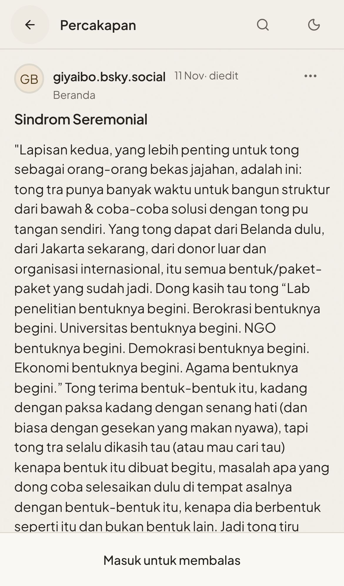

<div align="center">

# ETNOS

**Open-source software that turns everyday community conversation into a record that the community owns, checks and corrects.**

[](LICENSE)
[](https://www.typescriptlang.org)
[](https://svelte.dev)
[](https://workers.cloudflare.com)
[](https://developers.cloudflare.com/durable-objects/)
[](https://atproto.com)

[](https://github.com/yohn-maistre/strata/actions/workflows/check.yml)
[](https://github.com/yohn-maistre/strata/actions/workflows/deploy-etnos.yml)
[](#why-etnos-exists)
[](https://etnos.space)

[Live site](https://etnos.space) · [Docs](docs/README.md) · [Architecture](#how-it-works) · [Run locally](#run-locally) · [Licence](#licence-and-credits)

<br>


&nbsp;


</div>

> [!IMPORTANT]
> **Observatory redesign, phase 1 built (20 November 2026).** The wiki front at `/wiki` is now the observatory front (*Observatorium*): a knowledge map in three lenses (size and pace, the network of statements, and a map of places), a catalogue of public datasets at `/wiki/data`, a *Data* tab on thing pages and a locator map on place pages, all built on the world model fields and dataset records. Phase 2 adds the starter-data build, crosswalks, embeddings and access tiers beyond the open tier. Start with [docs/observatory/](docs/observatory/README.md), which lists what is built and what remains, then the [world model and starter data](docs/observatory/world-model-and-starter-data-2026-11-20.md) and the [data observatory](docs/observatory/data-observatory-2026-11-20.md). Remove this notice when phase 2 is built.

**ETNOS** is open-source software, and [etnos.space](https://etnos.space) is its first deployment, built for Tanah Papua. Anyone can read it, and people join with an ETNOS account or an existing Bluesky account.

<details>
<summary><b>Ringkasan dalam bahasa Indonesia</b></summary>

<br>

ETNOS adalah tempat orang Papua mengobrol seperti biasa di komunitas, dan obrolan itu diolah menjadi pengetahuan yang dimiliki komunitasnya sendiri. Sebuah lembaga adat bisa membuka komunitas bahasa. Asisten AI bernama Aksara mengusulkan kata, arti dan catatan tata bahasa dari obrolan itu, dan anggota memeriksanya satu per satu. Setiap halaman wiki menyebut sumbernya. Akun memakai AT Protocol, jadi orang bisa membawa akun dan datanya ke tempat lain. Kodenya terbuka (AGPL-3.0), sehingga wilayah lain bisa menjalankannya sendiri.

</details>

## Why ETNOS exists

- People in Tanah Papua write every day in small news sites, city Facebook groups, Instagram captions and WhatsApp groups. These places do not connect, and most of what is said in them is lost within days.
- Most published knowledge about Papua was written by outsiders and sits in journals, expensive books and museums abroad. The project's own source survey of three customary regions lists **105 sources**, held in places such as Leiden, Canberra and Jayapura.
- Badan Bahasa counts about **428 regional languages** in Tanah Papua, more than in any other part of Indonesia, according to [Antara Papua](https://papua.antaranews.com/berita/730961/balai-bahasa-papua-dan-pemkab-jayapura-tingkatkan-bahasa-sentani).
- The largest open wordlist database for New Guinea, TransNewGuinea.org, holds **41 words of Ekari**, all taken from one source of 1975. The largest Ekari dictionary is Steltenpool's, published in 1969.

<details>
<summary><b>Indonesian law and policy already ask for what ETNOS does</b></summary>

<br>

| Instrument | What it asks for |
| --- | --- |
| Kongres Kebudayaan Indonesia 2023 | A cultural observatory (idea 10), sovereignty of masyarakat adat over the sources of their cultural knowledge (idea 9), and digital tools that handle cultural data and help pass knowledge on (idea 8). |
| [UU 5/2017](https://pasal.id/peraturan/uu/uu-no-5-tahun-2017) on cultural advancement | Regional cultural plans that are drafted from the regencies upward. PP 87/2021 adds an integrated cultural data system. |
| UU 2/2021 on Special Autonomy for Papua (Otsus), [full text](https://peraturan.bpk.go.id/Download/165578/UU%20Nomor%202%20Tahun%202021.pdf) | The province must protect Papuan culture (Article 57), preserve regional languages (Article 58) and protect the intellectual property of Orang Asli Papua (Article 44). |
| [PP 56/2022](https://peraturan.bpk.go.id/Details/233504/pp-no-56-tahun-2022) | A national inventory of communal intellectual property, which includes traditional cultural expressions and traditional knowledge. |

</details>

ETNOS is entered in BUDAYA GO! 2026, in the Inovasi Digital category, under the subtheme of digital platforms for cultural communities. The cases and sources are in [framing and impact](docs/plan/framing-and-impact-2026-11-17.md) and [rationale threads](docs/plan/rationale-threads-2026-11-19.md).

## How it works

A lembaga adat opens a private language community, and its members talk as they always do. Aksara, an AI steward, proposes words, meanings, example sentences and grammar notes from that talk. Members check each proposal with one swipe, and the community decides what to publish. The same method applies to plants, places, events and customs.

<p align="center">
  <picture>
    <source media="(prefers-color-scheme: dark)" srcset="docs/assets/diagram-loop-dark.svg">
    
  </picture>
</p>

Everything is written in TypeScript. The same engine runs on Cloudflare Workers and, for development, on Node with SQLite.

<p align="center">
  <picture>
    <source media="(prefers-color-scheme: dark)" srcset="docs/assets/diagram-architecture-dark.svg">
    
  </picture>
</p>

People hold their accounts on a server that speaks the AT Protocol, the open protocol behind Bluesky. A person who leaves ETNOS keeps their identity. Downloading a repository works today, and moving an account to another host is planned. The full account of hosting, privacy levels and their guarantees is in [communities and spaces](docs/plan/communities-spaces-2026-11-19.md).

## Features

Each feature carries one of three marks. **Live** means it is deployed on etnos.space. **Being tested** means it runs for a small group of testers. **Planned** means that it is designed and not yet built.

| Feature | What it does | Status |
| --- | --- | --- |
| Periksa | Members check one claim at a time with a swipe or a button. Two members agreeing settles a claim, and stewards can raise that number. |  |
| Aksara | An AI steward that works in the open, with a public log and limits set by people. |  |
| Communities and lembaga | Public and private communities, joined openly, by request with a written reason, or by invitation. |  |
| Wiki with sources | Pages are written from cited sources and show their history, their author and whether a person has reviewed them. |  |
| News by place | Stories from many publishers are grouped by story and sorted by place, with every publisher credited. |  |
| Knowledge model | Every statement is stored with its supporting source and the voice that speaks. A seed of 110 entities is built from checked quotes and the place catalogue. |  with a map prototype |
| Accounts on ETNOS | A handle such as `name.etnos.space`. Sign-up needs an invite code from the stewards. |  |
| Kamus and Tata bahasa | A community dictionary and grammar sketch, seeded from published wordlists. |  |
| Voice notes and uploaded video | People record a word, a song line or an answer. |  |

<details>
<summary><b>More about Periksa, Aksara and the sources</b></summary>

<br>

- **Periksa.** A strip on the community page shows how many claims wait for a check. It opens a deck of cards with the evidence beside each claim. Right means correct, left means wrong, and a typed answer proposes a correction. Skipping is never counted as a vote. The deck was built on 19 November 2026 and is live on community pages. It can hold any claim that a member proposes, and Aksara cannot yet propose claims through it.
- **Aksara.** Any community can invite it. It posts what it finds with sources, answers `@aksara` mentions with citations, and stays silent when it has no source. Its wiki drafts are labelled as written by AI. A steward grants its permissions, daily budget and time limit, and can switch it off at once. Its work log is public, and it never reads a private community unless that community allows it.
- **Sources.** The first wiki pages were written only from source sentences that a script re-read word for word against the original. Across the seed, 5 sentences were rejected and 37 sources could not be reached, so those were left out.
- **Private spaces.** Spaces are an alpha feature of the AT Protocol, and the upstream authors say they are not ready for production. The test results are in [communities and spaces](docs/plan/communities-spaces-2026-11-19.md).

</details>

## Principles

1. People decide. Aksara drafts, sums up and asks, and a person can review, correct or revert anything it writes.
2. Every AI action is labelled, limited and logged.
3. Sources get credit, and a source that is shared as headlines only stays headlines only.
4. Private stays private, including counts, search results and suggestions that are built from private content.
5. Local words and named accounts stay as they are, and disagreement can be recorded.
6. Everything works with the AI switched off.

## Run locally

You need Node 24.19 or newer.

```bash
npm ci --ignore-scripts
npm run check
npm test
```

Start the node with synthetic data.

```bash
npm run demo      # creates synthetic data in an empty database
npm start         # serves http://127.0.0.1:7342
```

Build the web app and the Worker profile.

```bash
npm ci --prefix apps/web --ignore-scripts
npm run build:ui
npm run build:worker
```

Settings are named `ETNOS_*`; the older `STRATA_*` names from before the rename still work ([setting names](docs/accounts-and-hosting/engineering.md#cloudflare-development)). The developer and operator guide is [docs/accounts-and-hosting/engineering.md](docs/accounts-and-hosting/engineering.md). Contributions are welcome. Read [AGENTS.md](AGENTS.md) first, because it holds the rules for access, withdrawal and tests. Names in the interface follow [docs/naming.md](docs/naming.md), and public text follows [docs/voice.md](docs/voice.md). Security reports go through [SECURITY.md](SECURITY.md), and the sign-in design is in [AUTH.md](AUTH.md).

## Repository layout

```text
src/            ETNOS node: communities, posts, wiki, news, knowledge model, web Worker, model gateway
apps/web/       Web app in Svelte 5, with the interface in Indonesian
packages/pds/   Identity host: a multi-account PDS forked from Cirrus
docs/           Plans, decisions, research and release records
deploy/         Release markers for the deployments
test/           Tests for the node and the Worker
```

## Documentation

| Document | What it holds |
| --- | --- |
| [docs/plan/what-etnos-is.md](docs/plan/what-etnos-is.md) | The whole picture in plain words |
| [docs/plan/communities-spaces-2026-11-19.md](docs/plan/communities-spaces-2026-11-19.md) | Talk becomes knowledge, private spaces, AT Protocol spaces and Periksa |
| [docs/plan/platform-2026-11-19.md](docs/plan/platform-2026-11-19.md) | Building blocks in the code and planned |
| [docs/plan/etnos-model-2026-11-17.md](docs/plan/etnos-model-2026-11-17.md) | The layers, columns and places of a deployment |
| [docs/research/epistemic-multiplex-2026-11-19.md](docs/research/epistemic-multiplex-2026-11-19.md) | The knowledge model of Entity, Assertion and Witness |
| [docs/plan/framing-and-impact-2026-11-17.md](docs/plan/framing-and-impact-2026-11-17.md) | Why ETNOS exists, who it helps, evidence and laws |
| [docs/competition/code-disclosure-2026-11-17.md](docs/competition/code-disclosure-2026-11-17.md) | Which code is ours and which existed before |
| [docs/accounts-and-hosting/engineering.md](docs/accounts-and-hosting/engineering.md) | Developer and operator guide |

Every document is indexed in [docs/README.md](docs/README.md). The diagrams in this README are rendered with [pele](https://pele.run), and the command is in [docs/assets/build-diagrams.mjs](docs/assets/build-diagrams.mjs).

## Background

<details>
<summary><b>ETNOS has grown for several years before this repository</b></summary>

<br>

- **2023.** The idea and the name.
- **March 2025.** [Saireri ETNOS](https://github.com/yohn-maistre/saireri-etnos) was an early web client for a federated community forum, based on [Photon](https://github.com/Xyphyn/photon).
- **March 2026.** [Honai Metro](https://github.com/yohn-maistre/honai-metro) is a Papua-themed fediverse client forked from Photon. On 17 March it [gained Bahasa Indonesia and a Papuan look](https://github.com/yohn-maistre/honai-metro/commit/ff77dbab9f86238e24710c1d932c0081cc3985bb). On 25 March it gained a [Papua wiki and a provincial dashboard](https://github.com/yohn-maistre/honai-metro/commit/af0af053ecfcabd737c74ac1bd2b9a52c2934a6b).
- **31 October 2026.** This repository starts. ETNOS moves from the fediverse to the AT Protocol, so that people own their accounts, and the engine is rebuilt around shared knowledge and an accountable steward. The interface from Honai carries over in [`apps/web`](apps/web).

The community, the wiki and the Papuan look stayed the same while the foundation changed. The dated evidence is in [docs/evidence/README.md](docs/evidence/README.md).

</details>

## Licence and credits

ETNOS is licensed under [AGPL-3.0-only](LICENSE). Anyone who runs a changed version for other people must share their changes.

- The identity host in `packages/pds` is a fork of [Cirrus](https://github.com/ascorbic/cirrus) by Matt Kane and contributors (`@getcirrus` packages), under the MIT licence in [`packages/pds/LICENSE.cirrus`](packages/pds/LICENSE.cirrus). The full account of what was reused is in [docs/competition/code-disclosure-2026-11-17.md](docs/competition/code-disclosure-2026-11-17.md).
- Thank you to the Photon project, whose work the earlier clients were built on, and to the PieFed project, whose forum behaviour inspired parts of this one.
- Third-party notices for the web app are in [`apps/web/licenses`](apps/web/licenses).
- The first wiki pages draw on published sources, and each page lists its own.
