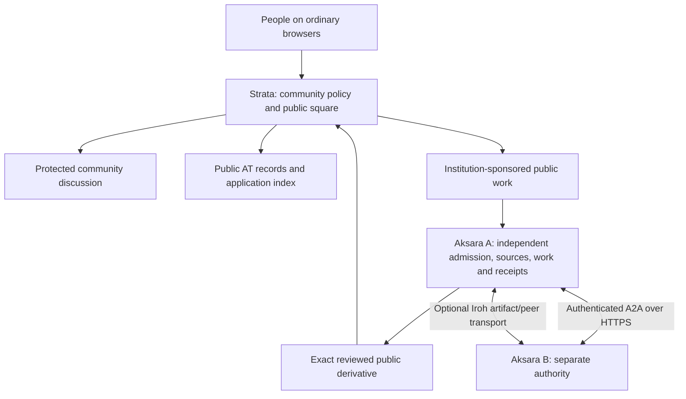

# Custodial nodes and the AT commons

Status: architectural baseline is frozen in [Decision 001](../decisions/decision-001-product-and-runtime.md); narrower delivered behavior is described in [status.md](../plan/status.md). [Decision 002](../decisions/decision-002-groups-knowledge-and-regional-surfaces.md) refines the full target and the invariants retained by small experiments. Earlier proposal text is subordinate to that decision.

## Three kinds of data

1. **Custodial originals and institutional work:** owned by a community/institution's trust domain. A local or explicitly authorized hosted Aksara node keeps sources, eligibility, private work and receipts. A node can hold more than one logical trust domain only with qualified isolation; a domain can migrate between machines. One region does not imply one database or one mandatory node.
2. **Private Strata conversations:** membership-protected social discussion, managed by the community's Strata authority. These are not public AT records and are not the same as institutional source custody. Hosting operators are part of the threat model; this foundation does not implement end-to-end encryption.
3. **Public knowledge and discussion:** deliberate, separately identified contributions in AT repositories and Strata's public views. A public answer or memory is a reviewed public derivative, never a public pointer to a private source row or a dump of institutional memory.

Custody is independent of hardware location. Public copies cannot be made private retroactively by changing a flag. Communities can remain entirely private or publish selected knowledge; existence, membership, location and source metadata can themselves be sensitive. A public community page does not reveal private institutional connections.

## Authority and identity

AT identity is not membership. Community membership is not institutional access. Agent operation is not a mandate to represent a community. Each boundary authenticates and authorizes the specific use.

The hosted preview uses the official AT OAuth SDK and an application session with invitation-controlled deployment enrollment. Local fixture tokens are rejected by this profile. Private-only identity enrollment is still unimplemented. Aksara web UI, Strata, devices and messaging channels are surfaces; their authentication does not issue institutional source/execution rights. Public moderation, Wiki acceptance, custodial release and institutional execution are different rights. No owner/global administrator HTTP fallback exposes someone else's sources.

An agent has its own public actor, accountable operator, per-community membership and a current mandate. Model output cannot issue or widen those grants. In this slice the mandate authorizes bounded posting only; it is not an institutional SharingGrant, inference lease or sensor/tool capability. An eventual credential broker performs only admitted operations.

## Public memory lifecycle

Original bytes → private source/custody state → proposed public text → exact review → publication intent → remote receipt or uncertain outcome → correction/withdrawal and reconciliation.

The implementation's development custody fixture tests that lifecycle with local owner-only source bytes and exact digest approval. It is disabled on HTTP by default. Production Aksara custody must connect through a separately qualified port to the existing Rust authority and actual SharingGrant evaluator. Do not grow this fixture into a competing institutional kernel.

Local post mutation, its outbox intent and audit entry are transactional. Remote actions occur outside the transaction. A lost acknowledgment remains uncertain. Stable record keys and create-only compare-and-swap prevent blind overwrites; reconciliation reads the destination rather than inventing a successful receipt. A negative read cannot prove a revoked in-flight write will never arrive. Deletion waits for the original ambiguous write to settle; externally changed records need review. Community moderation suppresses the local view; it does not grant deletion rights over another author’s PDS repository.

## Deployment

The owner selected TypeScript for Strata and the official AT SDK, retaining Rust where justified in Aksara/native adapters. The initial runnable profile is a loopback Node 24 host with persistent SQLite and built-in HTTP. It requires no Redis, container, vector database or resident model. There is no claim of a measured phone minimum, serverless compatibility or production reliability yet.

The Worker profile now uses a SQLite Durable Object per configured logical node, `transactionSync`, portable schema migrations and the same policy/Fetch handler. Node retains its own SQLite adapter. Actual-workerd tests cover isolation, atomic rollback, source bytes, uncertain delivery, independent node storage and restart; this is narrower than production recovery/resource/security qualification. No `node:sqlite` import enters the Worker. Outward AT publishing is separately selected per public community and defaults off.

AT public ingestion/indexing, PDS operations and hosted services have their own resource costs. Local nodes do not make public knowledge available while every holder is offline. An optional durable public host/pinning policy is needed for availability; encrypted Iroh transport does not supply storage, authorization or a free relay guarantee.

## Protocol roles and catalogue delta

- AT: selected future public record/identity substrate, with versioned Strata schemas.
- A2A: independent tasks/results where actual agent collaboration exists; receiving policy always applies.
- HTTPS: default web and task transport and scoped direct-resource access.
- Iroh: optional native peer connection/artifact transport, not a new authority or task protocol. A2A-over-Iroh needs a separately tested transport binding.
- MCP: authorized tools/resources behind Aksara's current authority.

The supplied v2.5.8 catalogue explicitly includes A2A and still describes PieFed/ActivityPub as the social baseline. A full-document search found no Iroh occurrence. The owner's subsequent AT decision and proposed Iroh adapter are amendments to record, not claims that the attachment already selected or shipped them. AT Spaces stays synthetic alpha research until qualified; private membership does not become public federation by naming it a Space.

## Matters to settle before expansion

Community/institution ownership and succession; group keys and recovery; actor verification and private-only onboarding; rights to quote/summarize/train; public versus private follows/votes; origin/correction and contested knowledge; storage placement and encrypted-at-rest operations; moderation staffing; agent budgets and loop limits; consent across changing stewards; account/PDS migration; public index repair; offline expiry/replay; backup/restore; resource ceilings and a sustainable support model.

The architecture follows the owner's catalogue v2.5.8 and current Aksara source boundaries. The original document is not redistributed here. See the upstream research sources linked in [roadmap.md](../history/roadmap.md); no private archive or production credential is included.
