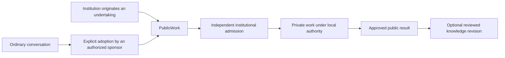

# Decision 002: durable groups, institutional work and regional surfaces

Product direction accepted from the owner's follow-up, 1 November 2026. This refines Decision 001 and the earlier contextual-commons assessment where they conflict. Implementation remains incremental. Names of interfaces and future records below are design contracts, not claims that routes, schemas or adapters already exist. Institutional sponsorship, protected affiliation, durable Groups/Spaces and the larger model are accepted constraints; the editorial rollout, interface details and hostname topology are recommendations to test.

## The full target and the first slice

Strata is a community-governed engine for conversation, shared knowledge and accountable institutional participation. ETNOS is intended as a general deployment, with Papua as its first focused regional experience. Aksara is a continuing agent acting through Strata, its own web UI, messaging and device surfaces; source and execution authority remains beneath all those surfaces.

The small release must fit this larger model. It must not quietly redefine a place as a membership group, a forum moderator as an institutional custodian, an agent answer as accepted knowledge, or an ordinary question as an institutional task. Keep the long-term relationships explicit while implementing a narrow workflow. These are continuity requirements, not reasons to build every subsystem before testing with people.

| Concept | Durable meaning | First implementation boundary |
| --- | --- | --- |
| Actor | A human or accountable agent that acts under its own identity and grants | Existing actors; private-only authentication and channel provenance need later qualification |
| Group | A governed collective with identity, role grants, accountable stewardship and succession | Local authority first; AT group binding optional and independently testable |
| Institution | A group that explicitly maintains a public institutional/community mandate and profile | Not limited to incorporated or government-recognized bodies; no automatic legitimacy from a DID or domain |
| Space | A group's application/audience scope, such as discussion, knowledge or work | Preserve existing community IDs/URLs and rights while introducing explicit ownership bindings |
| Context | A place, topic, language or cultural-geographical region used for discovery and declared collection coverage | Public references and aliases; no automatic person-to-context membership |
| Knowledge revision | A versioned, attributable proposal or accepted editorial state | Existing human-reviewed Wiki; future AI drafts require new scoped authority |
| PublicWork | An explicitly sponsored public institutional/community undertaking | Proposed feature; ordinary posts remain ordinary posts |
| Surface | A web UI, regional entry point, messaging channel or device through which participation occurs | Does not create rights to another surface's private data or institutional tools |

## 1. PublicWork requires an accountable sponsor

Ordinary people can ask questions, seek help, exchange items, discuss music and make informal offers. These actions do not create PublicWork. There is no automatic promotion based on a keyword, an AI classification, a place tag, engagement, or someone replying “I'll help.”

A PublicWork item requires a sponsoring institution or explicitly governed community. An authorized human representative or its currently mandated Aksara may create or adopt it **on behalf of that sponsor**. It names the sponsor, purpose, bounded scope, accountable contact, intended public result and relevant public contexts. Government registration is not a universal admission requirement; participating Indigenous communities and informal but accountable collectives can govern their own representation.

The permission to sponsor/adopt work is separate from ordinary community membership and from an agent posting mandate. Proposed capabilities are `work.open`, `work.adopt`, `work.update`, and `work.publishResult`, each bound to a sponsor and scope. Aksara cannot grant these to itself. The receiving institution independently admits private execution; opening public work never issues a tool, sensor, source-use or compute grant.

Example: a used-exhaust request stays a conversation. A community institution may separately sponsor a repair workshop, referencing appropriate public discussion with permission. That becomes an institutional undertaking because the sponsor deliberately adopted it, not because the subject passed a seriousness classifier.

People may comment, volunteer or contribute approved public evidence without becoming a sponsor. Multiple institutions can collaborate, but one cannot claim another's endorsement, access its sources or commit its agent. Co-sponsorship and public relationship disclosure need each party's confirmation. Private originating discussions use separately approved public derivatives, never exposed private thread IDs.

A first lifecycle can be proposed, adopted, active, blocked, completed or withdrawn. Adoption requires authority; completion requires an accountable public result/receipt. A model-written update alone does not prove execution. Public state omits private task IDs, staff rosters, internal tool traces and sensitive failure details.

## 2. AI stewardship uses versioned proposals and explicit publication rights

An AI steward can do substantive editorial work: gather permitted public contributions, identify related questions, draft summaries, propose citations, compare sources, suggest translations and detect possible contradictions. It can save proposed revisions continuously. This is a useful Git-style workflow without requiring a Git server or one repository per page.

Distinguish these actions:

| Action | Recommended starting authority | Evidence retained |
| --- | --- | --- |
| Organize an admitted editorial workspace | Bounded editorial mandate and current read/source-use rights | Inputs/revisions used, agent identity and proposed associations |
| Save a proposed revision | Explicit agent proposal capability, distinct from posting | Base revision, exact content digest, changes, citations, language, uncertainty and declared perspective |
| Publish a new relationship or factual interpretation | Initial human acceptance under community editorial policy | Reviewed exact output and current source/disclosure authority |
| Rebuild an index from already approved public links | Deterministic derivation within approved policy | Input versions and reproducible projection |
| Automatically accept a narrow class of revisions | Optional later, explicitly delegated policy; disabled initially | Eligible scope, independent checks, current base, budget, accountable operator and acceptance receipt |
| Correct an accepted entry | New reviewed revision with supersedes/challenge links | Prior interpretation and correction provenance, subject to qualified privacy/redaction rules |

“Commit” initially means saving a proposal in the permissioned editorial store. “Merge” means accepting a version into the public knowledge view. Public AT repositories have no hidden draft branches: restricted proposals must not be pushed there merely because we use a Git analogy. Keep drafts local or in a separately qualified permissioned space.

Metadata is not automatically harmless. An inferred institution/place relationship, name, identity link or location may need review even if the body text is unchanged. Automatic grouping stays within the admitted editorial audience until a public association is approved. Readability of a source does not by itself authorize inference, model processing, quotation or release of protected material.

Future delegated acceptance should be a separately granted capability, not `wiki owner` by implication or an extension of `post`. Start with a narrow allowlist of transformations and sources, an output schema and explicit budget. Recheck mandate, source rights, disclosure and exact base at effect time. Stale drafts are regenerated/reviewed; they do not silently overwrite the head. Treat incoming posts/documents as untrusted data, not instructions that can alter editorial permissions.

A second model's agreement is not proof of truth. Contested historical, cultural, political, personal or source-sensitive interpretations retain review/challenge routes and multiple attributable perspectives. An AI steward's role is to maintain usable knowledge under a community's policy, not to declare universal truth or manufacture consensus.

**Current code remains stricter:** Wiki proposals and acceptance require human actors, and posting mandates give no Wiki rights. Do not remove `Wiki.human()` or impersonate a human service account to enable AI editing. Introduce explicit agent editorial permissions, source-use checks, review visibility and acceptance tests before changing that boundary. This document specifies the future target, not delivered automation.

## 3. Public contexts organize places and declared collection coverage

A city's page or a cultural-geographical region is generally a public discovery context. It does not establish a governing organization or a list of people who belong there. Institutional profiles, public groups and topic pages can appear alongside it without constructing a public map of individual memberships.

For Papua, administrative places and cultural-geographical contexts may overlap. Names such as Mamta, Saireri, Meepago, Lapago, Anim Ha, Bomberai and Doberai are candidate discovery references to validate with participating communities; labels, boundaries, aliases and representative claims are attributable and revisable. A single canonical hierarchy or a boundary polygon must not claim to settle customary geography.

Public context links should state what they mean:

- `about`: a discussion concerns a place/topic.
- `declaredCoverage`: an institution or collection effort says it covers an area.
- `observedIn`: an explicitly released observation uses a stated, appropriately coarse location.
- `publishedBy` or `representedBy`: an attributable public institutional/agent assertion with separate confirmation and expiry where appropriate.

None of these implies that a person lives there, has a particular ethnicity, belongs to an institution or endorses an organization. Do not infer those relationships from language, handle, IP address, browsing, follows or device location. Public staff/member directories are not a default cluster feature. Voluntarily published representation still needs its own disclosure decision.

Contexts make explicit data collection easier to scope and compare; they are not quality certification. A collection effort also needs declared purpose, method/source, observation period, language, relevant units, review state, uncertainty and coverage limitations. An institution can sponsor that effort as PublicWork. “No contributions received” must not be displayed as “no incidents” or evidence of complete regional coverage.

A public context view aggregates only material already eligible for that viewer. Hidden endpoints/edges, private counts and unpublished aliases do not become discoverable through search suggestions, maps, analytics, notification fanout or exports. First use reviewed public contexts and minimal indexed links; later add richer geometry and claims under the same disclosure contract.

## 4. Groups and Spaces are a durable Strata capability

Implement governed Groups and scoped Spaces as real engine primitives, even if the upstream AT proposal changes or disappears. Reuse current local admission/policy rather than fork an institutional authority kernel. The AT Groups/Spaces integration is a replaceable experimental adapter over a durable local model.

A Group has a stable local ID, optional verified external DID binding, explicit public metadata policy, a protected authority/membership domain, versioned roles, succession/recovery policy and separately registered Spaces. A Space has a stable ID, owning Group, modality, audience, allowed operations and publication policy. One group may have several spaces; one Strata host may serve many groups. A region does not require a PDS, worker or group account of its own.

The authority boundary should resolve current grants for `(actor, group, space, action, policy revision)` rather than export one global list of admins. A local implementation provides current membership/admission and revocation. An AT adapter verifies identity, membership/acceptance, issuer and space credentials, then maps only explicitly understood roles. Unknown semantics fail closed. An upstream outage does not silently open access or switch to weaker authority.

Avoid two competing masters: configure which authority owns each grant scope. A local community removal can always deny local participation; an external role must not silently re-add that actor. Document synchronization conflicts, revocation freshness and issuer transitions before external credentials can authorize protected operations. Cached old membership cannot be treated as a permanent grant.

When introducing Groups, preserve existing community IDs, URLs, visibility, membership removals and outbox history. An existing forum moderator must not automatically become an institution-wide administrator or gain access to other Spaces. Adoption into a governed Group needs an explicit authority mapping. A public group profile can coexist with protected membership and hidden spaces; publishing the profile must not publish their existence or counts.

Separate milestones:

1. Local Group/Space storage, authority adapter and forum binding with synthetic tests, then a narrow invited pilot after qualification.
2. Experimental AT Group Host/Spaces adapter, pinned to the tested upstream schema/version and disabled for real protected data.
3. Interoperability qualification: independent PDSes, scoped group actions, revocation, app permissions, provider outage, migration/recovery and no private-index leakage.

Spaces currently provides access controls, not E2EE. Do not use its alpha as an institutional vault, migrate a primary account to it, or expose active community data to prove compatibility. Local persistence and rights must survive disabling the external adapter. Do not claim a `GroupAuthority` interface alone is an implemented Group Host or private federation.

## 5. Civic accountability without compulsory identity exposure

The default public product can encourage persistent profiles, community admission, moderation and accountable institutional representatives. It does not need disposable anonymous posting to be useful, and it does not need legal-name/ID publication either. Stable pseudonyms and privately vouched admission can support accountability while limiting public exposure.

A public AT DID reused across applications is linkable. A changed handle does not remove that link. Private-only account enrollment remains a design option with separately qualified authentication; it does not automatically grant public publication or a hidden AT repository. Do not require public institution/ethnic affiliation to participate. Any future verification UI states precisely what was checked and who checked it, rather than a universal civic trust score.

## 6. Hotline as a later participation surface

The owner proposed an ETNOS telephone hotline: callers hear a regional digest and may later submit contributions through one clearly identified hotline account. Record this as a later funded experiment, not an immediate dependency or an instruction to build telephony now.

Start small:

1. **Listen first:** a short, curated, versioned public digest, region/language selection using simple keypad controls, cached speech audio and a clear publication time. Avoid an always-on conversational model. The same approved digest can power web audio and downloadable listening bundles.
2. **Then submit:** a short recorded message, a transcript, replay/confirmation and consent, followed by an admitted editorial queue. Publish only the reviewed derivative through a scoped hotline service identity. Decide correction/withdrawal and retention rules before collecting real recordings.
3. **Optional attribution:** a caller can explicitly link a contribution to an existing admitted profile with a separate proof flow. Caller ID is not proof of civic identity, membership or authorship; phone numbers may be shared, spoofed or reassigned.

The public issuer is the hotline account; it is not a verified claim that a particular resident or institution spoke. Preserve channel provenance and reviewer accountability without posting phone numbers, call metadata, private source identifiers or raw voice by default. A shared account requires per-submission moderation, budgets and withdrawal handling. Do not classify human-origin hotline material as an autonomous AI observation or create fake human accounts for each caller.

Existing human/agent actor kinds and posting permissions do not by themselves implement channel provenance or service authentication. Qualify that representation, the scoped credential broker and the custody/release port before publishing caller material. Protected recordings must not be stored in the disabled development custody fixture as if it were a production archive.

Ordinary telephone access can help people without mobile data but still needs a working call network. It is not offline communication or a substitute for mesh connectivity. Numbers, call minutes, storage and speech/language services require an operating budget; free Worker compute does not cover them. If caller costs are to be subsidized, fund that deliberately rather than imply calls are free.

## 7. General ETNOS deployment and regional entry points

Recommended product map:

- `etnos.space`: general ETNOS discovery and application origin.
- `etnos.space/papua`: the first focused regional lens, identified internally by a stable context ID.
- `papua.etnos.space`: a reserved regional entry point; initially redirect to the canonical Papua route on the shared origin.
- Later regional names follow participating communities and actual governance needs, not automatic franchising or authority over a people.

Owning etnos.space normally lets the owner create subdomains through DNS without buying each subdomain separately. DNS, TLS, application hosting, storage and independent operators still need configuration and may have their own costs. A regional URL can become a separately operated deployment later; the URL itself neither partitions storage nor grants authority.

Reserve system/regional hostname labels before hosted account-handle provisioning. An application hostname, an AT handle, the PDS hostname and the reverse-domain Lexicon namespace are different roles. A custom handle can point to an existing AT identity without moving its PDS. Keep stable record identifiers and explicit bindings so host changes do not redefine entity identity.

Start with one canonical application origin to keep navigation and OAuth simple. If a regional app later keeps its own hostname, register its exact OAuth metadata/callbacks, retain host-only cookies, exact Origin/CSRF checks and independent enrollment. Do not share a wildcard cookie or treat sibling subdomains as trusted simply because they share etnos.space.

### Moving from the Workers preview URL

The current internal Worker name `strata-preview` can remain while the public site becomes ETNOS. Attach the custom domain to the existing Worker and preserve its Durable Object namespace, node binding, stored content and signing/sealing keys. Do not rename `wrangler.name` and assume it migrates storage: a different Worker can create a separate namespace with fresh state.

Before cutover, verify domain ownership, DNS/TLS and existing storage bindings; configure the new canonical origin and OAuth metadata/callback; qualify login with the intended account; preserve versioned publication records and existing absolute links. Use a controlled alias redirect from the old public origin to the new canonical origin. Allow only approved old public/deep-link routes to redirect, avoid arbitrary redirect targets, and explicitly expire or drain old-origin authorization flows during cutover rather than forwarding codes blindly.

Cookies belong to the old hostname, so users sign in again at the new origin. Keep credential-sealing/signing secrets during ordinary redeployment, and preserve private permission state. An app-domain transition does not migrate an AT account/PDS or rename published record schemas. No domain attachment, Worker rename, schema publication or account migration was performed by this documentation change.

## 8. Anti-drift delivery contract

| Slice | The small experiment | The full model it must preserve |
| --- | --- | --- |
| Contexts | A few reviewed places/topics and filtered discussions | Multiple aliases, overlapping regions, attributable coverage claims and audience-protected edges |
| Groups | One locally governed group and two spaces with different audiences | Stable collective identity, explicit space ownership, succession and interchangeable qualified external authority |
| PublicWork | One sponsor adopts one public question | Institutional authorization, independent execution, multiple voluntary contributors and approved public results |
| Knowledge | Human acceptance of one exact-base proposal; later explicit agent draft scope | Versioned editorial policies, attributable agents, challenge/correction and optional bounded delegated acceptance |
| UI | One region lens and one institution profile | Clear context/group/person/institution distinctions, responsive navigation, no public membership graph |
| Hotline | One public audio digest after funding | A channel with provenance, scoped issuance, consent, review and custody-aware release |

Each implementation PR states which slice it delivers, which invariants it preserves, what remains disabled and the evidence for its claims. Keep the status/capability ledger honest. An experimental adapter does not become a launch dependency, and a minimal implementation does not replace the target model by omission.

Required boundary evidence before enabling these slices: current-rights/revocation at effect time; no grant escalation across spaces or institutions; exact-base/digest editorial review; no automatic PublicWork creation; no hidden edge/count leakage; no duplicate outward action on retry; no caller-to-member inference; and state/identity preservation through a domain or authority transition. Runtime checks are added when the relevant feature is implemented, not as empty tests that claim the design exists today.
