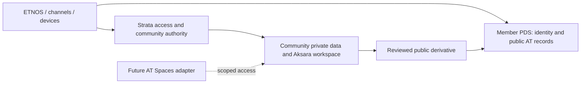

# Decision 005: one node experience, explicit data boundaries

1 November 2026 · Architecture proposal, not a deployed PDS service. This extends [account hosting](decision-004-at-account-hosting.md) after source inspection. UI/news and the owner-authorized canonical-origin cutover can ship independently.

## A community node can host identities while ETNOS hosts the interface

An AT account's DID document points to its PDS. The website need not run there: ETNOS can authenticate accounts on several qualified PDS providers and assemble a forum view. A community can therefore operate its members' PDS while we operate etnos.space. A PDS is not inherently one account per server; the two Cloudflare candidates inspected below deliberately deploy one identity at a time. Serving twenty identities means a managed fleet or additional, qualified multi-account hosting work.

Use “a node hosts the accounts of people who choose it,” rather than “every node is the PDS for everyone.” Each account has one authoritative PDS location. An offline community node makes those hosted account services unavailable; a central AppView does not make its missing PDS available for login, writes or fresh sync. Hosting also does not automatically grant Strata community membership. Our current provider egress allowlist must qualify a new node before OAuth will accept it.

Keep one coherent node dashboard and installation manifest, with distinct services and credentials underneath. A common identity does not mean a common all-powerful credential.

## The permission model can describe any data; public repos cannot enforce its privacy

Lexicons can describe language material, task artifacts, provenance or agent receipts. Ordinary AT repository records remain public, redistributable and verifiable. OAuth write scopes authorize an application to act; they do not turn public records into private records. Restricting enrollment or not notifying a relay does not create a private PDS.

AT Spaces is the relevant **official experimental protocol** for permissioned records, distinct from custom PDS projects. The alpha and proposal explicitly provide access control, not E2EE: PDSes and authorized applications can read the data they handle. A space host/authority and a repo host are distinct roles and need not be one service. Per-user space repos remain on their respective hosts; the application assembles the shared view. This matches distributed community hosting considerably better than copying one institution's entire archive into every member's public repo. It also means a community is an authority over access, not necessarily the physical custodian of every original.

Keep the existing two-PDS Spaces experiment and local Strata Groups separate from production sensitive data. The alpha warns of breaking changes and data deletion. Do not enable experimental Spaces as the only copy of a language corpus, raw agent trace or activist archive. No production Spaces claim follows from a successful local lab.

A private-object envelope can be shared across Aksara and Strata:

- Stable object ID, custodian/collective authority, contributing person, language and provenance.
- Sensitivity, retention, current policy version and an audit receipt.
- Independently granted `read`, `contribute`, `process`, `export`, `publish-derivative` and `train` purposes, with audience, expiry and withdrawal.
- A storage reference resolved only after current authorization, never a permanent public blob URL.

These are application policy requirements, not powers the PDS supplies automatically. Read permission is not training permission. A chief/dewan-adat authorization and contributor consent need a documented local process and scope. CARE responsibilities continue outside code. A revoked credential stops future authorized access; it cannot recall copies already downloaded or promise to untrain a released model.

Raw agent traces may contain tokens, private source excerpts, personal data and hidden context. Keep them in the private workspace with narrow agent mandates; publish a reviewed, redacted activity receipt only when useful. A community's persistent Aksara can expose its public role without revealing its private memory. Treat extensions as trusted server code: pds.js collection-scoped hooks are not a sandbox for hostile plugins.

## Deployment profiles

| Profile | Public account hosting | Private authority and data | Appropriate now |
| --- | --- | --- | --- |
| Hosted alpha | Existing qualified external PDS accounts; ETNOS on Workers | Strata local access-controlled forum data; Aksara connector still pending | Twenty invited participants, public reading |
| Community node | Community-operated always-reachable PDS for opted-in members | Community storage and Aksara, local/private by default | Pilot after hosting, recovery and security qualification |
| Field node | Hosted PDS initially; offline outbox for approved actions later | Local private store, sensors, devices and Aksara | Future offline-first pilot, not autonomous public signing on two primaries |

Iroh can carry authenticated peer traffic, but does not supply internet reachability, institutional authorization, durable replication or safe concurrent PDS primaries. A2A describes agent collaboration, not transport privacy or member rights. Keep one write authority until an explicit replication/failover design is tested. Account recovery must let a person move away from a host; an institution should not own every member's identity or sole recovery key.

## Source audit: Cloudflare PDS candidates

Inspected upstream source snapshots, not just homepages:

| Candidate | Useful foundations | Costs and gaps |
| --- | --- | --- |
| [Cirrus](https://github.com/ascorbic/cirrus/tree/de476f57ba1fb936c6480a8fc278b6c7fc250cab), package 0.19.0 | Worker/Hono + account SQLite DO + R2; **official `@atproto/repo`** and crypto packages; hibernating firehose; full CAR export streams from SQL cursor | Community experimental beta, single-account deployment; some upload/import routes buffer complete bodies. Cloudflare-focused storage needs adapters for servers. Relay notification defaults to bsky.network |
| [pds.js](https://tangled.org/chadtmiller.com/pds.js), commit `72a7c998bdc765c3d196b1f0a8f65ac54016c862`, core 2.5.2 | Explicit actor/shared/blob/WebSocket ports; Node, Deno and Workers adapters; optional extensions outside core; streaming/multipart blob paths; DO WebSocket hibernation | Community implementation, single-account and no multi-user invite administration. Own MST/repository/crypto code increases compatibility review scope. Extension hooks are trusted code. Relay URL defaults to none |
| [Official PDS](https://github.com/bluesky-social/pds) | Mature multi-account operational path, official AT implementation, SQLite account repositories | Persistent service and storage; the recommended 1GB VM is a deployment starting point, **not** measured per-user RAM or a minimum proven for our workload |

**Proposed approach:** qualify Cirrus first for a narrowly scoped Cloudflare AT-hosting pilot because repository-format correctness benefits from official library reuse. Borrow the *port boundaries* of pds.js for our node design and keep it as the portable-runtime comparison. Do not combine two implementations' cryptography or create a multi-tenant fork by changing a hostname. Neither is “the official Cloudflare PDS.” No additional public DID, PDS or account was created in this pass.

For a pilot, use disposable identities and interop tests for OAuth, DPoP, MST/CAR imports, blobs/range requests, relay restart, deletion, key rotation, recovery, exports and restore. An entire-node backup includes blobs, signing/recovery material, authority policy and service state; a CAR alone is not a full-node backup.

## Efficiency and free-tier reality

Cloudflare's 128MB isolate limit is not a reservation per registered account. On-demand SQLite DOs and hibernating sockets can avoid a permanently running process for each member. The expensive cases are signing/verification, KDFs, CAR imports, large media and sync amplification, not twenty rows in a users table. Both projects already use hibernation; Cirrus already streams full CAR export. Those are source observations, not a comparative RAM benchmark.

Before choosing a fork, measure identical 0/1k/10k-record repositories, bounded image/blob uploads and CAR import/export; cold/hot heap/RSS where applicable, CPU, p50/p95 response, storage rows and request counts. Test twenty separate identities, restore after restart and relay subscription. Profile full-body buffering before claiming a 128MB worker safely accepts a large import. Keep uploads streamed/bounded and maintenance incremental. No 1GB-per-twenty-user claim or low-memory performance guarantee is justified yet.

Current account observation: R2 reports **5,419 published Standard objects, 47,267,302 payload bytes + 1,008,653 metadata bytes**. Its only bucket is `westpapua-watch-archive`, so this account-level snapshot corresponds to WPW inventory. This is about 48.28 MB including metadata, roughly 0.5% of a 10GB quantity. Metrics may lag; this is not a monthly GB-month bill or measured Class A/B operation usage. Included allowances are shared across applications. Free DNS does not establish the Workers subscription. No new bucket, paid plan or database was provisioned.

Free request/CPU/storage limits remain in Decision 004. A PDS may receive public sync requests unrelated to our member count. Keeping a host unadvertised avoids our own crawl requests, not independent discovery: DID/handle resolution exposes the endpoint, and open sync APIs remain readable. Use private application storage or a qualified permissioned protocol for private data, never obscurity.

## Modular rollout

1. Ship surface improvements, optional news and canonical origin independently of PDS hosting.
2. Retain Strata's policy/transaction/outbox core, SQLite DO adapter, JSON API and standalone Honai client. The Node CLI remains loopback-only, not a production OAuth server just because the core is portable.
3. Keep PDS lifecycle as a separate service with explicit provider adapters and export/recovery contracts. No Postgres/Supabase/Neon dependency is needed to qualify account hosting.
4. Keep blob storage, public news and Aksara authority behind ports. Current news reads only the fixed public WPW endpoint, caches a small projection at the edge and never forwards forum credentials, member identities or search queries. WPW ingestion does not move into Strata.
5. Add a community node installer only after the single-node paths are qualified. Use one manifest with separately scoped keys and backups, not one shared admin token. Later Spaces can implement part of the private-data exchange without replacing our purpose/consent rules.

## Canonical-origin operation

The owner attached `etnos.space` to `strata-preview` and authorized making it canonical. DNS/custom-domain attachment is now confirmed; prior observations of registrar parking are historical. Before this release the application rejected it because `STRATA_ORIGIN` still named workers.dev. Change only the application origin; preserve logical node `preview`, DO namespace, schema and both existing secret bindings. Public AT publishing remains disabled and invited participation remains enforced.

Fresh OAuth consent is required at the new client URL; no cookies or tokens are forwarded to the new domain. The legacy URL redirects GET navigation, drops OAuth callback parameters, rejects writes, and keeps only `/recover-messages` plus static assets available. Its recovery page has no network API access and can export the browser's existing passphrase-encrypted vault. Import on etnos.space checks actor ID and allowed source origin, authenticates/decrypts with the passphrase, rejects replacing an existing vault, and seals again for the new origin. Do not run the same ratchet state on two devices or restore stale backups over active history. This is an explicit experimental migration path, not general multi-device DM recovery.

## Primary references

- [AT public repositories](https://atproto.com/specs/repository)
- [Spaces alpha warning and scope](https://atproto.com/blog/atproto-spaces-alpha)
- [Spaces proposal](https://github.com/bluesky-social/proposals/blob/main/0016-permissioned-data/README.md)
- [Spaces developer goals, 14 October 2026](https://atproto.com/blog/devex-goals-for-spaces)
- [Cirrus repository export](https://github.com/ascorbic/cirrus/blob/de476f57ba1fb936c6480a8fc278b6c7fc250cab/packages/pds/src/repo/sync.ts)
- [Cirrus relay defaults](https://github.com/ascorbic/cirrus/blob/de476f57ba1fb936c6480a8fc278b6c7fc250cab/packages/pds/src/relay.ts)
- [pds.js architecture](https://tangled.org/chadtmiller.com/pds.js/blob/main/docs/architecture.md)
- [R2 pricing](https://developers.cloudflare.com/r2/pricing/)
