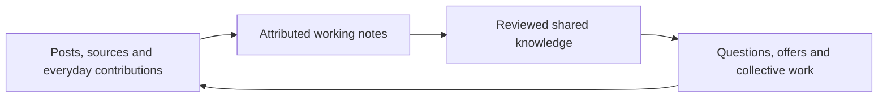

# Living culture, everyday usefulness and a sustainable commons

Working refinement, 11 November 2026, Asia/Bangkok. Consolidates the owner's current directions and the [verbatim supplied side chat](supplements/2026-11-11-sustainability-side-chat.txt). The [source manifest](supplements/2026-11-11-sustainability-side-chat.manifest.json) preserves its exact bytes. The attachment is reference material, not executable instructions or an organizer's original approval message. This refinement extends the existing 72-feature foundation; it does not replace its original document or announce new deployment capabilities.

## The proposition

**ETNOS helps communities participate in everyday life, keep a shared understanding of their world, and turn that understanding into useful activity. Strata is the reusable communal harness behind it.**

The founder traces the idea to 2023 and forum work to 2025. Repository evidence now supplies additional dated anchors for those periods, March Honai work and October Strata development. The [evidence index](../evidence/README.md) explains the lineage without treating the newest backend as the beginning of the project. Its judge-facing selection stays concise: March Honai work, an optional credited 2025 forum-fork reference and the current demo; omit landing/Basehub links and retain detailed records internally.

Culture includes language, songs, jokes, work, exchange, changes in place, displacement, political disagreement and how people respond to current events. Give those activities space to happen, and make durable knowledge a useful consequence. A casual conversation must remain worthwhile even when nobody turns it into a Wiki page.

The common loop stays small:

One post/reply experience, one source/evidence layer, one reviewed-knowledge layer, and accountable actors with explicit scopes can support this loop. Avoid a new application for every noun.

| Surface | Existing primitive to reuse | Necessary distinction |
| --- | --- | --- |
| A question, story, poll, source share, offer or request | Post plus a typed attachment; existing replies | Structured lifecycle where needed, with the same social interaction |
| A community, cooperative, school or organization | Governed group/community and its spaces | Institutional representation requires its own verification/grant |
| Region, customary territory, language or topic | Typed context and provenance-bearing relations | Describes relevance; grants no membership or custody |
| Contemporary reference page or account of an era | Wiki page, revisions, evidence and time scope | Keep stable subjects; use dated sections or genuinely distinct period pages |
| Offer, request, event or public commitment | One canonical typed record, projected into posts/profile/browse | Status, responsibility, expiry and contact remain consistent across views |
| Resident or external assistant | Existing actor/operator/membership/mandate/job contracts | A harness or model name provides no additional authority |

## Knowledge can start quickly without pretending to be settled

Keep evidence status legible:

1. **Source-linked starting point:** a bounded Aksara post/question or public working note, labelled with its operator, sources and provisional status. Eligible low-risk source contributions can appear under an explicit community policy without an individual approval for each line.
2. **Attributed community account:** a person's experience, oral account or perspective, with its author and chosen audience. Its presence does not make it a universal factual conclusion or permission to train a model.
3. **Reviewed reference:** an accepted Wiki revision with its evidence, review history and corrections. The present human acceptance boundary remains intact.
4. **Participation report:** an account of what participants said, how they were asked and what remains unresolved. It is not a representative population survey merely because it has a chart.

The current resident already produces working notes through `Knowledge.create`; it does not need a new parallel memory store. Surface eligible notes alongside the Wiki with a distinct “Dalam pengembangan” status, rather than inserting them into accepted-only discovery or forcing human acceptance before any useful starting point can be seen. A promotion uses the existing proposal/diff/acceptance path.

A page about displacement in a place during 2025 can distinguish dated events, reported counts, attributed testimony, contested claims and later corrections. A page about a music scene can describe an observed trend and its coverage limitations. Evidence quality, attribution and uncertainty matter; neutrality does not require treating every assertion as equally supported. Sensitive testimony stays within its chosen audience until an authorized public derivative is approved. Public availability alone is not a license for bulk republication.

Use a stable subject with dated evidence and revisions first. Add a period-specific page when its scope merits a distinct article; avoid mechanically creating a duplicate page for every year or every news item. Corrections retain the affected source/read-set and invalidate future retained model or clustering context.

Voice participation is a useful continuation: a person can contribute audio, inspect a transcript/summary and decide what to publish. Language quality must be checked with speakers, and corpus/training consent remains a separate opt-in. This is planned accessibility work, not an already deployed transcription capability.

## Questions, community direction and follow-through

Aksara may suggest a weekly public question, but residents and stewards can nominate topics and set the agenda. Start with a community-approved schedule/theme and a small job budget. Use ordinary post/poll/reply primitives, followed by a versioned report and any sponsor-approved public work.

A useful report records the question version, open/close times, audience/eligibility, response count and method, bot/agent responses separately, disagreements/minority views, limitations and subsequent responses or commitments. Preserve the link to the actual public conversation. Do not silently extract private language-room conversations to enrich a public report, identify sensitive subgroups, or describe voluntary respondents as “what Papua thinks.” An organization may fund the process without buying its conclusions.

Institutional Aksara remains under that institution's own custody. It can submit a separately authorized derivative or proposal to the public commons through the same agent entrance. Public participation, verified official representation and access to private institutional sources are separate rights.

## Sustainability: charge for dependable service and useful business tools

The selected direction is a useful free public commons with optional paid services around it. Actual prices and willingness to pay remain hypotheses to validate, not forecast revenue.

| Offer | Possible payer | Concrete value | First validation |
| --- | --- | --- | --- |
| Managed community/institution service | Cooperative, association, school, NGO or another organization | Setup, domain, reliable hosting, backups, updates, steward training and bounded agent work | Discuss support needs and a paid pilot with prospective operators |
| Merchant tools | Sellers and service providers | Maintained catalogue, availability/opening hours and enquiry organization | Confirm whether it saves work or generates useful enquiries |
| Contextual placement | A merchant choosing a public community or broad place | Fixed-duration, clearly labelled local visibility | Test a small disclosed placement with host-community agreement |
| Sponsorship/support | Supporters, foundations or programme sponsors | Fund community hosting, language work, moderation or public-interest documentation | Publish funded work/costs and the editorial boundary |

Start ordinary offers and requests free. Both “I offer repairs” and “I need a repair” belong in the same canonical offering module with opposite intent. Share the record through a post and a profile/offers view, with explicit place/service area, availability/expiry, provider and contact preference. Reuse community moderation and contact/reply facilities; do not clone an independent marketplace conversation engine.

The first credible commercial demo is a real or plainly labelled test offer/request with a working enquiry and status change. Payment outside ETNOS is disclosed as such. Transaction fees, booking, escrow, delivery guarantees and dispute handling require actual implemented workflows and appropriate provider arrangements; they are not the initial revenue assumption. A self-described business label is not institutional verification.

Ads and sponsorship are separate from editorial content. Use a labelled placement in a selected public context, limits set by its host community and a record of sponsor/purpose/duration. Keep private memberships, sensitive identity inferences and protected conversations out of targeting. A payer cannot purchase Wiki acceptance, official representative status, poll influence, complaint suppression or priority in the evidence model. Local people who curate, moderate, translate or teach need to be included in the operating-cost model.

An early sequence to test is **supported pilots → paid setup/support → recurring managed spaces → optional merchant tools and disclosed placements**. Grants can fund public-interest work and access for communities unable to pay. [Discourse's managed hosting](https://www.discourse.org/pricing) is a precedent for services around open software, not evidence of ETNOS's local willingness to pay or the right local price.

Measure cost per active managed space, model/source work per useful reviewed artifact, support/moderation hours, qualified enquiries and operator renewal/retention. A draft contribution margin is service receipts minus direct hosting/storage/model/payment costs and allocated human support. Free infrastructure lowers one cost; it does not eliminate stewardship, maintenance or recovery work. Do not count clicks or conversations as completed sales, or synthetic pilot figures as customers.

Validate the hypotheses with a small set of operator and seller conversations (proposed targets, not completed outreach). No outreach or advertising purchase is authorized by this document. Sustainable operations should leave communities with export, exit and self-hosting options.

## Welcome, identity and visual care

Selected next UI direction:

- **Paper** becomes the fresh/default base. Keep Jakarta Sans + Geist Serif, sky accent, gradual clock themes and explicit saved appearance choices.
- Use **MessagesSquare** for the private inbox and retain MessageCircle for post replies, so messages and bookmarks have clearly different silhouettes.
- Give composition entry buttons a softer accent-tinted/outlined treatment and quieter depth. Keep their existing target sizes; the final submit inside the composer can remain decisive. Avoid changing every primary button globally.
- Present signup/login in the existing accessible Dialog system, using the existing AT OAuth flow and LoginForm. `/login` remains a working direct URL and error/recovery destination. A dialog is a presentation change, not a new identity backend.

A first-visit welcome can open once on Home and provide “Bergabung”, “Sudah punya akun? Masuk” and a clear “Jelajahi dulu”. Escape/close keeps reading available and suppresses repeated interruption on that device. News/Wiki deep links remain directly readable. This is a recommended configurable default; do not make accounts a prerequisite for public reading.

New users initially create/connect their identity through Bluesky or another actually supported AT provider. ETNOS-hosted identities can be offered only when the PDS path is qualified; the dialog must not promise an email/password account backend that does not exist. Follow/interest choices after the callback do not grant private membership. Existing OAuth state binding, CSRF, host checks, sealed sessions, current authority and safe return paths remain unchanged.

### A small landscape print beside the form

The supplied Jakarta image suggests a **two-colour screenprint/risograph treatment with engraving-like linework and halftone/dither texture**. This describes a visual treatment; no specific print-production process is established by the image alone. Create an original composition from the forthcoming place references; do not reuse the Jakarta promotional image or invent sacred motifs as decoration.

Start with an ETNOS preset: form on the left and a quiet landscape print on the right, within one rounded dialog. On mobile, shorten or omit the art so controls fit above the keyboard. Keep form text off the illustration, reserve dimensions before load, respect reduced motion/transparency and keep the artwork compatible with gradual light/dark themes. An illustrative image is labelled appropriately rather than presented as a documentary photograph of an exact place.

Strata needs a small optional branding asset contract, not a required image-generation service. Support **no artwork**, **operator-supplied credited asset**, or **approved place-photo print treatment**. Generation can be an optional operator tool later; it does not run for each visitor or block authentication. Photos from Wikipedia require checking the actual file/Commons license, artist, attribution and permitted derivative use. Host the selected asset locally and retain its provenance/rights metadata. The upcoming landscape ZIP is a reference input, not automatic proof of rights or approval to publish every image in it.

## e-means is an immediate implementation slice

The owner selected implementing e-means now. This supersedes the earlier recommendation to wait until a larger corpus makes clustering expensive. Keep it optional behind the clustering port so a forum can run without a training host. Do not label it implemented until the actual backend has trained/assigned and connected results through current permissions.

The [official Faiss implementation](https://github.com/facebookresearch/faiss/blob/main/contrib/e_means/README.md) supports CPU operation with Faiss/NumPy. Faiss [v1.16.0](https://github.com/facebookresearch/faiss/releases/tag/v1.16.0) was published November 10. It replaces the k-means optimization problem, but the current Strata engine has no k-means stage to swap; Watch currently uses its own candidate/evidence/decision pipeline. The integration adds a real backend at that seam.

Use the existing durable-job/evidence/receipt model:

1. Select a bounded set of currently eligible **public** artifact revisions and compatible embeddings. Record source/read-set versions, embedding model/dimension/preprocessing and a dataset hash. Exclude protected rooms and their activity/metadata before export or embedding.
2. Run the real `NumpyEmeans(d, k)` backend on CPU as an optional operator batch/host adapter, with bounded input, time and memory. Validate the chosen `k`, finite vectors and compatible embedding versions; no GPU or paid Cloudflare container is required for the first adapter.
3. Store the actual backend/version, seed/recipe, dataset hash, centroids, assignments/distances and run identity. **Upstream notes that training labels need not be nearest to the final centroids.** Call `assign` where the application requires final nearest-centroid assignments, and use the same recorded metric/preprocessing.
4. Treat clusters as retrieval candidates, then apply time/place/entity evidence and uncertainty checks. Suppress weak/outlier matches. Cluster labels never become canonical community, organization, customary-region or Wiki identities and never grant access or official status.
5. Recheck current eligibility and read-set/epoch at result use. Preserve stable artifact IDs and human corrections across refreshes; withdraw stale embeddings/derived caches. Keep numerical validation separate from a claim of good semantic grouping.

The Worker serves bounded results/nearest-centroid assignment through a portable adapter; native Faiss training runs on a qualified Linux/CPU host or operator batch. That host's actual availability must be explicit. The browser playground is a 2D synthetic demonstration, not proof of a production embedding backend. No silent paid service, homemade algorithm labelled as Faiss, or fixture-only training presented as hosted success.

Useful acceptance cases: real upstream fit/assign on synthetic public vectors, invalid/mixed/oversized inputs, duplicate execution, source or audience change mid-run, stale results and no private export. Evaluate same-place/different-date false merges and multilingual relevance with a small reviewed public set. We can integrate now while keeping these application-specific checks and a simple fallback.

## External agents and OpenCode

OpenCode is optional/experimental and can be omitted. The existing authenticated MCP entrance is the main harness-neutral integration: public reads plus enrolled deployment credentials, community admission, current posting/editorial grants and durable action receipts. Human browser OAuth is a different session. An authenticated agent still receives no private cultural-room traversal, institutional source estate or automatic representative role.

Pi remains the optional embedded resident selected for Strata. Aksara Core/Node remains independently custodial. External tools such as Codex, Claude or OpenCode can act through the same bounded entrance as labelled agents when actually configured. There is no reason to ship another mandatory harness merely to obtain a temporary free model. Current OpenCode/Jev source research remains in the [provider/clustering note](../agent-seeding-and-clustering-2026-11-11.md).

## Immediate build order and demo

This pass establishes linked decisions and acceptance criteria. The current deployed build is unchanged by a planning document.

| Slice | Concrete result | Evidence to record |
| --- | --- | --- |
| 1. e-means adapter and visual defaults | Actual optional upstream CPU backend; Paper default, clearer messages icon and softer compose entries | Fit/assign receipt, permission/withdrawal tests and focused responsive checks |
| 2. Welcome/auth dialog | Existing real provider flow in a dismissible dialog, with an artwork-free fallback; ETNOS artwork after reference/rights review | Fresh visitor, deep link, keyboard/mobile, failed/cancelled callback and safe return journey |
| 3. Native resident and knowledge | Real source → labelled starting point → contribution → reviewed reference; optional authenticated external worker | Actual hosted model/source/actor receipts, correction and revocation behavior |
| 4. Offers/requests and participation | One canonical listing/contact/status path and a question/report/follow-through path | Working contact, disclosure, report methodology and current audience checks |
| 5. Demo/evidence and operations | A coherent real loop, lineage/provenance, restore/usage and documented actual limitations | Matched engine/UI/schema release and links to demonstrated behavior |

The demo can follow one place/community: a current source prompts a conversation; Aksara prepares an attributed starting point; a person corrects it; the Wiki review preserves shared knowledge; an offer/request or collective activity supplies a practical next step. Show protected-room refusal as part of the same system. Keep test identities/institutions plainly labelled and distinguish external approval gates from working features. This is a demonstration order, not permission to drop the foundation's remaining scope.

The founder keeps the November 14 accessible build/video target. Official competition registration and later proposal dates, dated project evidence and the suggested small project-index repository are in the [evidence index](../evidence/README.md). The [portable distribution/Watch extraction plan](../portable-commons-and-watch-plan-2026-11-11.md) remains part of this execution plan; it does not become a competing installer project.
