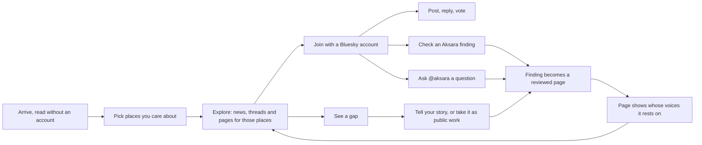
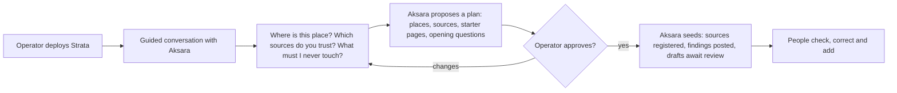
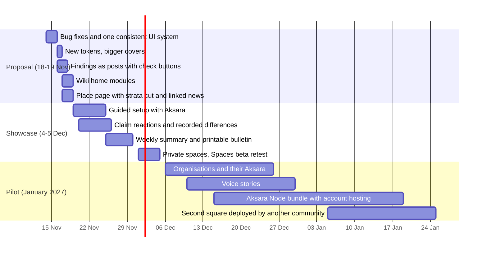

# Vision, ideas and roadmap

14 November 2026. Agreed with the owner in the BUDAYA GO! planning session. This is a record of direction and ideas. Nothing here is shipped until the [feature ledger](../foundation/feature-ledger.md) says so. See also the [build plan](../competition/budaya-go-plan-2026-11-14.md) and [design direction](../product/design-direction-2026-11-14.md).

## The whole system

Three layers, described in the [README](../../README.md#how-it-fits-together): the public square on the surface, shared knowledge in the middle, and private originals in custody underneath. Things move up a layer only when a person decides. Use the layer names quietly, as a way to draw the system. They are not a slogan.

ETNOS today is a managed site with a managed steward and seeded public sources. That is the pilot. Institution-run Aksara Nodes and hosted accounts come after, through real partnerships.

## Decisions

- **Everything in the stream is a post.** Votes, replies, threads and saves stay. Findings, gaps and page cards differ by small marks only.
- **Reply, vote, save and share stay as icons.** Check buttons on findings keep their words.
- **Places are destinations. Explore is personal.** Explore shows news, threads, things to check and pages from the places you follow, and everything when you follow none.
- **You choose your places in the app.** Never inferred from where your account is hosted. The choice is private.
- **Many squares, one engine, portable accounts.** ETNOS is Papua's square. Strata is what other peoples deploy for their own, with their own name, art, languages, sources and rules. Accounts work across squares. Squares reading each other's public posts depends on AT publishing, which is off today.
- **Nothing Papua-specific is hardcoded in the engine.** Place names, the news desk and cover art become deployment settings.
- **Aksara's posts are typed blocks.** A source list, a claim check, a poll proposal, a comparison, a gap, a page draft. The app renders each with a real component wired to a real action. No free-form generated interface, and no mockups.
- **Aksara's visible work is the seed, and it must be true.** People arrive, watch it work on their knowledge and get invited in. Cap its volume, label it, and show receipts.

## Journey: first visit to first contribution

## Journey: a community sets up

## Roadmap to January 2027

Dates are targets, not commitments.

## Ideas worth building

### It would be a pity not to

- **A public "what Aksara did today" log** for each community, in plain words.
- **A receipt on every Aksara post:** what it read, which model ran, and on whose permission. One tap.
- **"Ceritakan" by voice.** Record a story on a phone. Aksara transcribes it and the teller approves the text before anything is posted. Meta's Omnilingual ASR is a candidate for low-resource languages; its licence, language coverage and where audio is processed all need checking first. Voice from a protected community must never leave that community's custody without consent.
- **A weekly printable bulletin** for church notice boards and kampung boards. The sitewide Aksara drafts it, a human editor approves it, and it is posted as a downloadable one-page PDF.
- **A shareable card** for every wiki page and place, with the print and the voice bar.
- **Follow a gap** and be told when someone fills it.
- **An in-app "Tentang ETNOS" page** with the same status labels as the README.

### Wilder

- **The cover print comes into focus.** A place's lower layers render as coarse pixels and sharpen as sources and stories are added.
- **Disagreement on a timeline.** Where accounts differ, show who said what and when.
- **A steward you can fork.** A new community copies another's Aksara setup, with its sources, rules and tone, and adjusts it.
- **Elders' line.** A phone number to call and leave a story. No app needed.
- **The news engine moves into Strata** so any community can register its own trusted sources and get a local news desk.

### Later, with partners

- Institution-run Aksara Nodes holding archives, language corpora, artefact scans and datasets, with reviewed public copies published to the wiki.
- Organisations verified by domain, each with an Aksara that answers questions and takes public work in the open.
- Collections and research datasets shown on place pages.
- A typed knowledge graph (entities, records, statements, perspectives) following the Knowledge Recovery Pipeline. Categories remain lenses over sources.
- A Pasar community type for local sellers, with disclosed paid placement kept out of conversation and knowledge.

## Guardrails that hold across all of this

- People decide. No model gets the last word.
- Measure community value, never agent activity.
- A community is not automatically one institution, one voice or one representative.
- The right not to digitise is part of sovereignty.
- Coverage is labelled *belum terindeks*, never as a score.
