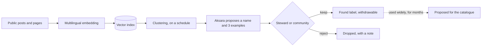

# Organising knowledge: labels, found themes, time

15 November 2026. For the owner and whoever builds next. It follows the [commons model](commons-model-2026-11-15.md) and the [sitemap and community catalogue](sitemap-and-communities-2026-11-15.md). Proposals are marked. Sources checked today are marked "checked". The rest are from memory and need a second look before they go into the proposal.

## The worry, stated plainly

A catalogue is outside labelling. We wrote the list, people arrive and find themselves sorted. That is the thing we set out to avoid.

Two rules keep it honest.

1. **The catalogue stays thin.** It answers where, which language and which broad domain. It comes from sources anyone can check. It never names a people.
2. **Themes come from what people write.** Posts are grouped by similarity. Aksara proposes a name with three example posts. A steward or the community keeps it or throws it away. A kept theme is a label like any other, and it can be withdrawn.

A label goes on a post, a page, a room or an organisation. It never goes on a person.

## Label families

A family gets in when it has a citable source, stays near a dozen entries at its top level, is something people would browse by, and classifies no person.

| Family | Entries | Source | State |
| --- | --- | --- | --- |
| Tempat | 7 wilayah adat, 6 provinces, 42 regencies and cities | Bappenas planning documents, BIG | Live, with a map |
| Bahasa | 256 | Glottolog 5.3 | Live |
| Topik | 11 | Our own list | Live. Weakest source. |
| Jenis lembaga | 8 | Our own list | Live |
| Ranah budaya | 10 | UU 5/2017 Pasal 5 (checked) | Added to the catalogue file today. A steward loads it from Studio. |
| Perantauan | A few places outside Papua | On request | Proposed |

**Ranah budaya** is the ten objects of cultural advancement in Indonesian law: tradisi lisan, manuskrip, adat istiadat, ritus, pengetahuan tradisional, teknologi tradisional, seni, bahasa, permainan rakyat, olahraga tradisional. Budaya GO! sits under the same law, so judges already think in these words. They map onto UNESCO's five domains of intangible heritage (2003 Convention, Article 2.2). "Seni" and "Bahasa" reuse the lenses we already had.

**About the seven wilayah adat.** The RIPPP 2022–2041 says Papua "dikenal dengan 7 wilayah adat dengan karakteristik sosial budaya yang berbeda" and plans by them (checked). A ministry official told the Jakarta Post in 2016 that the grouping was used by the Dutch administration in 1934 (checked, one press source). So these are planning regions with a colonial administrative history. They're useful and widely used in Papua. We keep the line "Wilayah acuan, bukan batas tanah adat" on every one of them, and we don't present them as peoples.

**Left out on purpose**

- **Suku.** Census categories and outside lists disagree. A people names itself by starting its own community.
- **Kampung and distrik.** Thousands of entries. A community writes its kampung as free text under its regency. When the same name appears often, it becomes a candidate entry.
- **Named eras.** Periodisation is an argument. The timeline uses plain date ranges.

**Properties, kept apart from labels**

Kind of material, rights and protocol, language of the text, and how settled something is. These describe one item. They are filters, and none of them gets a page.

## Found themes

Half of this exists. The engine has an offline clustering path for **sources** in a public community: a steward exports a snapshot, `packages/clustering-cpu` fits it with FAISS on a CPU, and the engine accepts the result only if the public read-set hash still matches (`src/clustering.ts`, `test/clustering.test.ts`). It powers "related sources". See [agent seeding and clustering](agent-seeding-and-clustering-2026-11-11.md).

What's proposed here is the same discipline for **posts and pages**, plus a naming step and a place to see the result.

- **Input.** Only records that are public at that moment. A hidden, deleted or withdrawn record leaves the index in the same transaction that hides it. This needs the same tests as search.
- **Embedding.** `@cf/baai/bge-m3` on Workers AI is multilingual (checked). How well it handles Papuan Malay and mixed-language posts is unknown. We test on a hand-labelled sample of 200 posts before trusting it.
- **Index.** Cloudflare Vectorize holds up to 20 million vectors of up to 1,536 dimensions per index (checked). At our size a plain scan inside the Durable Object would also do.
- **FAISS.** It is a native library and does not run inside a Worker. The existing path already treats it as an offline job with a receipt. Posts would reuse it: export the public snapshot, fit, import the receipt. A changed read-set refuses the import, so a post withdrawn between export and import can never be labelled.
- **Clustering.** HDBSCAN over reduced embeddings, the BERTopic recipe (Grootendorst 2022, arXiv 2203.05794). It leaves outliers unassigned, which suits us.
- **Honesty floor.** Under about 300 public posts a clustering is noise. The page says "Belum cukup percakapan untuk melihat tema" and shows nothing.
- **Naming.** Aksara proposes. A person decides. The proposal shows the posts it was drawn from. A cluster made mostly of one author's posts is never proposed.
- **Never.** No clustering of people. No theme about a named person. No private room enters the public index. A private room may get its own index later, visible only inside it.

## What's missing from the model

The commons model asks four questions: who, what kind of thing, where it belongs, how settled it is. Two more are needed.

5. **When is it about?** Nothing carries a date it refers to. A page on the 1969 Act of Free Choice and a page on sago seasons look the same to the engine. The history view can't exist without this.
6. **Under whose protocol?** Rights sit on sources only. A page, an image or a recording needs its own line: who may see it, who may reuse it, on whose say.

Other gaps, in order of how much they'd help:

- **Pages have no kind.** A person, an event, a place below regency, a practice, a work and an organisation are all "a page". Six page kinds would let a page show the right fields and let the timeline pick out events. Proposal: orang, peristiwa, tempat, praktik, karya, lembaga.
- **Pages don't link to each other with meaning.** A small set of typed links would do: bagian dari, tentang, bertentangan dengan, menggantikan, terjemahan dari.
- **One thing, many names.** Contexts have aliases. Pages don't. A river or a clan house has names in several languages, and each name belongs to its speakers.
- **Accounts that stay plural.** The strata read as a ladder toward "reviewed". Two clans can hold two accounts, and both stay. Add a state beside the ladder: berdampingan, recorded side by side, each with its own sources and its own reviewers.
- **Questions as an entry point.** "Celah" is computed. The questions people ask and nobody has answered are the best map of what the commons should learn next. Give them a page.
- **Kept items have no shelf.** Already in the plan as the collection view.

## Setting up a new commons

Proposal. The aim is that another community talks with Aksara, checks a draft and has a working set of labels in an afternoon.

A catalogue file already holds sources, notes and entries with parents. Three additions make it portable:

1. **Families declared in the file.** Each with a name, a source and how it is browsed: as a tree, as chips, as a searchable list, or on a map. Today the web app knows Papua's families by name. That knowledge moves into the file.
2. **A map file beside it.** Outlines for one level of places. Ours is `apps/web/src/site-map.json`.
3. **Defaults that work anywhere.** Administrative places from the national mapping agency, or geoBoundaries where there is none (Runfola et al. 2020, PLOS ONE). Languages from Glottolog inside the map's bounds. Cultural domains from the national culture law, or UNESCO's five domains. Our eleven topics as a starting list to edit.

The conversation, in order: where are you, which levels of place matter, which languages, which domains, which topics. Aksara drafts the file and shows every entry with its source. The steward edits and loads it. Customary and political regions come first. Everything else can wait for people.

Aksara can't yet draft a catalogue. The loader, the idempotent import and the "never rewrite what a steward edited" rule exist.

## Community kinds

A kind says **how people gather**. Labels say **what about** and **where**. That split keeps the list short. "Klub baca Nabire" is the kind Belajar with the labels Buku & tulisan and Nabire. "Hip hop bawah tanah" is Minat with Musik & seni.

The eleven kinds are in the catalogue file with defaults, and the create form now asks "Komunitas seperti apa?". A kind is also a label, so its page lists every community of that kind.

| Kind | How people gather | Examples | Default door |
| --- | --- | --- | --- |
| Tempat | They share a place | Nabire, Obrolan Mee Pago, Mahasiswa Papua di Yogyakarta | Open |
| Minat | They like the same thing | Film Papua, hip hop bawah tanah, Persipura, gim | Open |
| Belajar | They learn and practise together | Belajar bahasa Mee, klub baca, belajar ngoding | Open |
| Karya | They show work and give feedback | Seni rupa masa kini, musisi, penulis muda | Open |
| Tanya jawab | Questions get answered with sources | Tanya sains, tanya peneliti, tanya hukum | Open |
| Kabar & peluang | A notice board | Beasiswa & lowongan, acara | Approval |
| Pasar & usaha | They buy, sell and trade | Pasar Mama-Mama, kopi Papua | Open |
| Lembaga | A room that belongs to a body | A campus, a congregation, an office, an NGO | Approval |
| Kerja bersama | They have a goal | Forest watchers, a festival committee, a research team | Approval |
| Musyawarah | They deliberate on one issue and record the result | Air bersih di Dogiyai, usulan kampung | Approval |
| Lingkar | They belong to each other | A clan, a people, speakers of one language, alumni | Members only, made by its own members |

The list follows a typology used in community studies: communities of place, interest, practice, action and circumstance (from memory, to re-check). Lembaga and Musyawarah are added because organisations and public deliberation behave differently on a platform.

Not kinds: families, couples, friendships. Those are private messages.

**Seeding.** Seven Tempat rooms, one per wilayah adat, run by the node steward until local moderators take over. Everything else is started by its own people.

## Topics

Topics now sit in three groups so no list runs long. New ones are marked.

| Group | Topics |
| --- | --- |
| Hidup bersama | Pemerintahan, Hak & keadilan, Kesehatan, Pendidikan, Penghidupan, Hutan & tanah, Laut & pesisir, Iman & gereja, Kerja & beasiswa (new), Jalan, listrik & internet (new), Iklim & bencana (new), Pemuda (new) |
| Pengetahuan | Sejarah, Bahasa, Sains & alam (new), Teknologi & pemrograman (new), Riset & data (new) |
| Budaya & hiburan | Musik & seni (now names hip hop and contemporary art), Film & layar (new), Buku & tulisan (new), Olahraga (new), Makanan & masak (new), Hobi & buat sendiri (new) |
| Ranah budaya | The ten objects in UU 5/2017 |

Open: "Iman & gereja" leaves out Muslim communities on the coast, such as Fakfak and Kaimana. "Iman & agama" would be fairer. A steward can rename it in Studio.

The found-themes path is how the list grows. When people keep posting about something that has no topic, the theme shows up, and a steward can keep it.

## Voices that can reach policy

Proposal. Today a poll shows totals after five answers, labelled "dari N penjawab di ETNOS".

**What a result can honestly be.** A signal from the people who answered. It is never a survey of a population. Every export says so in its first line.

**A result page worth citing.**

- The question, the options, N, the dates it ran and who could answer.
- A breakdown by place or label only where each cell has at least ten answers. No cross-tabs. In a kampung of eighty people, a table is a list of names.
- A permanent link and a hash of the result, so a quoted figure can be checked.
- Export as CSV and as one printable page.

**Anonymity, in three levels.**

1. *Today:* the node knows who answered what and never shows it. You trust the operator.
2. *Next:* keep "this account has answered" and the running totals, and store no row that ties an account to a choice. A database reader can't recover a vote. The cost is that nobody can change an answer or audit a single vote.
3. *Later:* anonymous credentials, so even the "has answered" record can't be tied to a person. This is research-grade work. We don't claim it.

**One person, one voice.** We can't prove residency without identity papers, and we shouldn't collect those. Honest options: account age and community membership as a floor, and later an organisation vouching for its members without naming them.

**Deliberation over polling.** Polis lets people write short statements and mark agree, disagree or pass. It then shows where groups differ and which statements every group accepts (Small et al. 2021, from memory). That fits the Musyawarah kind and reuses the clustering path. The output is a list of statements with broad support, which is more useful to an office than a percentage.

**A real door into policy.** Indonesia's planning law has a bottom-up forum, Musrenbang, from kampung to regency (UU 25/2004, from memory). A Musyawarah room could export its result in the shape of a Musrenbang proposal: the problem, the place, who is affected, what is asked. That is a document an office already knows how to receive.

**Safety.** Some questions put people at risk in Papua. Stewards decide which topics may be polled in public. Results carry no time finer than a day and no place finer than a regency. Raw rows are never exported.

## Research and open science

Proposal.

- **Literature gaps.** OpenAlex is an open index of scholarly works with a free API. For each language, place and topic we can count published works by year and set that beside what the commons holds and what people ask. "Bahasa X: three papers, none since 1998, eleven questions here" is a research agenda nobody else has.
- **Questions as an agenda.** Unanswered questions, grouped by theme, published each month for researchers.
- **Tanya peneliti.** A researcher answers questions in a Tanya jawab room for a week. The answers become page proposals.
- **A project page for research about a community.** The question, who consented, what data is collected, and what comes back to the community and when. This puts the CARE principles into one form.
- **Papers in plain Indonesian.** Aksara drafts a summary of an open-access paper. A person checks it. The summary links the original and carries its licence.
- **Citable pages.** A reviewed revision already has a digest. Add citation export and, later, a DOI for a frozen revision.

## What decision models could do

Clef-flash is already wired in `src/decisions.ts` as a pilot that compares a post with news titles. Jev is a similar kind of model: it answers typed questions (yes or no, pick one, score) and can decline. Neither writes prose, which makes them cheap and easy to check.

Uses that fit organising knowledge:

1. **Suggest a kind and labels** for a new community or post, from the catalogue, with "none of these" allowed. The person accepts or dismisses.
2. **Same, related or different?** For near-duplicate pages, and for kampung names spelled five ways.
3. **Does this source support this sentence?** Yes, no, or can't tell. This is the base of claim checks.
4. **Where should this question go?** Pick a community or an Aksara.
5. **Does a person need to look now?** For sorting what comes in.

Rules: the model proposes and a person decides. Every decision keeps a receipt. A score is not a probability until we've measured it against answers people gave. The first experiment should be the first use above, because every accept or dismiss gives us that measurement for free.

Jev's licence, cost and data handling are still unverified.

## Terrain tiles

- **Today:** EOX Terrain Light, loaded from EOX with credit. Free to use, no uptime promise.
- **Outlines:** Badan Informasi Geospasial, credited on the map. Decided.
- **Alternatives:** Natural Earth shaded relief is public domain and fine up to the zoom we use. OpenTopoMap is CC BY-SA with a fair-use limit. Stadia's Stamen Terrain needs an account and has usage tiers. Esri's hillshade has its own terms.
- **Our own:** the map is one fixed picture. We can render it once from open elevation data (Copernicus DEM, 30 m) with a hillshade and our own ink treatment, and ship it as a single image of about 150 KB. That is half a day of work and removes the outside dependency. It also lets the terrain match the engraved look of the place covers.

## Ideas, from sensible to strange

Each is a proposal. None is built.

1. **Lini masa with real dates.** Give pages and kept items a "when" with a precision: day, year, decade, century, or "sejak dahulu". Draw Papua's history as one core sample. Thin periods are drawn coarse and ask for contributions.
2. **A calendar that isn't Gregorian only.** The sky is already on the home page. Add seasons people name themselves: wind, tides, sago, fruiting, fish runs. A community records its own calendar, and the home page shows "sekarang musim…" for a chosen place. Knowledge about nature and the universe is one of the legal domains above.
3. **Returning what's held elsewhere.** Recordings and photographs of Papua sit in archives abroad, such as PARADISEC for language recordings. A kept item can point to one with its rights position and a note on who may hear it. The index comes home even where the file can't.
4. **Aksara's correction ledger.** Every Aksara keeps a public list of what it got wrong and who corrected it. Trust in an agent then rests on its record.
5. **Who read us.** Agents read the commons over MCP. Show each community a plain log of which agents read its public pages and for whom. Data governance people call this the "Authority to control" part of the CARE principles (Carroll et al. 2020).
6. **A bulletin that leaves the internet.** The weekly card as one printable A4 and one three-minute audio file, sized for WhatsApp and community radio. Most of Papua won't open a web app. The commons should reach them anyway.
7. **Kampung by accretion.** Free-text kampung names, clustered by spelling and regency, become a gazetteer made by residents. Nobody imports a list.
8. **A question travels.** Someone asks in Nabire. The regional Aksara can't answer, so it asks the Saireri Aksara, in public, and the thread shows the hop. The network of Aksaras becomes visible as a conversation.
9. **Listening before reading.** A wiki page opens with its voice bar. For oral traditions, the recording is the page and the text is its note.
10. **A second commons as a test.** One other community loads its own catalogue and map. If that takes more than a day, the engine still has Papua baked in.

## Order

1. Done today: the regency map, communities on place pages, ranah budaya in the catalogue, a period on wiki pages, and `/lini-masa`. The timeline is empty until reviewers set periods on real pages.
2. "When" on kept items and news. Lini masa by place, so a place page can open its own history.
3. Community kinds and the wider topic list are in the catalogue file. The create form asks for a kind. Next: families declared in the file, so the directory reads them.
3a. A suggested kind and labels from a decision model, with accept and dismiss recorded.
4. Page kinds and typed links.
5. The collection view, with protocol on each item.
6. Found themes, once there are enough public posts to cluster.
7. Aksara drafting a catalogue in a setup conversation.

## Sources

From memory, to re-check, added later the same day: the place/interest/practice typology of communities; Small et al. 2021 on Polis; UU 25/2004 on Musrenbang; OpenAlex terms.

Checked today:

- UU 5/2017 tentang Pemajuan Kebudayaan, Pasal 5: https://dapobud.kemenbud.go.id/docs/dasar-hukum/uu-5-2017.pdf
- Rencana Induk Percepatan Pembangunan Papua 2022–2041: https://badanpengarahpapua.go.id/wp-content/uploads/2026/01/Buku-RIPPP-Tahun-2022-2041.pdf
- Jakarta Post, 5 September 2016, on the seven areas and 1934: https://www.thejakartapost.com/news/2016/09/05/govt-shifts-to-anthropological-approach-in-developing-papua
- Cloudflare Vectorize limits: https://developers.cloudflare.com/vectorize/platform/limits/
- Workers AI bge-m3: https://developers.cloudflare.com/workers-ai/models/bge-m3/

From memory, to re-check: UNESCO 2003 Convention Article 2.2; Grootendorst 2022 (arXiv 2203.05794); Carroll et al. 2020, Data Science Journal 19:43; Runfola et al. 2020, PLOS ONE 15(4) e0231866; PARADISEC holdings for Papua.
