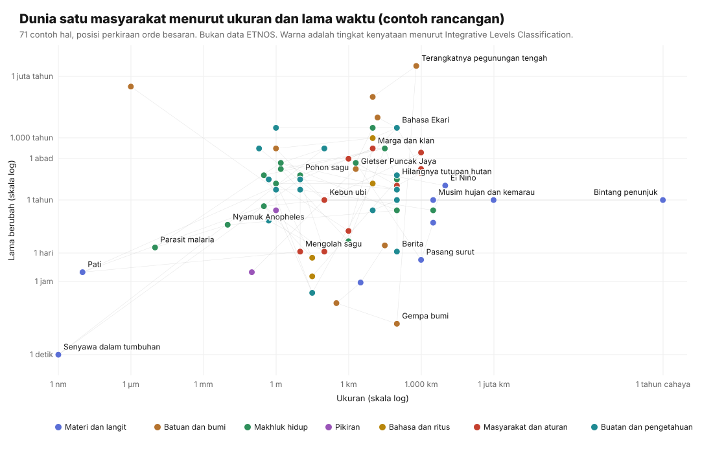

# A model of a people's world, the starter dataset, and the knowledge map

20 November 2026. Design research; no product code changed. Part of the observatory redesign; see [README.md](README.md). Marks: *(proposal)*, *(not measured)*, *(to verify)*. Names follow `../naming.md` and sentences follow `../voice.md`. A morning draft of 20 November proposed fifteen domains on a ring; it was not merged, and section 4 says why. The earlier notes ([epistemic-multiplex](../research/epistemic-multiplex-2026-11-19.md), [knowledge-ontology](../research/knowledge-ontology-2026-11-18.md), [community-dictionary](../research/community-dictionary-2026-11-19.md)) were read for context. Where this note disagrees with them, it says so and gives the reason. Sources are at the end.

A working prototype of the interface is saved as [`docs/assets/peta-pengetahuan-prototipe.html`](../assets/peta-pengetahuan-prototipe.html); open it in a browser. The companion note [data-observatory-2026-11-20.md](data-observatory-2026-11-20.md) covers datasets, viewers, access and deployment. Its 71 items are design examples with order-of-magnitude positions. They are not ETNOS data and have not been checked by anyone in Tanah Papua.



## 1. In one paragraph

ETNOS should hold everything that a people has learned about its world, from the starch in a sago trunk to the stars used for direction, and connect each item to what modern science knows about it. The unit of this knowledge is a **thing in the world** (*Hal*), such as a plant, a practice, a season, a law or a story. It is not a document, a discipline or a category. Every thing gets three coordinates that anyone can estimate and that science already uses: **size**, **pace** (how long it takes to change) and **level of organisation** (from molecules to knowledge). Every statement about a thing gets a **depth** (what it is, how it is done, what rules govern it, what it means) and a **voice** (who says it). Published classification schemes are **lenses** over the same things, not the structure itself. The schemes are the Integrative Levels Classification, the Outline of Cultural Materials, the Intercontinental Dictionary Series, OpenAlex topics, nature's contributions to people, the UU 5/2017 cultural objects and a school curriculum, plus the community's own scheme. Crosswalks between them are computed with embeddings and checked by people. Relations form a typed hypergraph, and a prerequisite graph is only used for learning paths. On top sit **synthesis notes** that set what people say beside what science records and state what it means now. The interface is a three-dimensional map of points that can be rearranged by size and pace, by level, by field of science or by need. A new deployment receives all of this pre-computed from public sources in one build.

## 2. What the owner asked

From the two conversations on 20 November, lightly edited:

- Seed a new deployment's knowledge base with as much public data as possible. Find the right default for onboarding.
- Make setup simple: a prepared set of questions or a conversation, and a coding agent that sets everything up with free-tier Workers AI and keyless services.
- Clear labelling should not mean "outside voice" written everywhere.
- Cover bioculture as one thing: biodiversity, plants and animals, ocean, sky, land, technology over time, the science behind everything, history, stories and governance. The forest is a supermarket, a pharmacy and everything in between.
- Cover any research at any scale that matters to a people and their place, from molecules and organisms to epidemiology, psychology, economy, network science and relationships to the unknown.
- It does not have to be a ring. A 3D constellation of points that people can explore is fine. Go further with the interface and with the underlying primitive, which should generalise.
- Is the default general enough, usable enough and understandable enough? Could a researcher use it? Is it arbitrary? It should cover everything a first people could have learned over time, then connect that to modern science and say what it means.
- Marble's curriculum graph is an inspiration, but a DAG may not be the right primitive.
- Do the research, including philosophy of knowledge organisation. Consolidate into one document with sources, pre-computed embeddings and the source list from the earlier answer.
- The docs and the code follow the owner and this work. Check the code for what exists now and read the docs for context only.

## 3. What the code holds today

These facts were read in `apps/web`, `src` and `scripts` on 20 November (deploy `2026-11-20h`).

- **The knowledge model is already the right core.** `src/knowledge-model.ts` keeps entities (*Hal*), assertions (*Pernyataan*) and witnesses (*Saksi*). Every assertion rests on an excerpt. Access is checked at every read, and agents may not propose statements about persons. Twelve classes are defined, along with eight voices and three epistemic layers (*jejak, tuturan, tafsir*).
- **The public graph uses three of the twelve classes.** The built `graph.json` has 110 entities (63 places, 38 languages, 9 groups) with 84 statements from 469 excerpts.
- **The analysis code is real.** `src/knowledge-graph.ts` has Leiden clustering, a rewiring null model, strategic roles, Hill numbers, link prediction and a deterministic layout. `scripts/observatory/build-knowledge-portal.ts` writes byte-identical files from the same input.
- **The 3D engine exists.** `apps/web/src/KnowledgeGraph3D.svelte` draws one canvas with a loop that stops when nothing moves, a fixed force layout and lower pixel ratio on phones. The wiki front (`WikiFront.svelte`) offers three lenses: *Hubungan*, *Kelompok* and *Belum diketahui*.
- **Domains are keyword lists.** `scripts/observatory/build-map.mjs` tags items with 14 domains and with cultural forms through regular expressions.
- **A deployment is written by hand for Tanah Papua.** The values live in `site-place.ts`, `site-branding.ts`, `papua-atlas.json`, `src/catalogues/tanah-papua*.json` and `seed/`. `site-place.ts` already asks each deployment to declare its own star figures, which is the right pattern for the whole profile.

The engine and its rules are sound. Three things are missing: a model of the world beyond places, languages and groups; a way to fill it from public data for any place; and a front page that shows a world rather than a network.

## 4. Why the morning draft is replaced

The morning draft proposed fifteen domains on a ring. It fails the owner's tests in four ways.

1. **It was arbitrary.** The fifteen were a judgement that mixed levels of reality (substances, living kinds) with human categories (rules, work). No researcher uses that list, so nothing coded with it could be compared with anything else.
2. **It forced every item into boxes.** A sago swamp is food, land, law, ecology and story at once. Partitions make people argue about which box is right, and they hide exactly the links that matter.
3. **The ring was one culture's order.** Laying knowledge on a circle from physics to philosophy is how science and libraries see it. Descola's comparison of how peoples relate to the non-human world shows that the line between nature and culture is one way of seeing among several.
4. **It was another scheme beside the 18 post topics.** A third hand-made list would confuse everyone.

The fix is to stop authoring a taxonomy. Measurable coordinates set the positions. Published schemes, each with an owner and a licence, supply the codes. Only the community's own arrangement is local, and it belongs to the community.

## 5. The model

### 5.1 The unit is a thing in the world, as phenomenon-based classification recommends

Knowledge organisation distinguishes classifying by **discipline** (who studies something) from classifying by **phenomenon** (what is studied). In a phenomenon-based scheme, each phenomenon has one place of its own, and it is the disciplines that get scattered. The Integrative Levels Classification (ILC) by Claudio Gnoli is the working example of this approach.

ETNOS already made this choice on 18 November, when the owner asked that map nodes be the entities of a people's world rather than documents. This note keeps the existing *Hal* and its twelve classes and adds coordinates, depth and lenses to it. A phenomenon can be a being (sago palm), a process (pig feast, flood, glacier retreat), a practice (processing sago), an institution (customary land right) or an idea (a counting system). The twelve classes already cover these.

### 5.2 Three coordinates that anyone can estimate place every thing *(proposal)*

Every thing gets three numbers. Each is stored as a range with its basis: a rule, a model estimate, a measurement or a person.

| Coordinate | What it measures | Stored as | Examples |
| --- | --- | --- | --- |
| **Size** (*ukuran*) | The typical spatial extent of the thing | log10 of metres | starch molecule about −8, sago palm about 1, Lake Paniai about 4, the central range about 6 |
| **Pace** (*lama berubah*) | How long the thing takes to change, cycle or happen | log10 of seconds | earthquake about 1.5, processing sago about 5 (a day), a season about 7.5 (a year), a clan about 10, mountain building about 14 |
| **Level** (*tingkat*) | Its level of organisation, from matter to knowledge | ILC main class, a to y | molecule f, rock i, organism m, population n, language q, ritual r, community s, polity t, artefact w, knowledge y |

None of these is new. Earth and ecological sciences have long plotted phenomena on log axes of space and time, as **Stommel diagrams** in oceanography and climate science and as the space-time scale diagrams of vegetation change by Delcourt and colleagues. Such plots show where each phenomenon lives in space and time because of its characteristic time and extent. Hierarchy theory treats landscapes as levels, each working at its own time and space scale. The scale plot is therefore a known scientific instrument, not a metaphor.

The third coordinate comes from **ILC**, which orders its 25 main classes by integrative level: forms, spacetime, branes, energy, atoms, molecules, continuum bodies, celestial bodies, rocks, land, genes, bacteria, organisms, populations, instincts, consciousness, language, rituals, communities, polities, enterprises, technologies, artefacts, artworks and knowledge. ILC2 was published as linked data in SKOS in 2019, so it can be loaded as data. For display, the 25 classes fold into seven colour bands *(proposal)*:

| Band (interface label) | ILC classes | Covers in a people's world |
| --- | --- | --- |
| Materi dan langit | a to h | substances, water and air, sun, moon and stars |
| Batuan dan bumi | i, j | rock, soil, land, lakes, glaciers, earthquakes |
| Makhluk hidup | k to n | genes, microbes, plants, animals, populations, ecosystems |
| Pikiran | o, p | instinct, feeling, dreaming, memory |
| Bahasa dan ritus | q, r | languages, words, rituals, feasts, worship |
| Masyarakat dan aturan | s, t, u | kin, villages, government, law, markets, livelihoods |
| Buatan dan pengetahuan | v, w, x, y | technology, objects, art, stories, ways of knowing |

These three coordinates answer the owner's question about scale directly. Molecules, organisms, populations and societies sit at different sizes, paces and levels, so the whole range from a compound in a leaf to a law is visible in one picture. Epidemiology is the study of disease at the population level. Economics studies enterprises and exchange, and psychology studies instinct and consciousness. Each lands where its phenomena are, without a special category.

Empty regions of the plot are information. The figure at the top shows that the design sample has almost nothing between one millimetre and one metre that changes within hours, and nothing about the sea at the scale of decades. In a real deployment, these holes are where the question list starts.

### 5.3 Every statement gets a depth: what it is, how it is done, the rules, and what it means

Fikret Berkes describes traditional ecological knowledge as a **knowledge-practice-belief complex** with four interrelated levels:

1. local knowledge of species and places;
2. resource management systems, which join that knowledge with practice;
3. social institutions, meaning the rules and codes of behaviour;
4. worldview, meaning religion, ethics and belief.

ETNOS adds this as a field on each assertion, called **depth** (*kedalaman*) *(proposal)*. The four values are *apa* (what it is), *cara* (how it is done), *aturan* (who decides and by what rule) and *makna* (what it means). The field sits beside the existing epistemic layer (*jejak, tuturan, tafsir*), which records the kind of evidence. Depth records which part of the complex the statement belongs to.

Depth answers the owner's demand that the model cover everything a people has learned and not only cultural artefacts. A sago palm has *apa* statements (where it grows, how long it takes to mature) and *cara* statements (how the pith is beaten and washed). It also has *aturan* statements (whose grove it is) and *makna* statements (the stories in which sago appears). Science usually fills the first depth only. A people usually holds all four. The depth chart shows that difference at a glance.

### 5.4 Voice stays, and each voice is checked inside its own system

Voice is already in the code. Two ideas fix how voices meet:

- The **multiple evidence base** approach treats Indigenous, local and scientific knowledge as parallel systems that each produce evidence. Each system is evaluated mainly within itself, not across systems. In ETNOS, a speaker's account is checked by the community, and a measurement is checked against its method.
- **Situated knowledge.** Haraway argued that objectivity comes from partial, located perspectives rather than a view from nowhere. Every view in ETNOS names its voices, including the scientific ones.

### 5.5 Published schemes are lenses over the same things *(proposal)*

A scheme is a named list of concepts with an owner, a licence and a version. ETNOS loads each scheme as data, embeds every concept, and gives every thing a soft code in each scheme (section 5.6). A reader picks a scheme, and the map regroups by it. The structure underneath does not change.

| Scheme | What it is | Size | Why it is here | Access |
| --- | --- | --- | --- | --- |
| Integrative Levels Classification (ILC2) | Phenomenon-based classification by level of reality | 25 main classes, facets | The level coordinate; neutral across disciplines | Schedules free online; SKOS since 2019; licence not stated *(to verify)* |
| Outline of Cultural Materials (OCM, HRAF) | The standard subject index for ethnography, used for 80 years to index eHRAF | 90+ major categories, 700+ subcategories, three-digit codes | Researchers can compare a deployment with every culture in eHRAF | Category list public; eHRAF texts by subscription; reuse terms *(to verify)* |
| Intercontinental Dictionary Series and Concepticon | Cross-linguistic concept lists; IDS has 22 chapters and 1,310 concepts | 22 semantic fields | Ties every word in the community dictionary to a world domain | CC BY |
| OpenAlex topics | Science's own map: 4 domains, 26 fields, 252 subfields, 4,516 topics | 4,516 | The bridge to modern science and its papers | Data CC0; snapshot free without key |
| Nature's contributions to people (IPBES) | What people get from and make with nature | Material, non-material, regulating | The needs view (section 6) | Published framework |
| UU 5/2017 *objek pemajuan kebudayaan* and UNESCO ICH domains | Legal heritage categories | 10 and 5 | Reports to the Ministry and to UNESCO | Public law |
| Marble open taxonomy | Primary-school micro-topics with prerequisite links | 1,861 topics, 4,003 edges, 9 subjects (v1) | Learning paths from local knowledge to school concepts | ODbL 1.0 and CC BY-SA 4.0; curriculum standards file has its own terms |
| The community's own scheme | The people's categories, in their language | Any | The arrangement that leads in the community's spaces | Under the community's protocol |
| ETNOS post topics (18) | Everyday topics for posts and communities | 18 | Feeds and community discovery | ETNOS |

This answers the questions about arbitrariness and research use. The coordinates are physical. The schemes are published and maintained by others, with known histories. A researcher can export a deployment with ILC, OCM, Concepticon, OpenAlex, GBIF, Wikidata and Glottolog identifiers on every thing and compare it with eHRAF, D-PLACE or another ETNOS deployment. The 18 post topics keep their job for posts and are not used to classify knowledge.

### 5.6 Crosswalks are computed with embeddings and confirmed by people

Coding every thing in every scheme by hand is impossible. Ontology matching research gives a working method. The current best systems retrieve the most relevant target concepts with embeddings first, and then ask a language model to choose among them. Some systems keep the model only for the borderline cases. ETNOS follows the same pattern *(proposal)*:

1. Embed every scheme concept once, using its label and definition, in a multilingual model (section 7.3).
2. Embed every thing using its title, aliases, description and the excerpts behind it.
3. For each thing and scheme, retrieve the top candidates and let a small model choose, with a reason. Gemma 4 on Workers AI is the free default.
4. Store each code with its score, its basis (`embedding`, `model`, `person`) and its scheme version. Low scores and disagreements go to the question list for a steward.
5. Never let a crosswalk change the community's own arrangement. Crosswalk links use match types (exact, close, broader), as SKOS does.

### 5.7 Relations form a typed hypergraph, and a DAG is used only for learning *(proposal)*

Marble's map shows what a prerequisite graph is good at. Every link says what must come first, so a learner can trace everything below a concept. That is the right primitive for **learning**, and the wrong one for **the world**. A forest has cycles: cassowaries eat fruit, spread seeds, and the forest feeds the cassowaries. A feast joins pigs, stones, clans, songs and a season in one event. ETNOS therefore uses three structures, all built from the same assertions:

- **A typed graph** for pairwise relations. The predicate families already in `knowledge-model.ts` (space, groups, life, making, practice, words, stories, custody, knowledge) cover most cases. This note adds four families with public sources:

  | Family | Example predicates | Public source to seed it |
  | --- | --- | --- |
  | Ecology | eats, pollinates, disperses seeds of, hosts, transmits | GloBI (Global Biotic Interactions), open species-interaction data |
  | Substance | contains compound, made of | LOTUS on Wikidata; Macrostrat for rock |
  | Cause and mechanism | affects, explained by, studied by | Papers through OpenAlex; Wikidata "studied by" |
  | Governance | decides, holds rights over, regulated by | Laws and the community; Ostrom's social-ecological systems framework as question templates |

- **Hyperedges** for practices and events. One *praktik* or *peristiwa* links all its parts, which the motif library calls M7.
- **Learning paths** computed as a DAG view. From any thing, ETNOS can compute a path to school concepts (Marble) and to science topics (OpenAlex). For example, processing sago leads to starch settling in water, then to density, then to the school concept of mixtures and separation. This is the bridge for *muatan lokal*.

Disagreement between voices is kept as it is today, with both statements standing. The sheaf-based measure of where voices disagree (M6) stays a research item.

### 5.8 Synthesis notes say what it means *(proposal)*

The owner asked to go beyond connecting knowledge to science, to "what it means". A synthesis note (*Catatan sintesis*) is a short, structured text attached to a thing, a place or a question. It has five parts:

1. **What people say**, with voices and depth, quoting accepted statements only.
2. **What science records**, with papers and measurements as witnesses.
3. **Where they meet, differ or stay silent.** This is the "second eye" motif (M18) in plain words.
4. **What it means now** for health, food, land, safety or rights, stated only as far as the witnesses allow.
5. **What to ask next**, from the question list.

Aksara drafts the note, every sentence carries its witness, and the note is marked as drafted by AI until members check it. The prototype shows one example for the glaciers near Puncak Jaya. Science records them as the last tropical glaciers in the West Pacific Warm Pool, with a thinning rate that rose about 5.4 times during the strong 2015 to 2016 El Niño, and expects them to disappear within about a decade. The note then says plainly that no community statement exists yet, and that only the peoples around the mountain can say what its loss means to them.

### 5.9 Direct answers to the owner's tests

- **General enough?** Yes. The coordinates apply to any thing in any place, and ILC was designed to cover all phenomena. Nothing in the model is specific to Papua.
- **Understandable?** The two most visible coordinates are "how big" and "how long it takes", which a child can answer. Levels show as seven colours with plain names. Depth uses four plain words.
- **Usable by a researcher?** Yes, through standard codes on every thing, a scale and depth profile per deployment, open exports with licences, and comparison across deployments (motifs M14 and M19).
- **Arbitrary?** The coordinates and schemes come from published science and librarianship. What remains a choice is the seven display bands and the four depth labels, and both are documented as choices.
- **Everything a first people could have learned?** Size, pace, level and depth together cover knowledge of matter, land, sky, life, body, mind, language, society, making and meaning. The coverage chart (section 7.4) shows which parts are still empty.

## 6. What a place provides: needs and their sources

The owner's picture of the forest as a supermarket and a pharmacy describes relationships of use. Two frameworks give this view a general shape:

- **Nature's contributions to people** (IPBES) groups what people get from nature into material, non-material and regulating contributions. It was built to hold different cultural ideas of value, including Indigenous and local knowledge.
- **Cultural keystone species** are species of exceptional importance to a people. Garibaldi and Turner list six elements for identifying them, including the variety of uses and the species' influence on language.

The needs arrangement (*Kebutuhan*) groups things by the need they meet: food, water, medicine and care, materials, tools, exchange, protection, learning and stories, and adornment. Flows come from accepted *digunakan-untuk*, *dibuat-dari* and *hidup-di* statements. An item that meets many needs and appears in many words and stories becomes a question for the community about cultural keystones, not a ranking.

Molecules enter through the beings that hold them. LOTUS publishes more than 750,000 referenced pairs of a chemical structure and an organism, hosted on Wikidata. One rule protects the community, and the prototype shows it as a locked link:

> ETNOS never joins a community's statement that a plant is used as medicine to that plant's compound list in any public view, export or API, unless the community decides to publish it. This pairing is what bioprospecting looks for, and it falls under prior informed consent and agreed terms in the Nagoya Protocol (UU 11/2013, PP 56/2022).

## 7. The starter dataset

### 7.1 One profile file drives the whole build

A deployment profile (`deployment.yaml`, section 8.2) holds the boundary, the peoples and their languages, the interface language, the sensitivity settings and the list of sources. The build reads only this file and public sources. The same profile and source snapshots give the same files, as the knowledge portal build already does.

### 7.2 Public sources, by what they add

This list joins the sources named in the earlier answer (wordlists from Lexibank and TransNewGuinea.org aligned to Concepticon, GBIF species, ERA5 normals, TESSERA, OpenStreetMap and Wikidata places, OpenAlex papers, the society's D-PLACE row) with those found on 20 November. Access was read on 20 November.

| Adds | Source | Access | Licence |
| --- | --- | --- | --- |
| Places, peoples, events, items with coordinates; "studied by" links | Wikidata Query Service | Keyless, 60-second query limit | CC0 |
| Rivers, mountains, villages, roads, schools, clinics | OpenStreetMap through Overpass | Keyless, fair use | ODbL |
| Articles near a point; images with licences | Wikipedia geosearch, Wikimedia Commons | Keyless | CC BY-SA and per file |
| Languages near the boundary, endangerment, family | Glottolog | Download | CC BY |
| Wordlists aligned to shared concepts | Lexibank, TransNewGuinea.org, Concepticon, WOLD | Download | CC BY |
| Grammar features | Grambank | Download | CC BY |
| The society's coded ethnography (mostly pre-1950 sources) | D-PLACE, linking 2,000+ groups to languages and environments | Download | Open |
| Species list, vernacular names, records over time | GBIF | Keyless reads | Per dataset |
| Marine species for coasts and seas | OBIS, by WKT polygon | Keyless | Per dataset |
| Who eats, pollinates, hosts or transmits whom | GloBI | Keyless API and archives | Open data |
| Compounds recorded in species present | LOTUS on Wikidata, PubChem | Keyless | CC0 |
| Rock units and their ages at points | Macrostrat | Keyless | CC BY 4.0 |
| Earthquakes and volcanoes | USGS catalogue; Smithsonian volcano data | Keyless; download | Public |
| Daily weather since 1981, 2001 to 2020 climate normals | NASA POWER | Keyless | Public |
| ERA5 history, forecasts | Open-Meteo | Keyless, non-commercial, 10,000 calls a day | CC BY 4.0 |
| Land embeddings per 10 m pixel per year | TESSERA (CC0); AlphaEarth through Earth Engine | Streamed; registered project | CC0; CC BY 4.0 |
| Tree cover in 2000 and loss by year to 2024 | Hansen Global Forest Change | Earth Engine or tiles | CC BY 4.0 |
| Star figures of a people, where one exists and its licence allows | Stellarium sky cultures | Repository | Per sky culture |
| National health and economy context | WHO data service, World Bank indicators | Keyless | CC BY 4.0 |
| Regency statistics | BPS Web API | Free key | Per table |
| Science topics and papers | OpenAlex snapshot (topics, works) | Free download without key; the API needs a free key since February 2026 | CC0 |
| School concepts with prerequisites | Marble open taxonomy | Repository | ODbL and CC BY-SA |
| Levels of reality | ILC2 in SKOS | Download | *(to verify)* |

Three cautions apply to the whole list. Keyless does not mean unlimited, so every response is cached with its date. Licences travel with every derived number as part of its witness. A public dataset may still hold a community's knowledge published without its agreement. Stellarium withdrew two Indigenous sky cultures in 2022 after a complaint about commercial use, so the build asks the steward before using such sources.

### 7.3 Embeddings are computed once per build and reused everywhere *(proposal)*

Each modality has an open model that already turns the world into vectors. ETNOS stores the vectors with the model name, version and dimension, as [knowledge-graph-sota](../research/knowledge-graph-sota-2026-11-16.md) already requires.

| What is embedded | Model | Where it runs | Used for |
| --- | --- | --- | --- |
| Things, statements, excerpts, posts | `@cf/baai/bge-m3` (100+ languages, long context), `@cf/google/embeddinggemma-300m` (768 dimensions, 512 tokens) or `@cf/qwen/qwen3-embedding-0.6b` (1,024 dimensions, 4,096 tokens) on Workers AI | Build step; Worker for new posts | Meaning layout, search, crosswalk retrieval |
| Scheme concepts (ILC, OCM titles, IDS and Concepticon, 4,516 OpenAlex topics, NCP, UU 5/2017, Marble) | Same text model | Once per scheme version | The lenses and crosswalks in 5.5 and 5.6 |
| Photos of plants and animals | BioCLIP 2, trained on 214 million organism images across 952,000 taxa; its embeddings arrange species by ecological traits | Build step, CPU or GPU | Species suggestions under the poster's own name; grouping photos into kinds for naming |
| Recordings of birds, frogs and insects | Perch 2.0 | Build step | Species in consented recordings (M23) |
| Land | TESSERA (CC0) or AlphaEarth | Build step | Place fingerprints, land change, community land categories |
| Locations | SatCLIP location encoder, which gives a vector for any latitude and longitude | Build step | "Places like this one" across deployments; habitat context for points |
| Words | Concepticon concept IDs and CLICS colexification | Download | Comparing words across languages without merging dictionaries |

The text model is the most important choice. It must handle Indonesian, Papuan Malay and English, and work reasonably on Papuan-language words in context. A 200-item test is already planned in [knowledge-graph-sota](../research/knowledge-graph-sota-2026-11-16.md), and the same test should pick the model for crosswalks.

### 7.4 What the build computes

The build writes static files beside today's `apps/web/public/observatory/knowledge/` *(proposal)*:

1. **Things and witnesses** in the existing `KnowledgeSeed` format, all with state `proposed`, except catalogue membership, which the model already accepts from the entry's own text.
2. **Coordinates** for every thing. Rules give size and pace for most classes (a species from typical body size and lifespan in public trait data, a place from its area, a law from its period in force). A small model fills the rest as ranges with a reason. People can correct any value.
3. **Codes** in every loaded scheme, with scores (section 5.6).
4. **The coverage table.** Accepted statements are counted by level band, size decade, pace decade, depth and voice. It is a small table, and it drives the gaps, the question list and the research view.
5. **The question list**, from templates (section 7.5) and from empty cells of the coverage table.
6. **Cross-links** that are known in public science but have no statement in the commons, such as "GBIF records {n} bird species here, and the wiki has local names for {m}".
7. **Learning paths** from things to Marble concepts and OpenAlex topics.
8. **Synthesis drafts** for the things with the most witnesses, waiting for review.
9. **Layouts** for the four arrangements in section 9, with fixed seeds.
10. **A deployment profile vector**: the coverage table plus a SatCLIP vector for the boundary, for comparison across deployments.

Language-model steps stay narrow and reviewable. Fetching, counting, coordinates from rules and layouts are deterministic code.

### 7.5 Question templates work for any community

| Framework | Asks about | Example question in the interface |
| --- | --- | --- |
| Coverage (size, pace, level) | Empty regions of the world | *Belum ada catatan tentang hal yang berubah dalam hitungan jam di {tempat}. Apa yang kamu tahu?* |
| Depth (Berkes) | Missing depth for a known thing | *Kita tahu di mana {makhluk} tumbuh. Siapa yang boleh memanennya, dan kapan?* |
| Ostrom's social-ecological systems framework | Resources, users, rules, interactions, outcomes | *Siapa yang memutuskan kapan dusun sagu di {tempat} boleh dipanen?* |
| Cultural keystone species | Uses, names, stories, whether it can be replaced | *Apakah ada tanaman lain yang bisa menggantikan {makhluk} untuk {kebutuhan}?* |
| Nature's contributions to people | What each place provides | *Apa saja yang diambil dari {tempat} dalam satu tahun?* |
| UU 5/2017 | The ten cultural objects | *Permainan apa yang dimainkan anak-anak di {tempat}?* |
| Science cross-links | What science records and the commons lacks | *GBIF mencatat {n} jenis burung di {tempat}. Burung apa yang punya nama dalam bahasa {bahasa}?* |

Questions about persons are never generated. Questions about sacred places, conflict or restricted knowledge go to stewards first, following [sources-and-sensitive-material](../knowledge/sources-and-sensitive-material-2026-11-16.md). The 18 November idea of routing a question to the people most likely to know is kept. Routing uses membership and past answers in a community, never inferred traits.

### 7.6 Labels stay quiet

Clear labelling is done by placement:

- Each statement shows a small source chip with the publisher and a kind icon (document, measurement, recording, speaker).
- A page written from public sources says so once in its byline: *Ditulis dari sumber publik. Belum diperiksa warga.* The line goes away after members check the page.
- Statements from members carry a quiet mark of their own voice.
- The map can show only what members wrote and checked (*Hanya dari warga*), which is the success measure in `PRODUCT.md`.

No interface text says "outside voice". Voices are named by kind: *ensiklopedia*, *pemerintah*, *penelitian*, *penutur*.

## 8. Onboarding a new deployment

### 8.1 Onboarding starts by asking who is starting the deployment, and for whom

The first questions record who is setting up the deployment and whether the people's own bodies have agreed. ETNOS cannot verify this, so it records the answer and shows it on the *Tentang* page. Without such a statement, the deployment runs in **place mode**: places, nature, news and public data, but no pages that speak for a people and no language spaces.

### 8.2 The questions fit in one profile file

The same file can be filled through a form in Studio or a conversation with Aksara *(field names are a sketch)*.

```yaml
deployment:
  name: ETNOS
  domain: etnos.space
  interface_language: id
  started_by: { kind: organisation, statement: "..." }
  peoples_consent: { status: stated, by: "role of the body, not a personal name", date: 2026-11-20 }
place:
  boundary: { source: wikidata, ids: ["<Wikidata item of the regency>"] }  # or GeoJSON, or a drawn polygon
  coordinate_precision_km: 5
peoples:
  - name: Mee
    own_name: Mee
    other_names: [Ekari, Ekagi, Kapauku]
    languages: [ekar1243]
schemes:
  load: [ilc2, ocm, ids-concepticon, openalex-topics, ncp, uu-5-2017, marble-v1]
  community: none          # or a file with the community's own arrangement
sky:
  figures: community       # or none, or a sky-culture id after consent
sources:
  on: [wikidata, osm, wikipedia, glottolog, lexibank, gbif, obis, globi, lotus, macrostrat, nasa-power, open-meteo, openalex-snapshot, d-place]
  keys: [bps, openalex]    # optional, from deployment secrets
sensitive:
  never_fetch_points_for: [sacred-site, burial, private-garden]
  medicinal_use_with_compounds: private
  conflict_and_casualties: surface-with-sources
```

### 8.3 A form or a conversation fills the profile, and deterministic scripts do the work

Typing a place offers the Wikidata item and its boundary. Choosing it lists the Glottolog languages within or near the boundary. Choosing a language lists the peoples that Wikidata links to it, and the steward confirms or renames them, own names first. Aksara can ask the same questions in conversation. The steward sees the whole file before the build.

A coding agent (Hermes, pi, opencode or Claude Code) runs `npm run deployment:build -- deployment.yaml` *(proposal)*. The agent watches, retries what failed and writes a report. It operates the build but is not part of it, which keeps every run reproducible. The build runs in CI or on a steward's machine, because some agent workspaces cannot reach the data hosts and because Python steps (TESSERA, BioCLIP 2, UMAP, Infomap) cannot run on the Worker. Workers AI does the text embeddings and the narrow model steps.

### 8.4 The steward previews the result and accepts it

The flow has six steps, and only the last one publishes:

1. Who and for whom.
2. The place: boundary and coordinate precision.
3. Peoples and languages, with own names.
4. Sources and schemes, all keyless ones switched on, each with what it adds and its licence in one line.
5. What stays out: the sensitive defaults.
6. A preview with the map, ten sample pages, the coverage table, the question list and the source report. Accepting publishes the starter data as `proposed` things.

### 8.5 Code changes are mostly moving Papua-specific values into the profile

`site-place.ts`, `site-branding.ts`, the atlas JSON, the catalogue, the knowledge seed and the wiki seed become outputs of the build. ETNOS keeps its current files as its first profile, so nothing changes on etnos.space. A second small test deployment outside Tanah Papua shows that the engine is general.

## 9. The interface: the knowledge map as a constellation

The prototype shows the proposal working. It reuses the approach of `KnowledgeGraph3D.svelte`: one canvas, pre-computed positions and no live physics. It adds four **arrangements** (*Susunan*) of the same points, with an animated move between them:

1. **Ukuran dan waktu** (size and pace). Size runs to the right, pace runs upward and level runs into the depth, each on a log scale with labels in human units (1 mm, 1 km, 1 day, 1 century). Turning the map shows how levels separate. This is the default, because it explains itself and shows the empty regions.
2. **Tingkat** (level). The same points are grouped by the seven bands of ILC.
3. **Bidang ilmu** (field of science). The same points are grouped by OpenAlex field. Matter and land go to the earth sciences, ecology to the life sciences, kin and law to the social sciences. This is how one world looks when it is cut up by disciplines.
4. **Kebutuhan** (needs). The same points are grouped by the need they meet. Items without a need sit faintly in the middle.

A fifth arrangement, **the community's own**, appears when the community has one. A sixth, **meaning**, uses the embedding layout that exists today. Switching between arrangements is the strongest single demonstration of the whole idea. One world is shown as a library sees it, as a scientist sees it, as daily needs see it, and as its people see it.

Selecting a point opens a panel with:

- the thing's level, field and need as chips;
- its size and pace in words, for example "about 10 m, changes over about 16 years";
- its description;
- its relations, each one a link, with closed links shown as closed;
- a synthesis note where one exists;
- questions for members;
- a full list of all points for screen readers and slow phones.

Planned additions *(proposal)*:

- **Trace by relation type.** As in Marble, tapping a point and choosing a relation family lights a path: ecology, use, governance, explanation, provenance or learning.
- **Depth and voice filters**, so a reader can see only *aturan* statements or only what members said.
- **Reading levels** (*Ringkas, Lengkap, Peneliti*) from [knowledge-ontology §9](../research/knowledge-ontology-2026-11-18.md).
- **Empty regions** drawn as faint cells in the size and pace arrangement, linked to questions.
- On phones, the first arrangement drawn almost flat (it is a two-axis chart), with level as colour.

## 10. What others have built, and what is missing

| Work | What it does well | What ETNOS adds |
| --- | --- | --- |
| eHRAF and the OCM | Every paragraph of ethnography indexed by subject for cross-cultural research | A living record that the people write and check, coded with the same OCM categories |
| D-PLACE | Links cultural data on 2,000+ groups with languages and environments | Today's knowledge from the people, beside pre-1950 coding |
| ILC | A complete classification of phenomena by level | Applied to one place's world, with size and pace |
| Marble open taxonomy | A beautiful 3D map of what a child learns, with prerequisite paths | Paths that start from a child's own place and language |
| Mukurtu, Local Contexts | Cultural protocols; labels owned by communities | Labels carried into derived data and the map |
| Wikidata and Scholia | Open statements and profiles generated from SPARQL | Voices, depth, consent and community review |
| IPBES, Ostrom's SES framework | Shared frames for nature, people and governance | Frames turned into questions a community can answer |
| Stommel and space-time scale diagrams | The physical scale plot | The same plot for a people's whole world |

As far as these searches found, no tool combines a social platform, a voiced and sourced knowledge graph, a scale-based model of a people's whole world, crosswalks to the standard research schemes, and a starter build from public data for any place. *(to verify further before the proposal states it)*

## 11. Where this goes

The same profile, coordinates, schemes and build serve five directions:

1. **Other First Peoples.** Any people with a boundary and a Glottocode can start. Tanah Papua alone has 428 languages by Badan Bahasa's count.
2. **Any place-bound community**, in place mode: a kampung, a parish, a cooperative, a neighbourhood, a diaspora.
3. **Schools.** Learning paths from local things to school concepts make *muatan lokal* material, and students can answer questions as class projects under the community's rules.
4. **Science on the community's terms.** Coded exports for comparative research, consented contributions to GBIF and Lexibank, and synthesis notes that bring papers back to the people they are about.
5. **Protocol.** Coordinates, depth, voice and the label rules become AT Protocol lexicons beside the voice-post record, so any app can read a community's statements with their rules.

## 12. Order of work

Before the proposal upload on 26 to 27 November:

1. Merge this note, the prototype and the figure. Use the prototype in the video, labelled as a design example.
2. Add `size`, `pace`, `level` and `depth` fields to the knowledge model and fill them for the 110 current entities by rule.
3. Put the size and pace arrangement into the wiki front beside the existing lenses.

Before the showcase on 18 to 19 December:

1. Build the starter-data command with Wikidata, OpenStreetMap, Glottolog, GBIF, GloBI, NASA POWER and the OpenAlex topics snapshot.
2. Load ILC2, IDS and Concepticon, OpenAlex topics and Marble as schemes, and compute crosswalks with review.
3. Generate the question list and show it in the map.
4. Write synthesis drafts for ten well-documented things and have members review them.
5. Run a second test deployment outside Tanah Papua from a profile alone.
6. Onboard the first 5 to 10 testers on ETNOS and record which levels, depths and voices fill first.

After the showcase: OCM coding once reuse terms are clear, BioCLIP 2 and Perch, the needs view with LOTUS, SatCLIP comparison across deployments, and the community's own arrangement.

## 13. Risks and rules

- **Bioprospecting.** Section 6 keeps the medicinal-use and compound pairing private unless the community decides otherwise.
- **Precise coordinates.** Public points are generalised, and sacred, burial and private sites never go to an outside service.
- **Scale numbers look precise.** Every size and pace is stored as a range with its basis, and the interface says "about".
- **Schemes can still impose.** Every scheme is labelled as someone's scheme. The community's arrangement leads in its spaces, and crosswalks never rewrite it.
- **Reuse terms.** ILC's licence is not stated, and OCM category text belongs to HRAF. Codes can be stored as references now, and full text waits until the terms are confirmed.
- **Seed volume can bury members' voices.** Seeded things stay `proposed`, and the members-only view keeps their work visible.
- **Free services change.** OpenAlex began requiring a key for the API in February 2026, so the build uses the free snapshot for topics. Every source has an adapter, a cache and a fallback.

## 14. Open questions for the owner

1. Are the seven level bands and their Indonesian names right, or should the interface show ILC classes directly?
2. Are the four depth labels (*apa, cara, aturan, makna*) clear in Indonesian and in Papuan Malay?
3. Should the size and pace arrangement be the default front of the wiki, or should the current network lens stay first?
4. Is place mode the right default when no consent statement exists?
5. Which small place outside Tanah Papua should be the second test deployment?
6. Should ETNOS ask HRAF about using OCM categories, and Local Contexts about becoming an integration partner?

## 15. Sources

Read or checked on 20 November 2026.

Knowledge organisation and philosophy
- Gnoli, C. Integrative Levels Classification (ILC). ISKO Encyclopedia of Knowledge Organization. https://isko.org/cyclo/ilc
- Kleineberg, M. Integrative levels. ISKO Encyclopedia of Knowledge Organization. https://isko.org/cyclo/integrative_levels
- Gnoli, C. and Poli, R. (2004). Levels of reality and levels of representation. *Knowledge Organization* 31(3): 151–160.
- Gnoli, C. (2017). Classifying phenomena part 2: types and levels. *Knowledge Organization* 44(1): 37–54.
- Human Relations Area Files. Outline of Cultural Materials. https://hraf.yale.edu/resources/reference/outline-of-cultural-materials and eHRAF subject browsing guide. https://ehrafworldcultures.yale.edu/help/Browse/browse_subjects.html
- Key, M. R. and Comrie, B. (eds.) Intercontinental Dictionary Series; concept list Key-2016-1310 in Concepticon. https://concepticon.clld.org/values/Key-2016-1310-1
- Haspelmath, M. and Tadmor, U. (eds.) (2009). World Loanword Database. https://wold.clld.org
- Brian Deer Classification System. https://en.wikipedia.org/wiki/Brian_Deer_Classification_System
- Descola, P. (2013). *Beyond Nature and Culture*. University of Chicago Press.
- Haraway, D. (1988). Situated knowledges. *Feminist Studies* 14(3): 575–599.
- Berkes, F. *Sacred Ecology*, 4th ed. (2018). Routledge; summary of the knowledge-practice-belief levels via OISE and Voices of the Rainforest (Leeds).
- Berkes, F., Colding, J. and Folke, C. (2000). Rediscovery of traditional ecological knowledge as adaptive management. *Ecological Applications* 10(5): 1251–1262.

Scale and systems
- Stommel diagrams, summarised in Ghil, M. and Lucarini, V. (2020). The physics of climate variability and climate change. *Reviews of Modern Physics*; arXiv:1910.00583.
- Delcourt, H. R., Delcourt, P. A. and Webb, T. (1983). Dynamic plant ecology: the spectrum of vegetation change in space and time. *Quaternary Science Reviews* 1: 153–175.
- National Research Council (1995). *Effects of Past Global Change on Life*, chapter on time and space scales.
- Gunderson, L. and Holling, C. S. (eds.) (2002). *Panarchy*. Island Press.
- Ostrom, E. (2007). A diagnostic approach for going beyond panaceas. *PNAS* 104(39): 15181–15187.

Nature and people
- Díaz, S. et al. (2015). The IPBES Conceptual Framework. *Current Opinion in Environmental Sustainability* 14: 1–16.
- Hill, R. et al. (2021). Nature's contributions to people: weaving plural perspectives. *One Earth*.
- Tengö, M. et al. (2014). The multiple evidence base approach. *Ambio* 43: 579–591.
- Garibaldi, A. and Turner, N. (2004). Cultural keystone species. *Ecology and Society* 9(3): 1.
- Permana, D. S. et al. (2019). Disappearance of the last tropical glaciers in the Western Pacific Warm Pool (Papua, Indonesia) appears imminent. *PNAS* 116(52).

Learning and maps of knowledge
- Marble open taxonomy (v1: 1,861 topics, 4,003 prerequisite edges). https://github.com/withmarbleapp/os-taxonomy and https://withmarble.com/curriculum
- Domain of Science, Map of Science. https://www.youtube.com/@DomainofScience
- Börner, K. et al. (2012). The UCSD map of science. *PLoS ONE* 7(7): e39464.
- OpenAlex topics and snapshot. https://help.openalex.org/data/topics and https://help.openalex.org/access/snapshot

Ontology matching
- Babaei Giglou, H. et al. (2024). LLMs4OM: Matching ontologies with large language models. arXiv:2404.10317.
- Taboada, M. et al. (2025). Ontology matching with large language models and prioritized depth-first search. arXiv:2501.11441.

Data and models
- Kirby, K. R. et al. (2016). D-PLACE. *PLoS ONE* 11(7): e0158391; https://d-place.org/source
- Poelen, J. H., Simons, J. D. and Mungall, C. J. (2014). Global Biotic Interactions. *Ecological Informatics* 24: 148–159.
- Rutz, A. et al. (2022). The LOTUS initiative. *eLife* 11: e70780.
- Macrostrat API v2. https://macrostrat.org/api/v2
- OBIS API. https://api.obis.org
- NASA POWER API. https://power.larc.nasa.gov/docs/services/api/
- Hansen, M. C. et al. (2013). High-resolution global maps of 21st-century forest cover change. *Science* 342: 850–853.
- Stellarium sky cultures and the 2022 withdrawal notice. https://github.com/Stellarium/stellarium-skycultures and https://stellarium.org/skycultures/2022/10/16/CopyrightIssue.html
- Gu, J. et al. (2025). BioCLIP 2: emergent properties from scaling hierarchical contrastive learning. NeurIPS 2025; arXiv:2505.23883.
- Klemmer, K. et al. (2025). SatCLIP: global, general-purpose location embeddings with satellite imagery. AAAI 39(4): 4347–4355.
- Cloudflare Workers AI models: bge-m3, embeddinggemma-300m, qwen3-embedding-0.6b. https://developers.cloudflare.com/workers-ai/models/
- OpenAlex authentication and pricing. https://developers.openalex.org/api-reference/authentication
- Local Contexts Hub API guide. https://localcontexts.org/support/api-guide/v2/
