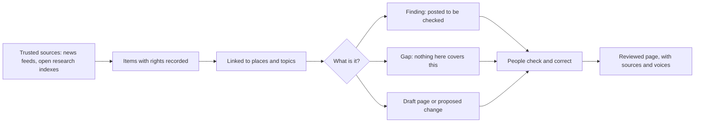

# Product shape: where everything lives

14 November 2026. Positions agreed in outline with the owner, written as a brief for whoever builds next. Planning only. See the [vision and roadmap](../history/vision-and-roadmap-2026-11-14.md) and [design direction](design-direction-2026-11-14.md).

## The rule

Add post types and filters, not pages. A new capability earns a page only when it has its own audience and its own work to do.

## Four doors and a rail

| Door | Job | Holds |
| --- | --- | --- |
| **Beranda** | The stream. The main screen. | Every post type, with tabs Semua, Perlu dicek, Pengetahuan |
| **Jelajah** | The front door. Personal to the places you follow. | News, places, events this week, market, open questions, active threads |
| **Wiki** | Shared knowledge | Pages, research reading, gaps, the check queue |
| **Kerja publik** | Shared business | Public work, consultations, organisations, and later open data |

The **right rail** becomes contextual, since it repeats the same community list everywhere today:

- On a thread: the related place, the related page, any open question, and the sources Aksara used.
- On a place: events, market listings and open gaps.
- On a wiki page: sources, whose voices it rests on, and what we don't know yet.
- On Beranda: news and what Aksara is working on now.

**People learn what exists from the composer.** Its type picker offers Obrolan, Tanya, Acara and Tawaran. No tour.

## Post types

| Type | Status | Notes |
| --- | --- | --- |
| Conversation | Live | |
| Poll | Live | Two to six options, totals only |
| Offer or request | Live | |
| Event | **Engine support exists** (`event`, `event_responses`) | Needs surfacing: "Acara" on place pages and "Minggu ini" in Jelajah |
| Aksara finding | Planned | Typed blocks with check buttons |
| Gap | Planned | Computed from data, then postable |
| Page card | Planned | A reviewed page shown in the stream |

## Questions, polls and consultations

One primitive in three sizes. Call the family **Suara**.

1. **Quick poll.** Anyone posts one. This exists.
2. **Prompted question.** Aksara proposes a typed poll about a news item or page, and a human editor approves it with one tap. News and wiki pages get a "Tanya warga" action that creates a linked poll. Polls are never attached to every item automatically.
3. **Consultation.** An organisation asks, in the open.

The consultation pipeline:

1. A verified organisation drafts it: who is asking, why, what will be done with the answers, and when it closes.
2. Each target community's steward admits it or declines. No consultation enters a community uninvited.
3. People answer. Results show totals only, after a minimum number of answers.
4. **The asker sees what everyone sees, at the same time.** There is no private dashboard, no respondent identity and no breakdown below the minimum.
5. The organisation must post a public response before it can open another consultation.

Never describe results as what a population thinks. They are "dari N penjawab di ETNOS", self-selected. Don't call the feature sentiment analysis. Ballot privacy is an application promise today and a reason to adopt Spaces.

## How much Aksara may do alone

Reviewing a stream of drafts in Studio would be a bottleneck. Review exceptions instead, by risk tier.

| Tier | What | Control |
| --- | --- | --- |
| **Posts on its own** | Link-only news notices from sources the operator trusted; cited answers to explicit `@aksara` questions; receipts | Daily budget |
| **Posts after a veto window** | Findings, facts drawn from reviewed pages, proposed questions, weekly prompts | Visible to stewards for a set time first, for example 30 minutes; any steward can cancel |
| **Needs approval** | Wiki changes, polls on contested topics, the weekly bulletin, anything quoting a person | A named human accepts |
| **Never** | Political positions, anything from a private source, speaking for a community | Refused in code |

After posting, any member can flag an Aksara post. Enough flags hide it until a steward looks. Stewards get one weekly digest of what it did. Keep Aksara to a small share of any feed.

## From sources to knowledge

- **Linking comes from declared facts first.** A news item's own place tags and a place's declared aliases do the work. This is live for news.
- **Clustering only suggests.** The existing e-means batch can propose "these look related". A person confirms. A suggestion is never shown as a fact.
- **Research** comes from open indexes such as OpenAlex. A person attaches a work to a place. Store metadata and abstracts only where the licence allows.
- **Datasets and collections** arrive with institution nodes.
- **Unverified:** the owner mentioned decision models called "jev" and "clef" and a free keyless DeepSeek route. None of these has been checked. Verify licence, cost and data handling before relying on any of them.

## Ranking

Write our own, small and published. The engine already has a ranking module informed by the Lemmy and X research.

- **Untukmu** ranks by the places, communities and people you follow, then recency, then conversation activity.
- No engagement prediction and no private signals.
- Aksara is capped to a small share of any page of results.
- "Perlu dicek" items from places you follow get a lift, because checking is the contribution we most want.
- Publish the formula on a page in the app.
- **Jelajah is editorial modules, not a ranked feed.**

## Market

A Pasar community type per place. Listings stay free for individuals and craftworkers. Businesses can pay a flat fee for a shop profile and a disclosed, rotating slot inside Pasar. Nothing paid appears in conversation or knowledge, and nothing is targeted from polls, politics or private data.

## Open data

Dashboards of institutional data belong in Kerja publik, fed by an organisation's own published sources. Build this with a real partner and real data. Don't mock it for the demo.

## Deploying

`.github/workflows/deploy-etnos.yml` deploys the web profile on manual dispatch after the checks pass. It needs two repository secrets: `CLOUDFLARE_API_TOKEN` and `CLOUDFLARE_ACCOUNT_ID`. Deploying from a cloud session with a proxy-injected token fails at the asset upload step, because that step uses its own temporary credential.

## Still to do from the 14 November release

- Meepago shows no news until a node steward sets its aliases to `kabar:nabire`, `kabar:paniai`, `kabar:deiyai`, `kabar:dogiyai`, `kabar:intan-jaya` and `kabar:mimika` through `POST /v1/contexts/:id/aliases`. There is no screen for this yet.
- One tab style, one heading style and one empty-state pattern across pages.
- Clipped chips and tabs, the cut-off right rail, and blank image placeholders.
