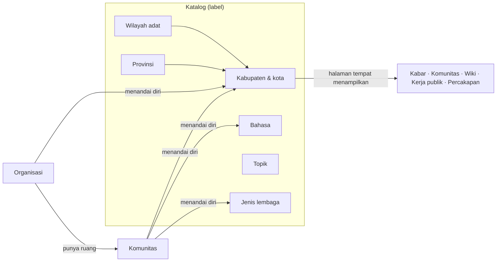
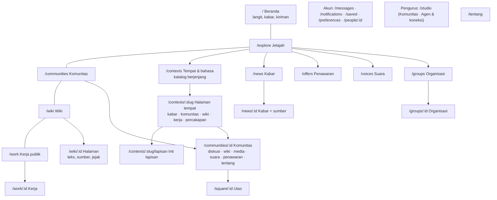

# Sitemap and community catalogue

15 November 2026. For the owner and whoever builds next. It describes how ETNOS is organised today, what was added today, and a proposed starter set of communities. Proposals are marked as proposals. See the [commons model](commons-model-2026-11-15.md) for the reasoning behind contexts.

## Three things, three verbs

| Thing | What it is | What you do with it | Who makes it |
| --- | --- | --- | --- |
| **Tempat & bahasa** (context) | A label: a place, a language, a topic, a kind of institution | Look. Its page gathers everything that carries the label. | The deployment's catalogue, loaded by the node steward |
| **Komunitas** (community) | A room with members, moderators and its own rules | Join, post, vote, moderate | Any member |
| **Organisasi** (group) | A named body: an office, a school, a church, an NGO | Represent it, sponsor public work, run its Aksara | Its own people, verified later by domain |

A community says where it belongs by carrying labels. Nobody joins a label. Nobody is put in a room because of where they live or who they are.

## What changed today

- A steward of a public or members-only listed community can label it with up to 10 entries from the catalogue. The editor is on the community's own page, under the description.
- A place page has a **Komunitas** section. It lists communities labelled with that place, or with anything beneath it. A community labelled Nabire appears on Nabire, Mee Pago and Papua Tengah, with "Nabire" shown on the two upper pages.
- The same section appears on language, topic and institution-kind pages. "Sekolah & universitas" lists every community that carries it, across all places.
- Hidden communities can never carry a label. The list shows a title, description, admission and labels. It shows no members and no counts.
- A place page has a **Mulai komunitas di sini** button. It opens the create form with the place attached and asks who may join.
- `/contexts` opens with a map of the 42 regencies and cities on terrain tiles. Each outline links to its page. Hatching marks a place that has a reviewed page, a public community or a public organisation. It is never a score.
- Tests cover the inheritance, the steward check, the hidden-community rule and the public count behind the hatching.

## Sitemap

| Door | Route | What a newcomer finds | Needs sign-in |
| --- | --- | --- | --- |
| Beranda | `/` | The stream: posts from every public community, news, the sky | No |
| Jelajah | `/explore` | Ways in: places, news, offers, polls, organisations | No |
| Tempat & bahasa | `/contexts`, `/contexts/:slug` | The catalogue as a tree, and one page per entry | No |
| Inti lapisan | `/contexts/:slug/lapisan` | One place read downward, from today to what's reviewed | No |
| Komunitas | `/communities`, `/communities/:id` | Rooms to join | To join or post |
| Wiki | `/wiki`, `/wiki/:id` | Reviewed pages with sources and a trail | To propose |
| Kerja publik | `/work`, `/work/:id` | Open questions and investigations | To sponsor |
| Kabar | `/news`, `/news/:id` | Stories with publisher credits and an automatic summary | No |
| Organisasi | `/groups`, `/groups/:id` | Registered bodies and their rooms | To manage |
| Studio | `/studio` | Community settings, Aksara, agents and connections | Steward |
| Tentang | `/tentang` | What works today and what doesn't yet | No |

## What exists on the live site

Catalogue, once loaded from Studio: 7 customary regions, 6 provinces, 42 regencies and cities, 256 languages, 11 topics, 8 kinds of institution.

Communities today: Beranda, Tanya & bantu, Budaya & bahasa, Kabar komunitas, Pemberitahuan, and one members-only room, Koordinasi daerah. All are sitewide. None carries a place yet. One organisation is registered.

Three things to fix before judges look:

1. "Pemberitahuan" has the description "Geng", and "Koordinasi daerah" has placeholder text. Rewrite or remove them.
2. All five public rooms use admission by approval. A newcomer can't post anywhere without waiting for a steward. At least Beranda and Tanya & bantu should be open.
3. No community is labelled. Label the existing ones so the place pages aren't empty.

## Proposed community catalogue

Proposal. A community **kind** is a template: a title pattern, a description, default labels and a default admission. A kind can exist in any place. The catalogue file would carry these templates beside the contexts, so another deployment ships its own.

| Kind | Example | Default labels | Admission | Who starts it |
| --- | --- | --- | --- | --- |
| Ruang wilayah | Obrolan Mee Pago | The customary region | Open | Node steward, handed over to local moderators |
| Kabupaten atau kota | Nabire | The regency | Open | Any member there |
| Bahasa | Belajar bahasa Mee | The language, Bahasa | Open | Speakers and learners |
| Baca dan belajar | Komunitas Baca Nabire | Place, Pendidikan | Open | Any member |
| Sekolah dan kampus | Mahasiswa Uncen | Place, Sekolah & universitas | Approval | Students or staff |
| Jemaat | A congregation's room | Place, Gereja | Approval | Its members |
| Musik dan seni | Musisi Jayapura | Place, Musik & seni | Open | Any member |
| Olahraga | A club's supporters | Place, Olahraga (new topic) | Open | Any member |
| Pasar dan usaha | Pasar Mama-Mama Nabire | Place, Penghidupan | Open | Sellers |
| Hutan, tanah, laut | Penjaga hutan Paniai | Place, Hutan & tanah | Approval | Any member |
| Pemerintah | A regency office | Place, Pemerintah | Approval | The organisation itself, once verified |
| Masyarakat adat | Named by its members | Language or region, Dewan adat | Members only | Only its own members |
| Perantau | Mahasiswa Papua di Yogyakarta | Needs a place outside Papua | Open | Any member |

Rules that go with the table:

- **The steward seeds seven rooms and stops.** One open room per customary region, clearly run by the node steward until local moderators take over. Forty-two empty regency rooms would make the site look abandoned.
- **Everything else starts on demand.** A place page gets a "Mulai komunitas di sini" button that opens the form with the place already attached and the kinds as choices.
- **No room is created on behalf of a people, a church or an office.** Those kinds appear as choices. The room exists when its own people make it.
- **A second room of the same kind in the same place is allowed.** The form shows the existing ones first, so people join before they duplicate.

## The seeding path, for any deployment

1. **Catalogue.** A file of contexts with parents. Done for Tanah Papua. A steward loads it from Studio.
2. **Kinds.** Community templates in the same file. Proposed above. Not built.
3. **Starter rooms.** The sitewide rooms plus one per top-level region. A steward decision. Not done.
4. **Labels.** Stewards label their rooms. Built today.
5. **Start here.** The create form opens from a place page with the place attached. Built today. Choosing a kind waits for step 2.
6. **Aksara per region.** Each regional room gets an Aksara that reads the sources for its regencies and posts findings to be checked. Depends on Aksara answering reliably.
7. **Handover.** A regional room moves to local moderators when two active members accept the role. Ownership transfer isn't implemented in the engine yet.

## Open questions for the owner

- **Regency outlines.** They come from Badan Informasi Geospasial's public Satu Peta service, simplified. The service states no licence. Keep them with credit, or redraw from Natural Earth and OpenStreetMap?
- **Terrain tiles.** EOX allows free use with credit and a link, on a demo service with no uptime promise. Browsers load them straight from EOX. For the pilot we should render our own.
- **Olahraga and Pemuda** aren't in the topic list. Add them?
- **Places outside Papua.** Students and families in Yogyakarta, Makassar, Jakarta or Port Moresby have no place to label. Add a short "Perantauan" branch to the catalogue?
- **Kampung and distrik.** The catalogue stops at regencies. Villages matter most to people, and there are thousands. Proposal: let a community name its kampung as free text under its regency, and add districts only where a community asks.
- **Regional rooms: one per customary region, or per province?** The two overlap. Customary regions fit the project. Provinces fit government questions. Proposal: customary regions, since province pages already list the same regencies.
- **Should organisations be labelled automatically from their rooms?** Today an organisation and its rooms carry labels separately.
