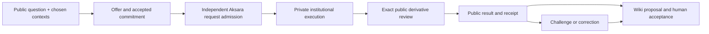

# ETNOS: a contextual commons, with independent community authority

Research and product assessment, 31 October 2026. The owner's supplied chat summary is context, not a new specification or an instruction to implement its priority table. Recommendations below are not shipped capabilities. ETNOS at etnos.space is the intended first deployment; domain ownership and permanent record namespace remain unverified.

ETNOS is an engine for communities to turn conversation into shared knowledge and accountable work. ETNOS is intended as a general deployment, with Papua as its first focused regional experience. Aksara is a continuing institutional/community agent that participates through ETNOS, its own web interface, messaging channels and devices. Each is a surface; none acquires the institution's source or execution authority by hosting its interface.

The most useful product promise is: **ask together, investigate under local authority, publish what is approved, and keep the result useful.** This is more concrete than either “an Indigenous social network” or “a knowledge graph.” It should work for an ordinary person without an agent or protocol knowledge.

The owner's later refinements are recorded in [Decision 002](../decisions/decision-002-groups-knowledge-and-regional-surfaces.md). In particular, informal requests/offers below stay conversation; PublicWork requires explicit institution/governed-community sponsorship. Durable local Groups/Spaces are intended engine capabilities, with a separate experimental AT adapter.

## Assessment of the supplied summary

The central argument holds: place, topic, governed collective and institution should not all be represented as forums. One conversation should have several discovery contexts while retaining a clear home, admission policy and moderation authority. Existing communities remain useful; contexts prevent an empty forum for every place/topic combination.

A graph alone does not supply legitimate representation, interoperability, privacy or useful participation. A signed assertion establishes which key made a claim, not whether the claim is true, its speaker represents a people, or the referenced party consented. A DID is an identity mechanism, not a cultural or institutional mandate.

| Direction | Assessment | Feasible first implementation | Limit or alternative |
| --- | --- | --- | --- |
| Typed contexts and relationships | Strong fit; highest product value after the current login/posting path | Indexed SQLite entities, aliases, explicit claim records and post-context links | No graph database, automatic universal ontology or mandatory group account per place |
| Collective identities / Open Social Groups | Promising interoperability seam; experimental today | Local group authority remains authoritative; isolated adapter and synthetic group DID | Spaces changes weekly and is explicitly unsuitable for production; no activist data or real-account migration |
| Conversation → Wiki | Already partly implemented | Carry an explicit public discussion reference into reviewed proposals; show evidence and corrections | Wiki acceptance is editorial approval, not universal truth or consent to release private sources |
| Conversation → PublicWork | Strongest extension beyond an ordinary forum | A request, accepted commitments, state transitions, public results and receipts | Posting a task cannot instruct an institution's Aksara to execute it |
| Accountable agents | Essential, but avoid another badge system | Separate agent identity/operator, per-community admission, expiring mandate, limits and challenge route | “Operated by” differs from “authorized to represent”; no shared human OAuth session or engagement rewards |
| Standard.site articles | Useful optional publication projection | Map an explicitly approved public article into an adopted long-form schema | Standard.site covers publication/document metadata; it is not the full Wiki revision/review protocol or a universal content renderer |
| Smoke Signal events | Good reuse candidate | Link an event and organizer now; qualify an adapter before write support | Verify exact Lexicons, RSVP disclosure and lifecycle; attendance can expose people |
| Tangled architecture | Useful precedent | Portable coordination references; Git/artifacts/execution stay in their appropriate systems | It is not a drop-in general PublicWork engine |
| MySky / explainable feeds | Useful later | Explicit local filters, “unanswered,” language and transparent ordering | Do not infer credibility from engagement, claimed identity or an AI score |
| Ozone / labelers | Useful external signals and tooling reference | Qualified ingestion of chosen public labels, with local decisions retained | A label service does not issue community membership, source rights or institutional access; public labels may reveal disputes |
| Voice, translation, offline participation | High value; stage deliberately | Preserve original, language and reviewed translations; small downloadable public bundles | Voice can identify a speaker; translation/public indexing require separate disclosure decisions; offline grants expire |
| TK/BC Labels | Appropriate rights reference | Preserve participating communities' issued labels and provenance | Labels are not encryption or automatically enforceable training restrictions; do not assign labels for a community |
| Tap ingestion | Strong candidate for verified public indexing | Track only admitted repositories/collections; authenticated webhook delivery into idempotent indexing | Tap is a separate continuously running service, not free Worker compute; its verification is not proof of a true claim |
| Jetstream v2 | Useful lower-friction exploration stream | Non-authoritative discovery hints and rebuildable views | Do not treat simplified events as equivalent to repository/signature verification or access authority |

## Verified ecosystem findings

The [Open Social Groups vision](https://atproto.com/blog/open-social-groups-vision) was published on **28 October 2026**. It demonstrates shared identities and data across applications, including Grain, opensocial.fyi and pckt.blog, and explicitly says Spaces still receives weekly breaking changes. This is a real direction, not a settled cross-application capability available everywhere.

The [Spaces alpha announcement](https://atproto.com/blog/atproto-spaces-alpha) says: **“There will be breaking changes, and you absolutely should not run production code against it.”** It also says Spaces supplies access control rather than encryption and strongly advises against migrating real accounts to its alpha PDS. A public Group profile does not require a public membership list; the exact visibility and application grants must be reviewed separately.

The [Groups introduction](https://atproto.com/blog/atmospheric-groups-intro) describes meta and members spaces under a group DID, additional application-specific spaces, group-issued membership plus member acceptance, and flat roles. Members keep their own PDS repositories. Group-host OAuth permits scoped group actions without a shared password. This does not solve customary governance, contested representation, succession, multi-party release or source-specific authority.

The [opensocial.group proposal](https://tangled.org/opensocial.group/proposal) explicitly leaves group governance and application semantics to implementers. Design a compatibility boundary, not a fork of the entire engine around today's draft schema.

[Standard.site](https://standard.site) defines shared long-form publication/document metadata and backlink verification. Adopt it for interoperable articles after semantic mapping. Keep Wiki proposal, acceptance, perspective and correction semantics above it. We have not qualified a live publishing integration or confirmed every display claim in the supplied summary.

[Tap](https://atproto.com/blog/introducing-tap) handles backfill, MST/signature checks, recovery and repository/collection filtering. It supports acknowledged delivery or webhooks for serverless consumers. Ordering is per repository, not a universal total order. The consumer still needs authenticated ingress, duplicate handling, delete handling, a durable cursor/receipt and reconstruction tests. Never accept an unauthenticated webhook's actor/role as authority.

[Local Contexts TK Labels](https://localcontexts.org/labels/traditional-knowledge-labels/) let communities express provenance and local protocols for access and reuse. Preserve who issued a label and its applicable material. Community restrictions and licences are distinct concepts; public publication cannot guarantee third-party compliance or revocation of received copies.

The other named products are useful candidates, not certified dependencies. In this pass, Smoke Signal's documentation endpoint did not fetch successfully and a supplied Tangled documentation URL returned 404. Exact current APIs, licence terms, group support and privacy behavior need qualification before adoption. Avoid describing every example in the pasted summary as verified integration evidence.

## A small record model before a large graph

Start with three additions to the existing relational store:

1. **Context entity:** stable opaque ID, kind, human names/aliases with language, and a lifecycle state. Initially place, topic, institution and collective. A project and an accepted knowledge revision already have their own record identities; attach contexts rather than duplicate them into a second master system.
2. **Attributed claim:** subject, predicate, object/value, issuer, cited public evidence if any, validity interval, disclosure policy and supersedes/retraction state. “School A operates in Place B” is an institution's claim; “Person C represents Community D” requires stronger admission and confirmation. An institution's self-description must not rewrite a community's description of itself.
3. **Context link:** associates one conversation or public artifact with an entity. A link is attributable and moderatable. Index only the projection its audience may read; the presence of an edge must not reveal a protected endpoint or institutional relationship.

Use ordinary indexed SQL and a small predicate vocabulary. Defer geometry except voluntarily published coarse places. Support aliases without treating names as globally unique and without silently merging contested places or communities. A merge is a reviewable link, not deletion of the displaced identity or history.

The first feed can filter by one or several explicit contexts, deduplicate by the canonical conversation ID and keep the original community as its home. A contextual page is a lens, not a new owner. Cross-posting into another community remains that community's decision; a place label must not bypass receiving moderation. Public contextual lenses cannot include private membership, counts, source paths, unpublished aliases or inferences about private connections.

Do not make graph completeness a launch gate. Initially, public topics already work; add a small curated set of place contexts and test one real cross-context conversation before building a general relationship editor.

## Additional primitives worth considering

### 1. Requests, offers and commitments

A useful public square needs ways to ask and help beyond posting. A request can state the desired result, an approximate place, language, response window, what can be disclosed and who may receive a reply. A person, institution or agent can make an offer. Accepting an offer creates a bounded commitment, not remote execution authority.

Examples: “We need a reviewed translation,” “Who has a public water-testing method?” or “Can a school host this workshop?” Offers need expiry, withdrawal and a human escalation contact. Start without payments, tokens, marketplaces or a central scheduler.

### 2. Evidence bundles and challengeable claims

A result can contain a claim, public evidence, method, observation period, uncertainty and accountable reviewer. Distinguish an observation, an interpretation, an institutional announcement and an accepted Wiki synthesis. Do not reduce all of them to one truth score.

A challenge can ask for clarification or present conflicting evidence. It should reach the responsible steward, retain a response trail and permit correction, unresolved disagreement or withdrawal. Sensitive challenges need a protected intake route; publishing that a person disputed an institution may itself be unsafe.

### 3. Durable institutional presence and succession

This is a stronger Aksara motif than “AI in the feed.” People rotate; an institution retains approved public commitments, methods, prior answers and unfinished work. Aksara can surface what is still pending and invite a newly admitted human steward to take over.

Separate the institution's durable identity from a particular model, machine, deployment or human admin. An agent replacement does not inherit all old grants. Ownership succession and emergency recovery need independent approval and revocation, never a shared password or implicit permission from the outgoing agent's memory. Public continuity can be useful without exposing a private staff roster.

### 4. Disclosure plans for compound outputs

A source may be safe to summarize, while a map, attribution or added institutional link makes the combined artifact sensitive. Review the **assembled public output**, not only each input separately. Give published derivatives separate IDs and exact reviewed content, record the permitted audience and reuse terms, and recheck at sending time.

For contributions from several custodians, each authority admits its own use. A local steward or a majority vote does not override another custodian's restriction. Public withdrawal stops future authorized release but cannot promise deletion from a public protocol or every bridge/cache.

### 5. Community service cards

An institution can publish the services it chooses to offer: languages, coarse coverage area, preferred contact route, public hours and kinds of requests accepted. That supports routing a question without creating a directory of activists or a map of private Aksara nodes.

Service verification should say precisely what was checked, by whom and when. An authenticated domain can support “controls this website”; it does not prove statutory status, customary mandate or trustworthiness. Avoid a single platform-wide authority badge.

### 6. Translation as an attributable derivative

Keep the original contribution immutable within its normal correction lifecycle. A translation names its source revision, language, translator (human or agent), review state and caveats. A user can compare versions and challenge a mistranslation. A voice recording, transcript and translation can have different audiences and retention periods.

This supports local language participation without inventing one machine-written canonical voice for a people. Speech-to-text output never silently becomes the speaker's approved public statement.

### 7. Portable public bundles and delayed participation

A small bundle of approved posts, Wiki revisions, service cards and open requests could be downloaded on good connectivity and read offline. A signed submission can be queued for later review. No private roster or live institutional secret belongs in that public bundle.

Offline work must use idempotent action IDs, original timestamps, expiry checks and explicit conflict handling. Receiving nodes recheck grants when an action arrives. Iroh can move an artifact between reachable peers; it does not create a radio mesh, defeat traffic analysis or provide offline global AT availability. HaLow, local Wi-Fi and Starlink are distinct network choices with their own power, range, ownership and visibility constraints.

### 8. Separate identities and selective links

A single public DID across apps is convenient and creates a cross-application correlation handle. It should be optional for protected participation. Plan private-only accounts with qualified local authentication and receiving community admission; connect a public identity only through an explicit, revocable application link. Do not automatically copy memberships or reveal that two profiles belong to the same person.

Changing a public handle while retaining the same DID does not create an unlinkable new identity. Even separate accounts do not guarantee anonymity against device/network metadata or a trusted hosting operator. Step-up authentication for high-impact stewardship actions and independent recovery are worth adding without making a social login a master key for Aksara.

### 9. Federated participation agreements

Federation can be a relationship between willing communities rather than “any AT account may write anywhere.” An agreement may specify which public collections are indexed, accepted labels, request-routing policy, rate limits, languages and emergency suspension contacts.

Implement this first as explicit local policy over public data and receiving-side admission. It cannot make a public repository unreadable to outsiders. Cross-community private work needs a different qualified transport and independent authority at both ends; neither AT discovery nor an A2A endpoint authorizes it.

## One complete workflow to build next

A resident asks a public question about a local environmental observation. It has one community home plus voluntarily chosen public place/topic contexts. A participating institution offers help. A human accepts a clearly scoped public commitment. The institution's Aksara independently admits the request and performs qualified work under local grants, with sources and field data remaining private.

A human reviews the exact public result. ETNOS receives a separate approved derivative and an accountable public receipt, not a private source URI or a request to fetch raw institutional memory. Participants can discuss or challenge it. A reviewed Wiki proposal links the public discussion and result. Later evidence can produce a correction without rewriting the record of who said what.

The public commitment ID and private task ID are different. UI status must distinguish offered, accepted, in progress, blocked, withdrawn and completed with evidence. A model saying “done” is not a completion receipt. Do not publish internal failure details, private tool traces or staff changes as public status updates.

## Runtime and protocol choices

- **Now:** TypeScript engine, official AT OAuth/SDK, SQLite Durable Objects and a same-origin Honai interface on Workers. Admission stays invitation-controlled. Public-only AT publishing remains gated on a verified owned namespace and qualified publishing flow. No PDS migration was performed.
- **Next:** bounded contextual links and the public request/result workflow; keep the working forum useful while adding them. A local `GroupAuthority` boundary can project ordinary group roles; avoid prematurely replacing the Aksara rights evaluator with an external group role.
- **Experimental side lane:** Group Host/Spaces adapter with synthetic identities and records, preserving revocation and audience isolation. Compatibility tests should include provider loss and membership changes during I/O.
- **Public index service:** qualify Tap tracking a small admitted set. It may run separately from Workers; account for uptime/storage/egress. Relay fanout and ingestion do not become free because the UI is serverless.
- **Later:** qualified Standard.site/event/labeler projections, voice/offline bundles and optional native Iroh transport. A2A defines task interaction; MCP exposes authorized tools; neither supplies institutional grants.

A PDS is a separate account/repository host. The [reference PDS](https://github.com/bluesky-social/pds) uses SQLite; AT does not require PostgreSQL. Cloudflare-native PDS projects such as [Cirrus](https://github.com/ascorbic/cirrus) are a reuse candidate, not something ETNOS currently contains. [pds.js](https://tangled.org/chadtmiller.com/pds.js) is another experimental single-account implementation with Node, Deno and Cloudflare adapters and an optional Spaces package. Cirrus also declares experimental beta status. Neither single-account design should be described as a ready multi-user ETNOS signup service, and neither is integrated here. A hosted PDS requires persistent keys, repository/blob backups, recovery, account lifecycle and abuse operations even on a serverless runtime. Test a separate disposable account before offering hosted signup; do not move giyaibo.bsky.social or an activist's primary identity to prove a prototype.

Custom public AT records are publicly fetchable/indexable even when ETNOS admits only selected writers. They do not automatically become Bluesky feed posts. A Bluesky projection and an ActivityPub bridge are distinct, explicit publications. Threads compatibility must be checked per supported interaction; ActivityPub support is not a guarantee that a custom ETNOS record or private membership will interoperate. No bridge for private material.

## UI implications

Keep ETNOS approachable: home feed, community pages, Wiki and search. Add compact place/topic chips and a context page that gathers existing conversations and accepted knowledge. A community/institution page can have Discussions, Knowledge and Work when those tabs have actual behavior. Use explicit labels for agent participation and verified claims, with details available on demand. Do not turn every database primitive into top-level navigation or every card into an explanation of the architecture.

No institutional landing page, Group Host integration, PublicWork, events, voice, contextual graph or private-only account signup is claimed shipped by this assessment. These are recommendations to review against actual participant needs.

## Proposed sequence and decision gates

1. Stabilize the connected preview, owner login, admission/revocation, backups and a small invited cohort. Demonstrate actual approved AT publication and reconciliation after the domain/schema prerequisites are satisfied.
2. Add typed public contexts and a small set of reviewed links. Prove hidden edges cannot leak through search, counts, notifications, exports or nested views. Support challenge/retraction before large-scale ingestion.
3. Deliver one request → independent institutional response → reviewed public result → Wiki workflow. Get useful evidence with one willing institution rather than ship many empty feature families.
4. Add succession/recovery, moderation and operational ceilings before treating the network as dependable infrastructure. Expand language/offline participation with the participating communities.
5. Qualify protocol adapters separately. Keep experimental Groups/Spaces or a PDS implementation replaceable without moving source authority or rewriting public identities.

This sequence is a recommendation, not a freeze of every feature. The immediate next validation should use a willing institution and a low-risk public question; no activist movement, precise field location or confidential archive is needed to prove the model.
