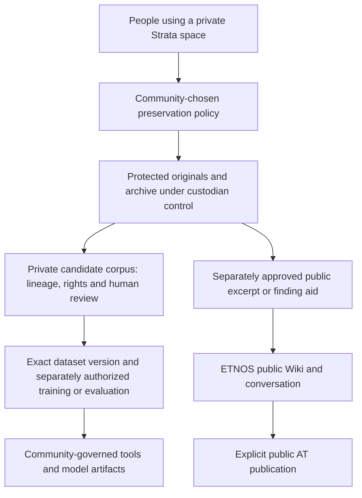

# Community language commons: Mee pilot and protected corpus custody

Research/proposal, 1 November 2026 (Asia/Bangkok). This responds to the founder's renewed language-preservation purpose. It is not a frozen collection protocol, permission to collect, a community mandate, a deployed corpus pipeline or a production privacy qualification. No participant data was collected and no real account/PDS was migrated for this research. The supplied catalogue is context, not an instruction to execute collection or its historical proposals.

## Recommendation

Keep Strata as an independently useful social engine. Let communities establish private spaces with clear preservation policies. Keep a separately governed archive/corpus under the chosen community custodian. Treat training, external processing and public publication as distinct, explicit uses. Use AT for the public network and optional portable identity; evaluate AT Spaces through a replaceable adapter with synthetic data. A community's private language programme must not depend on an unfinished protocol or an always-running AI.

Working product framing: **a community-governed commons where people use their languages, keep shared memory, develop useful tools and choose what they share.** A corpus is a governed derivative of participation, not an automatic consequence of joining the forum. Each language/community can adopt its own rules and choose whether to participate at all.

The catalogue v2.5.8 already specifies these boundaries in §§38–39, 58 and 61: plural authority, community and individual interests, independently authorized preserve/analyse/train/publish operations, custodial originals, reviewed public derivatives and no universal private archive graph. Local Contexts, CARE, Mukurtu and Māori governance precedents are existing references, not newly invented primitives or authority models to transplant into Mee governance.

## Current implementation versus target

| Area | Verified current behavior | Still required |
| --- | --- | --- |
| Strata private forums | Current-membership checks; hidden/listed-private modes; private posts/media excluded from public feeds and AT intents | Qualified operator isolation, recovery/retention, private-only onboarding and private federation; community posts are not E2EE |
| Hosting | Connected preview stores forum data in its configured Cloudflare SQLite Durable Object | Separate community-chosen custody/storage and key/recovery arrangements; a namespace is not isolation from a privileged provider/operator |
| AT integration | Invited AT OAuth and a guarded public publication outbox; live public publishing remains disabled | Owned Lexicons, live delivery/ingestion and qualified Spaces adapter |
| Wiki | Public accepted pages, restricted proposals, human exact-base/digest acceptance | Language-specific entry types, multiple attributed perspectives and safe private editorial/corpus tools; the current public Wiki is not a private archive |
| Aksara | Rust-scoped Library originals, current principal/lane/purpose gates and withdrawal-aware projections | Real SharingGrant/data-use enforcement, explicit training/evaluation/export operations and a qualified Strata custody connector |
| Training | No forum-to-corpus collector or training service exists | Programme consent, candidate review, versioned datasets, training receipts, release controls and community evaluation |

Aksara checkout reviewed: `2017d5b`. Its kernel currently accepts `knowledge` or `work` purposes, not a complete granular training-purpose policy. `protocols/aksara/v1/README.md` explicitly says the publication schema's SharingGrant field is not an implemented evaluator. Do not relabel those scaffolds as permission to train. Strata's development custody fixture must not become a competing institutional authority kernel.

## What AT supports today

The official [Spaces alpha announcement](https://atproto.com/blog/atproto-spaces-alpha) describes running code/SDKs for permissioned data, including private forums. The [current proposal](https://github.com/bluesky-social/proposals/blob/main/0016-permissioned-data/README.md) remains a proposal. The late-October [Groups introduction](https://atproto.com/blog/atmospheric-groups-intro) and [Open Social Groups vision](https://atproto.com/blog/open-social-groups-vision) show prototypes and explicitly describe continuing weekly breaking changes. No general production-readiness conclusion is supported by these sources.

Important distinctions:

- Public AT repositories are public; custom Lexicons, a private UI flag, login or an unlisted collection do not make them private. Restricted originals, identifying metadata and source lineage stay out of public repos/firehoses. Do not use public ciphertext records as a substitute for a designed private store.
- A Space is an access/sync boundary with a DID authority. Records normally remain in per-author, per-space repos on their repo hosts, rather than all moving onto the community authority's server. A Space therefore does not by itself establish community-controlled storage placement.
- Spaces provide access control, not E2EE. PDS hosts and authorized syncing applications can read the data they handle. An application view may hold another plaintext copy. Approving a reader is a meaningful distribution decision.
- A group's shared DID and roles can improve continuity across apps without sharing a password. They do not establish cultural legitimacy or replace source-specific contributor/community permissions.
- The current draft's `managedspace` policy delegates access decisions to a managing application. This is a plausible future Strata integration seam for current membership. It is not permission to read Aksara's archive or train a model.
- Optional `allowedApps` controls under `memberspace` are relevant to limiting admitted syncing clients. Read/write access is not a protocol-level restriction on downstream training, copying or commercialization after plaintext has been delivered.
- Short-lived credentials are the primary revocation mechanism: draft defaults are about ten minutes, with optional revocation fanout to repo hosts. Private federation needs tested expiry/fanout/caching behavior; instant global revocation must not be promised.
- A hidden member list does not hide all participation from admitted readers: the draft notes that writers can be enumerated from the writer set. Sensitive rosters/associations need their own threat assessment.

A future deployment may choose community-operated compatible repo/space hosts and only approved syncers. Alternatively, the community archive can remain off-protocol and publish only separately approved derivatives. Existing public AT identities can still authenticate to local Strata membership without sending private posts to those accounts' PDSs. Private-only/local identities remain an onboarding requirement, not a delivered feature.

## Three connected experiences

1. **Everyday conversation.** Admitted members talk, ask questions, share photos and use Mee without needing a data-collection interface. The forum remains usable if the language programme or Aksara is offline.
2. **Preservation and language work.** A community can choose room-wide preservation with clear retention, access and custodianship terms at entry. Selected contributions become review candidates only under the programme's separate permissions. Personal DMs and other private spaces are outside the collector's scope.
3. **Public commons.** Approved dictionary entries, teaching material, project findings and discussions can be public. Neither public membership nor a public word entry exposes private archive locations, source IDs, corpus membership or sensitive speaker identities.

No space automatically changes old messages' rights when a steward enables a new programme or updates its policy. Archive retention and conversation deletion are separate and must be explained honestly. A participant may accept preservation while declining training or publication.

## Directly in the forum: the proposed interaction

The founder clarified that this must be a clean forum capability. The custody boundary above is a backend responsibility, not a requirement to send people to a different archive app. Strata is a surface for the protected workflow as well as ordinary public conversation. Aksara's Workbench remains another optional surface; an LLM is not required for human language contribution/review.

A participating community can expose these contextual tabs:

- **Percakapan**: the usual posts, replies and media, with a quiet `Privat · Diarsipkan komunitas` indication only when that preservation arrangement actually exists.
- **Bahasa**: approved words/expressions, example sentences, permitted pronunciation recordings, attributed varieties, and useful community tools. Visibility follows the programme's policy; this is not automatically a public Wiki.
- **Usulan**: a private review queue visible to the relevant language/corpus stewards. Most people do not need this tab.

At admission, the space explains who can read, who preserves it and how long. Room-wide preservation may be an explicit agreed setting for that room. Optional participation in a *named* training programme is separate, for example a Mee typing/spelling pilot. Programme opt-in can cover eligible future contributions during a specified period, with a clear per-post exclusion/withdrawal action; it need not force a new research form on every message. It cannot silently apply to other rooms, DMs, historical posts or unrelated future models.

Example journey: a member writes an ordinary Mee reply. They can choose `Usulkan contoh bahasa` from its menu, or the programme can generate an eligible private candidate under its agreed opt-in scope. The steward sees a small source-linked review card, checks the example/context and rights, preserves alternate forms where appropriate, and accepts/corrects/rejects it. An exact reviewed batch can later be approved for a named training/evaluation job. Public dictionary/publication is an additional decision. The conversation itself stays a conversation, and a person's refusal of training does not erase their ability to participate.

The source version, programme terms, contributor permission and relevant community/source authority travel with the candidate behind the UI. A chief/community body's recognition and each relevant speaker/contributor's permission are evaluated according to the agreed governance; an admin click cannot stand in for missing rights. A mixed conversation cannot sweep nonparticipants' replies or quotations into a dataset just because one author opted in.

Archival originals, grant evaluation, dataset manifests, receipts and training may be implemented by the qualified custodian backend/Aksara authority on the same node or a separately approved host. The browser can present this as one coherent forum workflow through scoped APIs. It must not duplicate the institutional policy kernel or proxy restricted sources through the public Worker merely to keep a single URL. Plain forum use remains independent of that connector.

The smallest useful implementation is one opted-in private Mee room, a clear preservation/programme policy, contribution/exclusion controls, a human review queue and a reviewed portable export. The export goes only to an authorized destination under its exact scope. Voice tools, model training and private AT interoperability can be added after those rights and custody paths work. Existing Groups/Spaces, proposals, current-access checks and activity patterns are reusable; new programme/consent/dataset behavior is not yet implemented.

## Permission and governance model

The community determines the legitimate steward/decision process, including how relevant elders, clans, contributors, speakers and other rights holders participate. A chief's support can help establish collective governance; it is not by itself every person's consent or authority over every culturally restricted item. Do not publish an ethnic-membership registry, infer membership from language use, or make public AT identity/KTP a universal prerequisite.

Reuse the existing catalogue's `ArchiveCollection`, `UsePolicy`, `ConsentGrant/ConsentEvidence`, source versions and WorkObject/approval/receipt patterns. A language programme can present these as a coherent product capability, without inventing another authority service.

| Permission | Example decision |
| --- | --- |
| Read/discover | Who may see the conversation, collection title or source metadata? |
| Preserve | May the custodian retain an archival copy, for what period and recovery policy? |
| Annotate/translate | Who may transcribe, annotate or translate; can an approved AI assist? |
| Evaluate/train | Which dataset version, task/model family, processor, location and purpose are approved? |
| External processing | May plaintext leave the community trust domain for an ASR, LLM or training provider? |
| Publish | Separate decisions for text excerpts, audio, dataset, model weights/API and public finding aids |
| Commercial/onward use | Which recipients, purposes, benefit commitments and sublicensing conditions apply? |

These are policy operations, not seven mandatory toggles every time someone posts. Use small programme presets and clear opt-in with expandable terms; record the exact version and scope privately. A voice contributor may consent to transcription while refusing voice cloning or public audio release. Oral or assisted consent can be supported where appropriate; the evidence and process are decided with participants rather than assuming a checkbox is sufficient.

Permission checks must use current authenticated authority at selection, extraction, external processing, training start, reconnect/retry and release. An AI or programme moderator cannot invent or widen a grant. Mixed-source derivatives inherit applicable source restrictions; redaction/de-identification alone does not grant reuse rights. Source withdrawal blocks future authorized use and triggers feasible dependent-dataset/index/model reviews. It cannot guarantee unlearning from an existing model or erasure of copies already distributed.

Strata's code remains AGPL-3.0-only. Community data, recordings, annotations, datasets and model artifacts do not acquire an open licence from the code licence. Local Contexts labels express community protocols; they are not encryption or automatic technical enforcement. Māori and African examples inform discussion, not the naming or legitimacy of Mee governance.

## Useful corpus pipeline

Preserve original text/audio separately from normalized or model-ready derivatives. Track source versions, consent/policy versions, permitted recipients/operations, transformations, human review and dataset/model dependencies inside the appropriate trust domain.

- Keep dialect/variety, code-switching and alternate spellings where the community chooses; corrected text must not overwrite the original. Avoid mandatory personal ethnicity/location fields.
- Distinguish naturally authored human speech/text, human translations, AI-assisted corrections and synthetic agent output. **Exclude agent-generated forum posts from the initial human-language corpus by default.** Aksara's public participation must not contaminate its own training evidence.
- For multi-person conversation, account for other speakers, quoted text and identifying references. One author's opt-in does not automatically license everyone else's contribution in the thread.
- Review candidate examples, then approve a reproducible dataset manifest with exact source/derivative versions and purpose. Validate consent again at export/training, rather than trusting a stale `trainingAllowed` flag.
- Keep held-out evaluation separated by speaker/conversation where appropriate, avoid duplicates and preserve variety coverage. Do not describe an arbitrary 70/20/10 historical split as the agreed policy.
- Record training configuration, input dataset, processor/egress, model licence and output/release decision. Model weights, adapters, embeddings and logs can expose source information and need their own controls.

Start with useful, measurable tools: community lexicon and corpus search, spelling/typing assistance, sentence/translation review, and later consented speech/transcription benchmarks. A strong general chatbot or accurate ASR is not guaranteed from a small forum corpus. Training runs are separate bounded jobs on suitable compute; Cloudflare hosting does not provide free model training. Compute-to-data or federated learning can be explored later, but parameter updates and final models can leak information; those are not automatic privacy solutions.

## Reuse assessment

| Reference | Useful contribution | Boundary / recommendation |
| --- | --- | --- |
| ActivityPods | App/data-host separation, Pod custody, resource permissions and social notifications | Published v2.2.0 release and production app examples; not merely the remembered alpha. The reference provider uses Fuseki/WebACL and Redis, not a drop-in Workers deployment. Study/adapt selected patterns; do not add this whole stack to the current slice |
| AT Spaces / Open Social Groups | Permissioned sync, group DID and cross-app roles | Synthetic adapter spike only until qualified; per-author storage, admitted syncers, metadata and credential expiry need explicit review |
| Habitat Space Proxy | Concrete way to experiment with permissioned records using existing PDS identities | Its docs say repos are centrally maintained and suggest skipping some verification in the prototype. This is unsuitable as the default sensitive community custodian; do not copy that shortcut |
| ZDS permissioned-data implementation | Small alternative PDS prototype and migration/route references | Its own docs call it experimental/operator-gated and narrower than complete group support; current API details can differ from the changing upstream proposal |
| Te Hiku / Papa Reo / Rongo | Local processing, explicit contribution, community stewardship and return of benefits | Rongo's published policy processes recordings on-device unless explicitly shared. Their cultural framework/licence is not a generic text to transplant; the licence repository restricts reuse of its licence text |
| Mukurtu | Cultural protocols, dictionary roles, multiple community records/perspectives on an asset | Already a catalogue reference. Especially useful for preserving attributed variants without overwriting one community's account with another's; an archival adapter/UX reference, not a mandatory forum replacement |
| ELAN | Established local time-aligned audio/video annotation and portable export | Evaluate EAF/TSV import/export instead of building a full linguistic annotation workstation into Strata |
| Common Voice | Speech contribution/review workflows; openly licensed collection code | Public Common Voice datasets use CC0 in the reviewed listings; code is MPL-2.0. Do not submit a private Mee corpus to that public donation workflow by default; code licence and dataset rights are different |
| Esethu, ACL 2025 | Community-centred dataset governance, benefit-sharing and isiXhosa ASR proof of concept | A substantive research precedent, not proof of Mee model quality or a licence automatically suitable in Papua |
| Karya | Community-linked multilingual collection, annotation and evaluation case studies | Practitioner reference for contributor benefit/QA; company outcome claims are not reproduced benchmarks or an adopted vendor agreement |
| Germ | AT identity can be bound to a separate MLS messaging identity | Already relevant to the DM research; not a corpus engine or a drop-in replacement for the current unaudited DM implementation |

The Mee-specific sweep located an older Ekagi multilingual dictionary through the Library of Congress and Mee linguistic materials in a local university repository. These are a resource-inventory lead, not an asserted training corpus or rights clearance. Historical naming/orthography should be retained as source metadata while the community chooses its displayed name and varieties.

## First pilot proposal

1. Agree a small Mee language programme and a documented, contestable steward process with participating people. Record the intended direct benefit, retention, permitted tasks/processors and rights in understandable language. Do not treat the founder's relationships as a signed mandate.
2. Qualify private onboarding, host/custodian access, backup/restore, account succession, source withdrawal and reviewed export using synthetic material first. The public Worker preview is not the protected production corpus host.
3. Offer a clearly designated preservation space. Room-wide preservation can be the declared setting for that opted-in room, while training/publication still require their own permissions. Keep ordinary chat and DMs outside unapproved secondary use.
4. Build a small human-reviewed dictionary/text dataset and a useful first community tool. Voice capture/original audio and alignment are a separately scoped next step; today's resized forum image endpoint is not a preservation store.
5. Measure contributor comprehension, reviewer effort, useful retrieval/typing results, variety coverage, withdrawal behavior and recovery. Corpus size is one measure, not the only success criterion. Pilot size and model targets remain to be agreed rather than inventing accuracy/data-volume promises.
6. Add a synthetic AT Spaces/group adapter experiment alongside this path. Promote it only after deployment/security/migration qualification and an explicit storage/recipient decision. Other communities join through their own governance; no automatic pooled corpus or private network directory.

## Product/design follow-through

This architecture should be settled before the larger UI revamp requested in the same turn. The supplied screenshots remain the visual reference; no full UI polish or spinner repair is claimed by this research note.

- Keep a familiar Threads-like conversation canvas. Reduce duplicate headings, oversized global cards and navigation at mixed levels; put less-used institution/research controls in contextual views. Preserve the useful forum actions.
- A community landing page can show its approved public profile/Wiki and an independently admitted private language space. A `Bahasa` workspace appears for participating programmes, rather than exposing archive/training controls to every user.
- Public Wiki entries may have attributed meanings/variants, approved pronunciation/example assets, source perspectives and a correction/proposal path. Private transcriptions/corpus drafts live in the protected workbench, not in the public page schema.
- Show a concise private/preservation label and expandable programme terms. Joining an archive room must not hide training consent behind generic terms of service. Do not label a hosted store "community-held" unless the actual custody arrangement supports that statement.
- Simplify context attachment to search/select and minimal creation, with slug/type/language/aliases under appropriate defaults or advanced editing. Current public Contexts are discovery metadata, not a private ethnic roster or a corpus-consent mechanism.
- Confirmed spinner cause: `App.svelte` renders a global `LoaderCircle` without `animate-spin`, independently of route content. FeaturePages has its own animated loading state, so two indicators can appear. Give the shell/route a single loading owner and consistent accessible component, rather than hiding an indicator with CSS while duplicated work remains.
- Audit forms, dialogs, menus, feed density, mobile keyboard/focus, empty states and route errors together. Exact Threads pixel measurements should be taken in a controlled viewport; resized browser screenshots alone do not establish CSS dimensions.

## Acceptance cases for implementation

Reading never grants training; collective approval never invents missing contributor/source permission. A policy change cannot retroactively opt old posts in. A moderator is not automatically a corpus steward. Private inventories, speaker identities, grant IDs and sensitive counts cannot enter public Wiki/context/AT projections. Agent output remains distinguishable from human data. Expired/revoked grants are rechecked on retry and reconnect. Edited/withdrawn sources invalidate stale review manifests. Restoring an old backup cannot silently reactivate revoked grants. A model/API release requires its own decision. Disputed custodianship blocks disclosure pending the community's process. Authorized exported copies and trained models have explicitly limited recall guarantees.

## Sources reviewed

- AT: [Spaces alpha](https://atproto.com/blog/atproto-spaces-alpha), [live proposal](https://github.com/bluesky-social/proposals/blob/main/0016-permissioned-data/README.md), [Groups introduction](https://atproto.com/blog/atmospheric-groups-intro), [Open Social Groups vision](https://atproto.com/blog/open-social-groups-vision).
- ActivityPods: [project](https://activitypods.org/), [v2.2.0 release](https://github.com/activitypods/activitypods/releases/tag/v2.2.0), [provider README](https://github.com/activitypods/activitypods/blob/master/pod-provider/README.md), [provider compose](https://github.com/activitypods/activitypods/blob/master/pod-provider/docker-compose.yml).
- Governance: [CARE](https://www.gida-global.org/careprinciples), [Local Contexts TK Labels](https://localcontexts.org/labels/traditional-knowledge-labels/), [Papa Reo stewardship guide](https://blog.papareo.nz/a-practical-guide-to-creating-your-own-stewardship-license/), [Rongo policy](https://github.com/TeHikuMedia/Kaitiakitanga-License/blob/tumu/rongo.md).
- Language tooling: [Mukurtu community records](https://docs.mukurtu.org/digital-heritage-items/UnderstandCommunityRecords), [Mukurtu protocols](https://docs.mukurtu.org/communities-cultural-protocols-categories/), [ELAN manual](https://www.mpi.nl/tools/elan/docs/manual/Pref_Introduction.html), [Common Voice source](https://github.com/common-voice/common-voice), [Common Voice dataset listings](https://mozilladatacollective.com/organization/cmfh0j9o10006ns07jq45h7xk), [Esethu paper](https://aclanthology.org/2025.acl-long.1487/), [Karya practitioner work](https://www.karya.in/).
- Alternatives: [Habitat proxy](https://api.habitat.network/docs/space-proxy), [ZDS permissioned-data status](https://tangled.org/zat.dev/zds/blob/main/docs/permissioned-data.md), [Germ/AT integration](https://www.germnetwork.com/blog/integrating-germ-atproto).
- Limits: [training-data extraction research](https://www.usenix.org/conference/usenixsecurity21/presentation/carlini-extracting), [federated language-model leakage study](https://arxiv.org/abs/2310.16152). Neither is an assessment of Strata's particular code.
- Mee resource inventory leads: [Library of Congress dictionary scan](https://tile.loc.gov/storage-services/master/gdc/gdcebookspublic/20/19/66/75/00/2019667500/2019667500.pdf), [Universitas Cenderawasih repository](http://repository.uncen.ac.id/id/eprint/526/2/BAB%20I.pdf). Rights, collection history and community permission remain unverified.

Research used official pages/repos, the supplied catalogue and local code inspection. Exa initially returned a credit-limit error; after the user reconfigured it, two retries returned MCP `Unknown tool: exa.web_search_exa`. Supplemental sweeps used Parallel with Firecrawl/GitHub primary-source verification. Search hits and project claims were not treated as implementation/security proof. No provider account or service configuration was changed.
