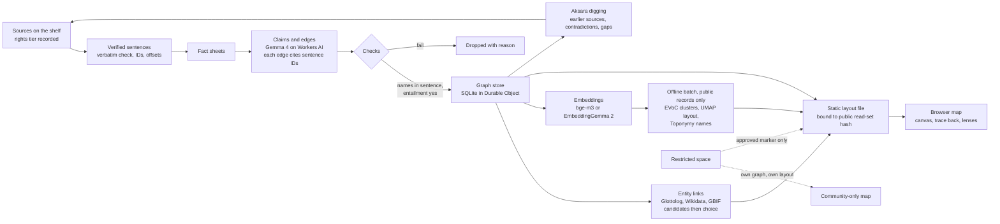

# A map of what is known: knowledge graph tools, embedding maps and agent curation, as of 16 November 2026

Research note · 16 November 2026 · Planning only. Nothing here is built, deployed or decided.

This note builds on [the relational landscape note](knowledge-observatory-2026-11-12.md), [the intelligence catalogue](etnos-intelligence-catalogue-2026-11-12.md), [organising knowledge](../knowledge/knowledge-organisation-2026-11-15.md) and [the 16 November direction](../plan/direction-2026-11-16.md). It does not repeat their reasoning on relationality, CARE, Local Contexts or label families. It adds current tools, licences and costs, and a concrete pipeline.

How to read the claims. Every tool claim has a source number in square brackets, listed in section 7 with the page, date or version I read. "Unverified" means I could not read a primary source. "Inferred" means my own reasoning from facts I read.

## 1. What the observatory is, and the recommended architecture

**What it is.** A map where every dot is something the commons knows (a page, a story, a source, a place, a language, a species, a question), coloured by domain, placed by meaning, with thin threads for typed relations and for provenance. Tapping a dot traces it back to the sentences and the earliest sources behind it. The map gets richer as people and Aksara add sources, and it shows where sources disagree or are missing.

**Recommended architecture in one paragraph.** Keep our own pipeline and do not adopt a graph framework. Verified source sentences already exist (525 of them across 39 seed pages and 87 cited URLs, counted from `seed/wiki/pages/*.json`). A small open model on Workers AI turns numbered sentences into claims and edges, and every edge must cite sentence IDs that the existing verbatim check can confirm. Entity links to Glottolog, Wikidata and GBIF come from candidate search, with a model or a person choosing among real candidates. Embeddings come from a multilingual model on Workers AI. An offline Python batch on a laptop clusters (EVōC), lays out (UMAP), and names clusters (Toponymy with a small LLM), then writes a static, hash-bound layout file from public records only. The browser draws that file in the way Marble does: precomputed coordinates, a plain canvas, no live physics. Restricted material stays in its community's own space and gets its own layout there. The public map can show a closed-shelf marker only when the community approves, and the marker's position never comes from restricted text.



**Two findings that shape everything else.**

1. Marble's page is simpler than it looks. I read the live page source on 16 November 2026. It embeds one JSON block with 1,590 nodes (each with x, y, z already computed), 3,221 edges, 8 subject colours and age bounds, and draws with a single `getContext('2d')` canvas call. I found no three.js or WebGL library name in the 686 KB file [S2]. The repository states 1,861 topics and 4,003 edges, so the live page is an older or different build [S1]. A third-party summary says height is the age field and horizontal position comes from a force-directed layout [S3]. The lesson: a precomputed layout plus a canvas is enough for thousands of dots.
2. Small models fail at structured extraction unless the pipeline is staged. In one 2026 study, raw one-shot JSON extraction on 500 documents left 80.8% of Qwen3-14B outputs and 98.0% of Gemma-4 (26B) outputs unparsed, while a staged zero-shot pipeline with Gemma-4 (written 26B in one table and 27B in another) reached F1 0.70 [S18]. We should expect to build the staging, the schema and the checks ourselves.

**The path-to-hope reference.** I could not read it. The page returned only its title, description and navigation to my fetchers (the hubs and images load in the browser). The only descriptive text I verified is: "See how our research, policies, and commitments address the hard questions about AI safety, governance, and the impact on society and the economy. This is a selection of our work so far." [S4]. Everything below about hubs with collage nodes comes from the owner's description, not from the page.

## 2. Comparison tables

Fit column: yes, partly or no for our constraints (Cloudflare free tier, small open models, Indonesian text, sentence-level verified provenance, community-controlled data).

### 2A. Building a knowledge graph from text with LLMs

| Name | What it does | Maturity | Licence | Cost and compute | Fit |
| --- | --- | --- | --- | --- | --- |
| Microsoft GraphRAG, v3.3.0 (8 Oct 2026) [S5, S6, S7] | Extracts entities and relations per text chunk, clusters them (Leiden), writes community summaries. Query modes: global, local, DRIFT, basic. | 36,650 stars. The README says it is in maintenance mode and not an officially supported product. | MIT | Indexing is the costly part: one extraction call per chunk plus summaries per entity and per community. Python, needs an LLM endpoint. A "fast" index method swaps some LLM work for NLP [S8]. | No. Maintenance mode, whole-corpus summaries are not what we need, and chunks lose our sentence IDs. Useful as a design reference for community hierarchies. |
| LazyGraphRAG [S9, S8] | Skips LLM extraction at index time (noun phrases instead) and uses the LLM at query time. Microsoft reports indexing cost equal to vector RAG and 0.1% of full GraphRAG. | Announced 25 Nov 2024. Integrated into Microsoft Discovery and Azure Local preview. | Not stated | Vendor figures, not independently checked. | No. I could not confirm it is in the open-source package: the methods page lists only "standard" and "fast" [S8]. |
| DRIFT search [S10] | A GraphRAG query mode: primer over community reports, then local follow-ups. | Part of GraphRAG. | MIT | Query-time LLM cost. | No. It answers questions. It does not build the map. |
| LightRAG, v1.5.8rc1 (15 Nov 2026) [S11] | Extracts entities and relations, dual-level retrieval, incremental updates, document deletion with graph regeneration, citation support (added Mar 2025), JSON-structured extraction option. | 40,707 stars. Very active. | MIT | Python server. Recommends a non-thinking extractor model and names Qwen3-30B-A3B-Instruct as a "reasonable minimum" for local use. | Partly. Its deletion with regeneration and citation support are close to what we need. Citations point to chunks, not to our verified sentences. Needs a graph and vector backend we would run elsewhere. |
| HippoRAG 2 [S12] | Joint passage and entity graph with Personalized PageRank for multi-hop retrieval. Reports lower indexing cost than GraphRAG, RAPTOR and LightRAG. | ICML 2025. 4,121 stars. | MIT | Python, PyTorch, an embedding model, an LLM. | Partly. Good retrieval idea for Aksara answering questions later. Not a map builder. |
| KGGen [S13] | Two-step extraction (entities, then relations), then an entity and edge resolution pass: embed, cluster, then an LLM merges duplicates and picks a canonical name. Ships the MINE benchmark. | NeurIPS 2025. 1,294 stars. Paper v2 6 Nov 2025. | Not shown on the page I read; check the repo LICENSE | Python with DSPy and LiteLLM, so local models via Ollama work. | Partly. Copy the resolution recipe (cluster of 128, top-16 neighbours, LLM chooses duplicates). Do not adopt the package, because it has no sentence provenance. |
| AutoSchemaKG / ATLAS [S14] | Extracts entity and event triples and induces a schema by "conceptualization". Reports 92% alignment with human schemas at 50 million documents. | arXiv May 2025. 848 stars. | MIT | Wants GPU-scale batch work; examples use Llama-3.1-8B. | No. We want a small, hand-governed schema, not an induced one. The event-and-entity split is a good idea to borrow. |
| iText2KG and ATOM [S15] | Incremental extraction with entity matching by cosine similarity. ATOM (EACL 2026 Findings) adds temporal graphs. | WISE 2024, EACL 2026. 980 stars. | Apache-2.0 | Python, Neo4j for the graph step. | Partly. Its observation matters: giving the model all known entities as context yields more implied, and more wrong, relations than giving only entities found in the block [S15]. We want the second mode. |
| Graphiti (Zep), v0.31.2 (20 Oct 2026) [S16] | Temporal graph. Every fact edge has valid-from and valid-to in real time plus created and expired in database time. New facts invalidate old ones. Raw "episodes" are kept and every fact traces back to them. | 32,809 stars. Active. Self-hosted only for the open-source part. | Apache-2.0 | Needs a graph database you run (Neo4j, FalkorDB and others) and an LLM. Not runnable in a Worker. | Partly. Copy the model: bi-temporal edges and episode provenance. Do not run it: invalidating old facts is the opposite of keeping two accounts side by side. |
| Cognee, v1.6.8 (12 Nov 2026) [S17] | Memory layer for agents with relational, vector and graph stores, connectors, provenance fixes. Claims it runs locally with small models on CPU. | 33,336 stars. Very active. | Apache-2.0 | Python service. Its own docs say its temporal model is less precise than Graphiti's [S17]. | No. Product-shaped, and heavier than what we need. |
| Newer work, 2026 [S18, S19, S20] | "Frugal KG construction" with local models; an Indic study on Wikidata population with 8B models; ELEVATE-ID for Indonesian entity linking. | Papers and a benchmark. | n/a | n/a | Useful as evidence. See the findings under 2A-2. |

#### 2A-2. What the evidence says about small models and Indonesian

- Local extraction can work with staging. Gemma-4-26B-A4B reached F1 0.70 on 500 DocRED documents zero-shot in a multi-stage pipeline, against 0.80 for a supervised model [S18]. Raw one-shot JSON with a minimal prompt left 98.0% of Gemma-4 outputs and 80.8% of Qwen3-14B outputs unparsed in the same paper's Table 4 [S18]. Read this as a warning about prompts and output format. It says little about the models' knowledge.
- Fine-tuned small models can beat larger zero-shot ones on typed extraction. Text2KGBench-LettrIA reports that smaller fine-tuned open-weights models can reach higher F1 than larger proprietary models [S21]. We have no training data yet.
- I found no benchmark of KG extraction in Indonesian, and none in Papuan Malay. The nearest evidence: models do best on languages they saw in pre-training, and the best predictor of transfer to a regional language is prior exposure to it or a related one [S22]. Cendol (Apache 2.0) shows instruction tuning helps Indonesian local languages and still falls short on local knowledge and values [S23]. No Papuan Malay test appears in these.
- Entity linking by model memory is poor in Indonesian. On the IndEL benchmark with Wikidata as the target, GPT-4 zero-shot scored F1 0.083 in the general domain, and Komodo and Merak scored close to zero [S20]. In an Indic study, when the right Wikidata candidate was retrieved, Qwen3-8B chose it in 92.9% to 99.5% of calls, so retrieval is the bottleneck, not choice [S19]. That supports our plan: fetch candidates from Wikidata, then let the model or a person choose.
- A two-step approach (entities first, then relations among them) is what KGGen found works better for consistency [S13].

#### 2A-3. Entity resolution, linking, time and provenance

| Need | Option | What it gives | Licence and cost | Fit |
| --- | --- | --- | --- | --- |
| Link to Wikidata | Wikidata reconciliation service (OpenRefine protocol, v0.2) at `wikidata-reconciliation.wmcloud.org`, language-specific endpoints [S24] | Ranked candidates for a string, filterable by type QID, scores 0 to 100 | Wikidata data is CC0. Free. Hosted by the Wikimedia community, not by OpenRefine, so no uptime promise [S25] | Yes, for candidates. Cache every answer. |
| Link to Wikidata | `wbsearchentities` and `wbgetentities` (the Wikidata API) [S24] | Label and alias search, full entity payloads | Free, subject to Wikimedia API etiquette | Yes, as fallback and for fetching statements. |
| Link languages | Glottolog 5.4 (10 Nov 2026), CLDF and CSV downloads [S26] | Glottocodes, ISO codes, classification, coordinates | CC BY 4.0 | Yes. Our docs say 5.3. Update to 5.4. |
| Link species | GBIF species matching and occurrence API [S27] | Taxon keys, occurrences | Per-dataset licences (check each record) | Yes, for approved scientific names only. |
| Link papers | OpenAlex works and topics [S28] | IDs, topics, references, open-access links | CC0 data. API key free, $1 of usage per day | Yes. |
| Merge duplicate entities | KGGen recipe [S13]: embed, cluster, LLM proposes duplicates, canonical name chosen, alias map kept | Fewer duplicate dots | Method only | Yes, with one change: never auto-merge. Write `same_as_candidate` edges and let a person accept. |
| When is a claim about | Graphiti's approach [S16]: an LLM prompt extracts a start and an end per edge, resolving relative time ("2 years ago") against the episode's reference date | Real-world time per fact | Method only | Yes. Use the source's publication date as the reference date. |
| Sentence-level provenance | None of the tools above keep our verified sentence. Graphiti keeps the raw episode; LightRAG keeps a citation to a chunk [S11, S16] | Chunk-level only | n/a | Build it ourselves: the model sees numbered sentences and may only cite those IDs. |
| Does a sentence support a claim | MiniCheck (EMNLP 2024): a 770M model reaches GPT-4-level accuracy on LLM-AggreFact at roughly 400 times lower cost; a 7B Bespoke version is the leaderboard leader [S29] | Sentence-level yes or no against a document | Weights licences not verified. The Bespoke README says commercial use needs contact | Partly. Offline, needs a GPU for the 7B. On Workers AI, the existing yes, no, can't tell decision model gives the same output type. |

### 2B. Embedding maps and topic structure

| Name | What it does | Maturity | Licence | Cost and compute | Fit |
| --- | --- | --- | --- | --- | --- |
| UMAP [S30] | 2D or 3D projection of embeddings | 8,326 stars, long-standing | BSD-3-Clause | CPU, seconds to minutes at our size | Yes, offline. Fix the seed. |
| EVōC [S31] | Clusters embedding vectors on CPU, returns several layers of granularity and a cluster tree, finds near-duplicates, accepts int8 and binary vectors | 357 stars. Paper arXiv:2512.16558 | BSD-2-Clause | CPU | Yes, offline. Replaces the HDBSCAN step in the 15 November note. |
| Toponymy [S32] | Names clusters at several scales: samples exemplars and keyphrases, prompts an LLM, cleans names. Wrappers for OpenAI-style endpoints (with `base_url`), Anthropic, vLLM, Azure. Has an audit mode with document traceability. | 112 stars. Active. | MIT | One LLM call per cluster. Needs a small text embedding model for keyphrase comparison. | Yes. Check one thing: an open pull request reports that the default EVoC clusterer settings collapse to one layer of about 4 clusters, and the fix is to leave the target cluster count unset [S33]. |
| DataMapPlot, v0.7.3 (31 May 2026) [S34] | Static and interactive data-map plots with cluster labels. The interactive version is deck.gl in the browser. Edges and hover supported. | 1,029 stars | MIT | Python, writes a standalone HTML | Partly. Good for our internal check and for a quick demo. The final map needs our own interactions (trace back, lenses). |
| BERTopic, 0.17.4 (3 Dec 2025) [S35] | Embeddings, UMAP, HDBSCAN, c-TF-IDF keywords, optional LLM names | 7,956 stars | MIT | CPU or GPU | Partly. Toponymy plus EVōC gives layers and better names. |
| Apple Embedding Atlas, v0.26.0 (15 Oct 2026) [S36] | Interactive viewer for large embeddings: automatic clusters and labels, density contours, search, nearest neighbours, cross-filtered charts, WebGPU up to a few million points, MCP access for agents. Python and npm. | 5,030 stars. Fast release cycle. | MIT | Runs locally or as a static site | Partly. Good for steward exploration. Its default look and tooling are generic. |
| Latent Scope, v1.0.0 (12 Jul 2026) [S37] | Embed, project, cluster, LLM-label, explore. EVōC, HDBSCAN, k-means, GMM. Sprite-atlas image maps. | 780 stars | MIT | Local Python server plus React | Partly. A good workbench for trying models on our 200-post sample. |
| Nomic Atlas [S38] | Hosted embedding maps. Free tier: one public dataset. Plus $10 per month. | Commercial service | Closed | Data goes to a third party | No. Community data should not leave our control. |
| Marble's approach [S2] | Precomputed x, y, z in the page, canvas projection | One live example | Page code not licensed for reuse as far as I know (unverified) | None at runtime | Yes as a pattern. Write our own code. |

**Embedding models.** All figures come from the Cloudflare pages and model cards named in the sources unless marked secondary.

| Model | Licence | Dimensions and context | On Workers AI now | Notes for us | Fit |
| --- | --- | --- | --- | --- | --- |
| bge-m3 (BAAI) [S39, S40] | MIT (secondary [S41]) | 1,024 dense; Workers AI context 60,000 tokens | Yes. 1,075 neurons per million input tokens | The model our 15 November note already named. Cheap and multilingual. | Yes |
| EmbeddingGemma 2 (Google) [S39, S42, S41] | Apache 2.0, with Google's prohibited-use policy attached | 768, truncate to 512, 256 or 128; 8,192 tokens; text, image, video, audio in one space | Yes, added 12 Nov 2026. 154 neurons per million | Four days old on Workers AI. Google reports 61.36 on MTEB Multilingual v2. The leaderboard snapshot of 27 Oct places it 40th there and below version 1 [S41]. | Partly. Test before trusting. The multimodal space could let one map hold images and text. |
| Qwen3-Embedding-0.6B [S39, S41] | Apache 2.0 | 1,024; 32K | Yes. 1,075 neurons per million | 20th on MTEB Multilingual v2 in that snapshot | Yes |
| harrier-oss-v1-0.6b (Microsoft) [S41] | MIT | 1,024; 32K | No | 10th on MTEB Multilingual v2 in that snapshot. Would have to run offline. | Partly (offline only) |
| granite-embedding-311m-multilingual-r2 (IBM) [S41] | Apache 2.0 | 768; 32K | No | Smaller. | Partly (offline only) |
| jina-embeddings-v5-text small and nano [S43] | CC BY-NC 4.0 | 1,024 and 768 | No | Non-commercial licence. The competition has a business model criterion, so avoid. | No |
| SEA-BED benchmark result [S44] | n/a | n/a | n/a | ACL 2026: across 10 Southeast Asian languages no single embedding model wins everywhere, and multilingual-e5-large-instruct did best overall. | Evidence for testing on our own data |

I found no published test of any embedding model on Papuan Malay. The honest plan is the one in the 15 November note: hand-label a sample of about 200 items, add 30 or more in Papuan Malay or mixed language, and compare models on whether nearest neighbours make sense to a Papuan reader. Do this before the map goes public.

**What Workers AI offers now (16 Nov 2026) and the free limits** [S39, S40, S45, S46]:

- Free allowance: 10,000 neurons per day across the account. Above that, $0.011 per 1,000 neurons on the Workers Paid plan.
- Text models relevant to us: `gemma-4-26b-a4b-it` ($0.10 per million input tokens, $0.30 per million output; 9,091 and 27,273 neurons per million), `qwen3-30b-a3b-fp8` ($0.051 and $0.335), `qwen3.8-27b` ($0.45 and $3.20), `gemma-sea-lion-v4-27b-it` ($0.351 and $0.555; a Gemma-based model from AI Singapore. I did not verify its Indonesian quality).
- A real-world report from a free-plan project: going over the daily limit blocks every model, embeddings included, and the block lasted 24 hours from the first use of the day, not to midnight UTC. The author recommends an own neuron counter in a Durable Object and stopping at 90% [S46]. One report, not an official statement.
- Vectorize, both plans: up to 1,536 dimensions, 20 million vectors per index, topK 50 with metadata or 100 without, 10 KiB metadata per vector [S47]. Free plan: 5 million stored dimensions, 30 million queried dimensions per month, 100 indexes. Queried dimensions are counted as (queries + stored vectors) × dimensions [S48].
- What fits in 5 million stored dimensions (my arithmetic): about 4,880 vectors at 1,024 dimensions, 6,510 at 768, 9,760 at 512, 13,000 at 384.

**Browser-side options.** Transformers.js v4 (blog 9 Feb 2026, GitHub release dated 30 Mar 2026) has a rewritten WebGPU runtime, runs in browsers, Node, Bun and Deno, and reports about a four times speedup for BERT-style embedding models [S49]. A tutorial reports about 180 ms to embed 256 short notes on an M2 laptop with WebGPU and about 1.4 s on the WASM fallback [S50] (a blog, not a benchmark). Model download sizes for the multilingual models above in ONNX form: not checked. For the map, a Workers AI call to embed a visitor's query costs about 0.01 neuron in one measurement [S46], so browser embedding gives us little and costs a model download. Use it only for an offline mode.

**Static precomputed layouts** are the default: UMAP and EVōC run offline, the result is one file, and the browser never embeds anything. Marble does the same [S2].

### 2C. Graph and map rendering in the browser

| Name | What it does | Maturity | Licence | Capacity and cost | Fit |
| --- | --- | --- | --- | --- | --- |
| Plain Canvas 2D with our own projection (Marble's method [S2]) | Draws precomputed x, y, z points and edges, rotates by matrix math | One live example | Ours | A few thousand nodes comfortably. Add a quadtree for hit tests. | Yes for the showcase and the first 5,000 nodes |
| cosmos.gl, v3.6.0 (4 Nov 2026) [S51] | GPU layout and rendering of "hundreds of thousands of points and links", highlight and neighbour queries, GPU transitions, touch support, runs as a deck.gl layer | 1,308 stars, 124,567 weekly downloads. luma.gl is a peer dependency, which adds setup. | MIT | WebGL 2. Needs a real GPU path. | Yes for 20,000 nodes and up. The upgrade path. |
| sigma.js, v4.0.6 (updated 10 Nov 2026) [S52] | WebGL graph renderer on graphology (layouts, metrics, communities in the standard library) | 12,233 stars | MIT | "Thousands of nodes and edges" by its own description | Yes for a typed graph view of a few thousand nodes. |
| deck.gl 9.x [S53] | WebGL2 layers, WebGPU-ready | 14,760 stars | MIT | Millions of points for scatter layers | Partly. Heavy for our need. Useful if we add a real geographic map under the dots. |
| regl-scatterplot [S54] | Scalable WebGL scatterplot with lasso | JOSS 2023, 241 stars | MIT | Large point counts | Partly. Scatter only, no typed edges. |
| three.js point clouds | General 3D engine | Not re-checked today | Not re-checked | Not re-checked | Unverified. Marble does not appear to use it. |
| DataMapPlot, Embedding Atlas [S34, S36] | See 2B | | MIT | | Partly |

**Sizing for us.** The map's dots are items and entities, not sentences. About 40 pages today gives roughly 40 pages, 87 sources, perhaps 150 entities and 525 sentences on demand: under 1,000 dots. At 10,000 items plus entities we expect 15,000 to 25,000 dots and about 100,000 edges. Plain canvas handles the first, cosmos.gl the second.

**Combining the typed graph with semantic closeness in one view.**

- Position carries meaning and threads carry the typed relation. Do not make both carry the same thing. Position comes from text embeddings (UMAP). Threads come from typed edges (part_of, spoken_in, told_by, about, cites, contradicts).
- Three lenses on the same data: (1) Meaning lens: UMAP position, threads hidden until a dot is selected. (2) Time lens, as in Marble: height is the year a claim is about, threads are provenance. (3) Place lens: dots pulled toward the centroid of their place using a weighted force on top of the UMAP start positions. The third needs a test: whether initial positions from UMAP survive a short force step in cosmos.gl is something I did not verify.
- A way to fold graph structure into position: concatenate the text embedding with a low-dimensional embedding of the typed graph before UMAP (umap-learn can also combine two models). This is from my own knowledge of UMAP, not re-read today, so treat it as an idea to try.
- Make positions stable between nightly runs, or dots will jump and readers lose their bearings. Options: a fixed seed, anchor points, or aligned UMAP. I have not checked which of these the current UMAP release supports well.

### 2D. Domain models, governance, peers and linkable data

**Standards and governance.**

| Name | What it does | Maturity | Licence | Fit |
| --- | --- | --- | --- | --- |
| CIDOC CRM 7.1.3, ISO 21127:2023 [S55] | Event-centred model for cultural heritage. ISO text matches community version 7.1.3. | Stable, Feb 2024 | Not checked | Partly. Export target for collections, not our internal model. |
| Linked Art API 1.0.0 [S56] | JSON-LD profile of CIDOC CRM for museums and archives, with a published context | Stable | CC BY 4.0 | Partly. Useful if a partner archive wants exchange. |
| SKOS [S57] | Concept schemes, labels, broader and narrower, and match relations (close, exact, related) | W3C Recommendation, 2009 | W3C | Yes for label hierarchies and for the `close_match` style of mapping. Avoid `exactMatch` unless a person decides. |
| Wikidata | Hub of identifiers. Statements carry qualifiers, references and ranks. | Live | CC0 | Yes for links. Exporting to Wikidata is a publication decision (see the 12 Nov note). |
| Local Contexts Hub API v2 [S58, S59] | Reads Labels and Notices for a Hub project. Default version since 10 Feb 2025. An API key from a Hub account is required. Private projects do not appear. | Live | Display rules: icons and Notice text cannot be changed, and title, icon and text must show together | Yes as a read-only integration, for projects that a community registers. |
| CARE principles (Carroll et al. 2020, from the 12 Nov note) | Governance frame | 2020 | n/a | Governs the design. Covered in the 12 Nov note, whose source I did not re-read today. |
| Mukurtu 4, release 4.0.8 (3 Nov 2026) [S60, S61] | Drupal 11 CMS with communities, cultural protocols (open or strict), Community Records, Local Contexts facets, map view | Stable. 4.0 released after a late-2025 beta. | Not checked | No as a platform for us. Yes as a model: protocols on every item and media, and several records on one item. |

**Observatory-style databases to learn from.**

| Name | What it holds | Licence and access | What to copy | Papua coverage |
| --- | --- | --- | --- | --- |
| D-PLACE [S62, S63] | Cultural, linguistic, environmental data on more than 2,000 societies. Every data point carries its date, location, language, primary sources and the coder's comments. | Data repo CC BY 4.0 | Tag every value with date, place, language and source, and keep coders' comments. | I did not check D-PLACE's own Papua coverage. A separate UZH atlas of coded cultural units says West Papua and PNG are the places where under 50% of the national population is identified and coded [S64]. |
| Seshat [S65] | Polity histories | Site terms: public data CC BY-SA 4.0, free account needed to download, private data not shareable. A third-party dataset card says the Zenodo record is AGPL-3.0 and warns of a licence mismatch [S66]. | Public and private data states; "Private" visible to collaborators only. | Not checked. |
| Grambank [S67] | Structural features of languages, as CLDF | CC BY 4.0 | Use CLDF to link. | Includes Papuan languages (inferred; not checked). |
| Glottolog 5.4 [S26] | Language classification, names, coordinates, endangerment, bibliography | CC BY 4.0 | Already used (256 languages). Use the `aes` endangerment and `med` (most extensive description) fields as map attributes. | Yes |
| Kinbank [S68] | 210,903 kin terms, 1,229 languages | CC BY 4.0 | Local terms as first-class records with language. | Not checked |
| Pulotu [S69] | Austronesian supernatural beliefs, 130+ cultures | CC BY 4.0 | Careful: beliefs and practices can be sensitive. Link only; do not import. | Austronesian-speaking groups only |
| eHRAF World Cultures [S70] | Annotated ethnographic texts by subject | Subscription (terms not checked) | Subject indexing of primary texts | Not checked |
| PARADISEC [S71] | 700+ collections, 1,370+ languages. Metadata is CC BY-NC-SA 4.0. Its access conditions say data may not be included in models, and may be uploaded to web systems only when the system will not keep it. | Click-through agreement | The archive's own protocol: a persistent identifier per item and citation form. | Yes, Pacific-wide |

**Papua and Melanesia specific material I found** (nothing here is a finished knowledge map of Papua; I did not find one):

- Stichting Papua Erfgoed: Irian Jaya Source Materials, such as no. 8 (19th-century Ministry of Colonial Affairs archives, 1994) and no. 12 (1901-1921), with PDFs [S72].
- KITLV Colonial Archives at Leiden: 1,200 manuscripts, parts digitised. Koloniaal Verslag volumes 1866 to 1923 [S73, S74].
- Delpher: Dutch newspapers 1618 to 1995. Newspapers more than 140 years old are public domain, and the 1618 to 1879 OCR set is free to use without restriction [S75].
- Huygens NIB 1950-1963: more than 6,000 annotated documents on Dutch policy toward Indonesia and Nieuw-Guinea [S76].
- The Colonial Collections Datahub research aid warns that colonial sources reflect the ideas and power relations of their time and that communities of origin should be involved early [S77].
- A Terralingua story on mapping an Indigenous knowledge database in the Strickland River headwaters: 286 trees cross-referenced with 184 birds, shown as a network [S78]. A close precedent for a typed graph of biocultural knowledge.
- PNG Biodiversity and Climate Geoportal [S79]; ECAI Pacific language atlas (Wurm and Hattori, 47 sheets) [S80]; Melanesia Bio-Cultural Network briefing [S81].

**Datasets with Papua coverage we can link to.**

| Dataset | Access and cost | Papua use | Caution |
| --- | --- | --- | --- |
| Wikidata | CC0. SPARQL endpoint works. | My query on 16 Nov 2026 counted 16,302 distinct items whose "located in" chain reaches Papua, Central Papua, South Papua, Southwest Papua or Highland Papua (five provinces; West Papua province is not in the list) [S82]. Provinces: Q5095, Q12486766, Q61439296, Q115253263, Q112810104. | Coverage is uneven. Many Papuan concepts have no item. |
| OpenAlex | CC0 data. Free key gives $1 of API use a day. List calls $0.10 per 1,000, searches $1 per 1,000, single lookups free [S28]. | Research items and topics. Filter by topic and search for place names. | No place filter finer than text search was verified. |
| GBIF | Occurrence search: 300 per page, 100,000 per query, then downloads. Rate limits apply [S27]. | Species and occurrences. | Records carry different licences. Location of sensitive species and of sacred sites should not be shown at fine scale. Not verified how GBIF generalises. |
| Glottolog 5.4 | CC BY 4.0 [S26] | Languages | |
| OSM | Not checked today. | Places and names | Licence terms need reading before use. |

### 2E. Agentic curation: finding earlier sources, checking claims, finding contradictions and gaps

| Name | What it does | Maturity | Licence | Cost and compute | Fit |
| --- | --- | --- | --- | --- | --- |
| Dossier (ACM DOI, 22 May 2026; venue not checked) [S85] | Keeps a persistent "Research Ledger" of claims, contradictions and information gaps while it searches in parallel branches | Paper, results on BrowseComp-Plus and HoVer | Not stated | Trained query encoder | Pattern only. The ledger of claims, contradictions and gaps is our graph. |
| Argus (arXiv 2605.16217, May 2026) [S86] | A Navigator keeps an evidence graph with support and contradiction edges, finds unsupported claims and unresolved conflicts, sends searchers to fill each gap | Paper. 35B-A3B backbone trained with RL | Not stated | Training needed | Pattern only. Its three kinds of weakness (unverified, contradicted, unaddressed) map to our dig targets. |
| Optimist Deep Research (arXiv 2610.23299, Oct 2026) [S87] | Searches OpenAlex, Crossref, arXiv and others, merges results into a provenance-preserving registry, snowballs through citations until saturation, reads into a claim store with location and strength, and has a critic scoring coverage, evidence quality, source diversity, contradictions, recency and gaps | Open-source, small case study | Not checked | LLM calls | Closest match to "keep digging for earlier sources". Citation snowballing and the critic dimensions are the pattern to copy. |
| Stanford STORM and Co-STORM [S88] | Perspective-guided questions, grounded Q and A, outlines, a mind map for human steering | Published, EMNLP 2024 for Co-STORM, with code | Not checked | Search API plus LLM | Partly. Wikipedia editors found "source bias transfer" and "over-association of unrelated facts" in its articles [S88]. Both fit our risks. |
| YuResearchAgent [S89] | A typed claim, evidence, source graph. Verdicts SUPPORTED, REFUTED or NOT_ENOUGH_EVIDENCE. Cheap deterministic checks first, an LLM only for ambiguous pairs. | Small repo | Not checked | Mixed | Pattern: verdict set, and cheap checks before model calls. |
| research-os [S83] | Append-only ledgers. Rules include: models may interpret source spans but may not author evidence spans; extraction may overproduce but synthesis may not inherit abundance; contradiction mapping does not resolve. | Small repo | Not checked | CLI | Pattern: matches our verbatim rule. |
| agent-knowledge research loop [S84] | Tracks each claim's support by independent hosts, flags single-source and contradicted claims, generates "gap", "contradiction" and "mechanism" questions, finishes only when claims have two independent sources or are marked contested | Open code | Not checked | LLM calls | Pattern: the completion rule. |
| Stanford CS224V lecture, 2026 [S90] | A claim is accepted only after a search for counter-evidence finds none; outcomes SUPPORTED, CONTESTED, REFUTED | Course slides | n/a | n/a | Pattern: CONTESTED as a normal outcome. |

**What "dig for earlier sources" can mean, as a built-in Aksara action.**

1. Pick the target. The weakest claim: single source line, or contradicted, or on a page with no source older than the seed. Also: a cluster with many posts and no page, a place with claims only after 2000, an entity with no external link. Call these "belum ada sumber di sini". Do not call them "missing knowledge", because absence may reflect consent or language access (the 12 Nov note).
2. Walk the ancestry. Read what the source itself cites (the Wikipedia reference list; for papers, the OpenAlex referenced works). Prefer earlier dates and primary kinds: field reports, archive records, official documents, original recordings.
3. Look in places where early Papua sources are: Delpher, KITLV, Koloniaal Verslag, Irian Jaya Source Materials, NIB 1950-1963, and Indonesian repositories (not surveyed today).
4. Stop at a root. A root is a source with no earlier source for that claim, or a primary record. Record `root_found`, `circular` (sources cite each other) or `single_line`.
5. Propose, do not ingest. Put the candidate on the shelf as a proposal. A steward accepts and sets the rights tier. This keeps the existing rule that the shelf is private to stewards and that text from members and from the web is evidence, not instruction.
6. One action per wake, inside the place agent's daily budget. Matches the direction note.
7. For every claim check, record the yes, no or can't tell with the sentence pair, so a reviewer sees both sentences side by side, as the "Dasar" screen already does for pages.

## 3. Recommended pipeline

Principle: each step keeps the sentence it came from, and each step can be rerun without touching earlier steps.

| # | Step | Concrete choice | Runs where | Status |
| --- | --- | --- | --- | --- |
| 0 | Source on shelf, rights tier recorded | Existing | Cloudflare (Durable Object) | Exists |
| 1 | Verified sentences with stable IDs | Existing check, plus an ID `src:<sourceHash>:<n>` and character offsets | Offline script now (`scripts/verify-wiki-seed.py`), Worker later | Mostly exists |
| 2 | Fact sheets | Existing | Workers AI | Exists |
| 3 | Claims and edges | `@cf/google/gemma-4-26b-a4b-it` with a JSON schema; two stages (entities first, then relations among those entities only); closed vocabulary of about 25 edge kinds plus the original wording; the model sees only numbered sentences and may cite only their IDs | Workers AI, from a Worker or offline batch | New. First task: build a 50-sentence hand-labelled set in Indonesian to measure it. |
| 4 | Edge checks | (a) cited IDs exist; (b) subject and object strings or known aliases appear in the cited sentences; (c) a second call answers yes, no or can't tell on "does this sentence support this claim"; (d) reject and log otherwise | Workers AI, deterministic code | New. Reuses the decision-model pattern. |
| 5 | Time | Per claim: about-interval, precision, original text; source publication date as reference | Same call as step 3 | New |
| 6 | Entity resolution | Block by type and place, embed names, LLM says same, related or different, write `same_as_candidate` edges, a person accepts | Workers AI plus review screen | New |
| 7 | External links | Glottolog code (already for 256 languages), Wikidata via reconciliation then a choice among candidates, GBIF match for species, OpenAlex IDs for papers | Worker with cache | New |
| 8 | Embeddings | bge-m3 (1,024) or EmbeddingGemma 2 (512 after truncation), chosen by the 200-item test. Text: title plus a one or two sentence gloss, never restricted text. | Workers AI | New |
| 9 | Clusters and layers | EVōC on full vectors, layers from fine to coarse; leave the cluster-count target unset [S33] | Offline Python on a laptop | New. Matches the existing offline clustering discipline: the receipt is bound to the public read-set hash. |
| 10 | Layout | UMAP, 2D and 3D, fixed seed; stable between runs | Offline Python | New |
| 11 | Cluster names | Toponymy with a small LLM through an OpenAI-style endpoint; names are proposals shown with exemplars; a steward approves each ("found themes" flow) | Offline Python calling Workers AI | New. Whether Workers AI's OpenAI-compatible endpoint works with Toponymy's wrapper: not tested. |
| 12 | Static layout file | Positions (Float32), edges (two Uint32 plus a kind byte), per-node card data in chunks by cluster, cluster tree, hash of the public read-set | R2 or static assets | New. Under 1 MB for 1,000 dots. For 10,000 items roughly 120 KB of 3D positions plus under a megabyte of edges, my estimate. |
| 13 | Browser map | Canvas 2D now. cosmos.gl 3.6.0 when dots exceed about 20,000. | Browser, Svelte 5 | New |
| 14 | Live "related items" | Vectorize index of public items only (fits in free tier up to roughly 6,500 vectors at 768 dimensions) | Cloudflare | Optional |

**What runs where.**

- Cloudflare free tier: steps 0 to 2, 3 to 8 within the daily neuron allowance, Vectorize at small scale, static serving.
- Offline batch (laptop, CPU, minutes): steps 9 to 12. No GPU needed at these sizes (inferred from the library descriptions: EVōC is described as fast on CPU [S31]).
- Browser: step 13 only. No model runs in the browser.

**Rough costs.** Token counts per call are my assumptions. Treat the totals as accurate within a factor of three. Prices are Workers AI list prices read on 16 Nov 2026 [S39].

| | About 40 pages now | About 10,000 items later |
| --- | --- | --- |
| Claim extraction (Gemma-4-26B-A4B) | 39 calls at about 2,500 tokens in and 1,200 out: about 2,160 neurons | 10,000 calls at 1,800 in and 600 out: about 327,000 neurons |
| Support checks | about 400 edges at 400 in and 20 out: about 1,700 neurons | about 60,000 edges: about 250,000 neurons |
| Entity resolution | a few hundred pairs: under 500 neurons | about 30,000 pairs at 300 in: about 82,000 neurons |
| Embeddings (bge-m3) | about 53,000 tokens: about 57 neurons | about 3 million tokens: about 3,200 neurons |
| Cluster names (Toponymy) | about 10 calls: under 100 neurons | a few hundred calls: under 5,000 neurons |
| **Total** | **about 4,500 neurons: under half of one free day** | **about 670,000 neurons: about $7.40 at $0.011 per 1,000, or about 67 days of the free allowance** |
| Vectorize | Not needed | 10,000 vectors at 768 dimensions is 7.68 million stored dimensions, above the 5 million free limit. Options: 384 or 512 dimensions, or the Paid plan (10 million included [S48]). The plan's monthly fee was not re-checked. |
| Offline compute | Seconds | Minutes on a laptop CPU |

The real cost is human review, as the direction note already says. Edges multiply the review load. Suggest reviewers see only disputed edges and a random sample of the rest, and the public map shows quote-backed edges as "dilaporkan" (reported) and reviewed ones as "ditinjau".

## 4. Proposed data model

Design choices, in short: sentences are the ground truth, claims are interpretations, edges are claims about relations, disputes are kept as separate claims under one question, and visibility is a property checked before anything is computed.

### 4.1 Node kinds

| Kind | Meaning | Key fields |
| --- | --- | --- |
| `source` | A document, page, recording, book or dataset record | url or archive id, publisher, date published, language, rights tier, `perspective` tag (for example `colonial_administration`, `academic`, `government`, `community`, `encyclopedia`), `cites` list (ancestry), access level |
| `passage` | A verified sentence or span in a source | source id, offsets, text, text hash, verbatim-verified date, language |
| `item` | A thing people read in the commons: wiki page, post, story, recording excerpt, observation | existing ETNOS id, kind, labels, space |
| `claim` | One atomic assertion | normalised text in the source language, subject, predicate, object or literal, modality (reported, observed, believed), `about_time` |
| `matter` | A question of fact or interpretation that has more than one answer | question text, claims attached |
| `entity` | Subtypes: `place`, `people_group` (self-named only), `language`, `organisation`, `taxon`, `practice`, `work`, `event`, `term` (local word with its language), `concept` | names with language and speaker group, external refs, kind |
| `theme` | A found cluster | layer, name, exemplars, approval state |
| `question` | A question people asked | text, asker group, status |
| `external_ref` | An outside identifier | system (Wikidata, Glottolog, GBIF, OpenAlex, PARADISEC), id, retrieved date. No ingestion for link-only systems. |
| `closed_shelf` | A community-approved marker that something exists | place scope, label chosen by the community, protocol reference |

No `person` node is created for living people by default. That follows the earlier rule: no clustering of people, no theme about a named person.

### 4.2 Edge kinds

| Family | Kinds | Notes |
| --- | --- | --- |
| Structure | `part_of`, `located_in`, `spoken_in`, `member_of`, `instance_of` | Place hierarchy as already in the label trees |
| Telling and making | `told_by`, `recorded_by`, `written_by`, `translation_of` | `told_by` appears only where the teller's group allows it |
| Aboutness | `about`, `mentions`, `depicts` | |
| Evidence | `supports` (passage to claim), `cites` (source to source), `derived_from`, `contradicts`, `answers` (claim to matter), `supersedes` | `cites` builds the ancestry used to find earliest sources |
| Mapping | `same_as_candidate`, `close_match`, `broader`, `related` | SKOS-style. No automatic `exact_match`. |
| Research | `studies`, `uses_data` | Paper to topic, place or taxon |

### 4.3 Edge record

```json
{
  "id": "e_01H...",
  "kind": "part_of",
  "from": "ent:place:nabire",
  "to": "ent:place:saireri",
  "relation_text": "wilayah pesisir Nabire sebagai wilayah Saireri",
  "relation_lang": "id",
  "evidence": ["src:ab12:7"],
  "asserted_by": { "type": "agent", "id": "aksara-meepago", "model": "gemma-4-26b-a4b-it", "prompt": "claims-v3" },
  "method": "extracted",
  "status": "reported",
  "about_time": { "from": null, "to": null, "precision": "unknown", "text": null },
  "source_time": "2026-10-01",
  "recorded_at": "2026-11-20T08:00:00Z",
  "expired_at": null,
  "voice": { "source": "src:ab12", "perspective": "encyclopedia" },
  "model_score": 0.72,
  "score_note": "uncalibrated model output, not a probability",
  "review": null,
  "visibility": { "space": "public", "level": "public" }
}
```

- `status` values: `suggested` (agent only), `reported` (quote-backed and checks passed), `reviewed` (a person read it against the sentence), `disputed`, `withdrawn`.
- Two clocks, as in Graphiti: `about_time` is when the claim holds in the world, and `recorded_at` and `expired_at` are database time [S16]. We add `source_time` because the source's date is the reference for relative expressions.
- `model_score` is stored but never shown as a percentage until it is measured against reviewer answers (the rule in the 15 November note).

### 4.4 Disputes and differing accounts

Do not merge, rank or overwrite. Attach each account to a `matter`.

Example from the seed pages: the Indonesian Wikipedia article on Mee Pago lists Dogiyai, Deiyai, Paniai, Intan Jaya and Puncak, while the English Wikipedia article on Central Papua says the coastal Nabire area is Saireri, with a culture different from the mountain Mee Pago groups (both from `seed/wiki/pages/meepago.json`).

```
matter: "Which regencies belong to Mee Pago?"
  claim A (voice: id.wikipedia, evidence src:..:3): Mee Pago covers Dogiyai, Deiyai, Paniai, Intan Jaya, Puncak
  claim B (voice: en.wikipedia, evidence src:..:9): coastal Nabire is Saireri, not Mee Pago
  status: berdampingan (side by side)
```

Rules.

- A `contradicts` edge between claims says "these cannot both hold under the same reading". It does not say which is right. The research-os project states the same rule: contradiction mapping surfaces the tension and does not resolve it [S83].
- Two sources that cite each other, or one source and its translation, do not count as independent. Count independence from the `cites` graph. The direction note already says the two Wikipedia articles are one source in practice.
- A claim is "corroborated" only with two independent source lines or one primary source. If it has one source line, the map shows a single-ancestry ring. This mirrors the "two independent sources or marked contested" rule used in one open agent loop [S84].
- Colonial and government sources carry a `perspective` tag and show it. Community accounts sit beside them, never beneath them.

### 4.5 Private and restricted items

- Three stores, three graphs: public commons, each community space, each Aksara Node. A community's graph is computed inside its own space and never joins the public computation.
- Filter before compute. The public embeddings, clusters, layout, counts and names are computed from public records only. Counts, node degrees and "related" lists can leak a protected relation, as the 12 Nov note says.
- Closed-shelf marker. If a community approves, the public map shows one marker with the community's own wording ("rak tertutup"). Its position is the place's centroid plus a jitter seeded by its id. It must not come from the restricted text's embedding, because position leaks content. Whether to show markers at all is the community's decision, item by item.
- Protocol reference. Each node can hold a pointer to a Local Contexts project ID or a community protocol, plus a hash of the label text shown. We display what the community registered and enforce access in our own code. A label is not an access control [S58].
- Link-only systems. PARADISEC items and similar are `external_ref` only, because their terms forbid including data in models and restrict uploads [S71].
- Withdrawal. Withdrawing a source retires its passages, claims, edges and any embedding, and the next layout drops them. The layout file carries the read-set hash, so an older file fails the check, as the existing clustering receipt already does.
- Test to keep: adding a private record to a community space must leave the public layout file byte-identical.

## 5. Ideas for the 4 to 5 December showcase

Today is 16 November, so about 18 days remain. The proposal deadline may be 18 to 19 November or a week later (confirm). The seed content is small, so every idea works with the 39 pages and 525 sentences.

1. **Peta pengetahuan, Marble-style (about 5 days).** One spinning 3D map of about 800 dots: pages, sources, entities and languages. Colour is the ranah budaya or the region. Height is the year a claim is about, which makes the history layer visible. Most dots will probably sit low, because the seed has few dated claims (inferred). Threads are typed edges and provenance. Each thread has a one-line reason, as Marble's edges do [S1]. Static layout, canvas, no backend change. Add a plain list view and a reduced-motion switch for accessibility.
2. **Telusuri ke sumber paling awal (about 3 days, depends on idea 1).** Tap a claim and the map lights the chain: claim, sentence, source, the sources it cites, and so on to the oldest one found. This is Marble's prerequisite trace, applied to provenance. It shows at a glance that most of our seed rests on two Wikipedia articles, which shows why digging matters. No fabricated roots: show "akar belum ditemukan" where none exists.
3. **Berdampingan lens (about 2 days).** Shows `matter` nodes as two dots joined by a dashed line, each with its own sources. Use the Mee Pago and Nabire case above. The message for the cultural-roots criterion: two accounts stay, neither erased.
4. **Hub view in the path-to-hope style (about 3 days).** Six to eight big questions as hubs (for example "Siapa yang disebut Mee Pago?" or "Bagaimana bahasa-bahasa ini berkaitan?"), each with five to eight cards, thin lines between hubs that share entities. Static HTML and SVG, no WebGL. Images only if licensed and approved: public-domain or CC BY images with credit, never sacred material. I could not read the reference page, so layout comes from the owner's description.
5. **Peta yang bisa ditutup, a proof of the privacy rule (about 2 days).** Create a private test community, add an item, and show two checksums: the public layout hash before and after is the same, and a closed-shelf marker appears only after the community approves. This gives a concrete answer to "Authority to Control" and to the technical-feasibility score. A "simulasi" label is needed if the owner does not run it live in Studio, per the competition facts in the direction note.

A possible sixth, if time remains: **Aksara menggali, a recorded run.** One Aksara action finds an earlier source for one weak claim (for example through OpenAlex references or Delpher), proposes it to the shelf, a steward accepts, and the dot's ring changes. Pick the case by hand and have a person check the result. I have not verified any specific earlier source for any seed claim, so no example is given here.

## 6. Risks and open questions

**Risks**

- The map will first show the Wikipedia view of Papua. Nearly all seed sources are Wikipedia in two languages. Say so on the map, and measure source independence (section 4.4) before any "richness" claim.
- Small-model extraction may fail on Indonesian and on Papuan Malay. We have no benchmark for either. Build the 50-sentence gold set first and publish the failure rate.
- Wikidata linking by model memory is unreliable in Indonesian [S20]. Always retrieve candidates, and accept "none".
- The embedding map shows text similarity, not meaning in a community's own terms. Label it "kedekatan teks". Do not read clusters as peoples or as cultural categories. This echoes the 12 Nov warning.
- Layout can leak (closed-shelf position, counts, silhouettes, cluster names built from restricted text). Section 4.5 is the guard. It needs tests before launch.
- A map of conflict places and organisations can be turned against people. The owner decided on 16 November that conflict, casualties and displacement do go on pages, attributed to their sources (`docs/knowledge/sources-and-sensitive-material-2026-11-16.md`). On the map, keep them as events and sources; do not add living persons as nodes by default.
- Colonial sources (Delpher, KITLV, Koloniaal Verslag) use exonyms and a ruling perspective [S77]. Tag them, and do not use a colonial term as a node label without the people's own name beside it.
- Licence knots. Wikipedia text is CC BY-SA, so verbatim sentences stay under that licence on the map. Marble's data is ODbL, and we do not import it. Seshat has an unresolved licence mismatch [S65, S66]. PARADISEC forbids model use [S71]. jina v5 is non-commercial [S43]. EmbeddingGemma 2 is Apache 2.0 with Google's prohibited-use policy attached [S41].
- Free-tier surprises. A 24-hour block after exceeding the neuron limit, and model deprecations that break a Worker while REST still works, were both reported [S46]. Run our own neuron counter. EmbeddingGemma 2 on Workers AI is four days old.
- The agent frameworks in section 2E are young research code. Adopt patterns, not packages.
- Review load. Edges multiply what one steward must check. See the review suggestion in section 3.
- Instability. A new UMAP run can move every dot. Fix seeds and test stability before the showcase.

**Open questions for the owner**

1. Which `perspective` tags are acceptable, and who can add one?
2. Do communities want closed-shelf markers at all, and what does a community see when it declines?
3. Should the colour axis be ranah budaya (the ten legal categories) or region? A single axis keeps the map readable.
4. Is a 3D spin acceptable, or should the first view be flat with 3D as an option? Spinning can be hard on some readers.
5. Should reviewed edges be the only ones shown by default, with quote-backed edges behind a toggle?
6. Is publishing links to Wikidata (read-only use) approved, given that writing to Wikidata is a separate decision?
7. Is Aksara allowed to fetch from Delpher and KITLV automatically, or only propose URLs for a steward to add?

**What I could not verify**

- The content of the path-to-hope page (client-rendered; only its description was readable) [S4].
- Why the live Marble page shows 1,590 nodes and the repository 1,861, and whether Marble's code is reusable.
- Whether LazyGraphRAG is in the open-source GraphRAG package. The docs I read list only "standard" and "fast" [S8].
- Licences for KGGen, MiniCheck weights, CIDOC CRM text, Toponymy's wrapper compatibility with Workers AI, three.js, OSM, eHRAF terms.
- Any benchmark of embedding models or small LLMs on Papuan Malay. I found none.
- Indonesian quality of `gemma-sea-lion-v4-27b-it` and of Gemma 4 for extraction.
- The Workers Paid plan fee, and the Worker CPU limit that matters if we scan vectors inside a Worker.
- Whether aligned UMAP or anchoring keeps dots stable (not checked), and whether cosmos.gl keeps UMAP start positions through a force step.
- That the Wikidata count of 16,302 is complete: it excludes West Papua province and depends on `located in` statements being present.

## 7. Sources

All fetched on 16 November 2026 unless a date is given. "Secondary" means a blog or directory summarising a primary source.

**Project documents read**

- S0. `docs/research/knowledge-observatory-2026-11-12.md`, `docs/research/etnos-intelligence-catalogue-2026-11-12.md`, `docs/knowledge/knowledge-organisation-2026-11-15.md`, `docs/plan/direction-2026-11-16.md`, `seed/wiki/pages/meepago.json`, `saireri.json`, `la-pago.json` (counts: 39 pages, 525 basis sentences, 87 distinct cited URLs, my own script).

**References**

- S1. Marble Skill Taxonomy repository and README (v1, 1,861 topics, 4,003 edges, ODbL-1.0 shown in repo header, created 2026-07-08): https://github.com/withmarbleapp/os-taxonomy
- S2. Live page source, which I fetched and inspected on 16 Nov 2026: https://withmarble.com/curriculum/ (inline JSON `graphdata` with 1,590 nodes and 3,221 edges, one `getContext('2d')`).
- S3. DeepWiki summary of the visualization (secondary): https://deepwiki.com/withmarbleapp/os-taxonomy/3.3-visualization
- S4. Anthropic page, readable text only (title, description, navigation): https://www.anthropic.com/path-to-hope
- S5. GraphRAG repository (MIT, 36,650 stars, maintenance-mode notice): https://github.com/microsoft/graphrag
- S6. GraphRAG releases (v3.3.0, 8 Oct): https://github.com/microsoft/graphrag/releases
- S7. Stackscape summary of GraphRAG, 3.3.0 dated 2026-10-08 (secondary): https://stackscape.org/en/p/microsoft-graphrag/
- S8. GraphRAG indexing methods ("standard", "fast"): https://microsoft.github.io/graphrag/index/methods/
- S9. LazyGraphRAG, Microsoft Research blog, 25 Nov 2024, with 6 Jun 2025 editor's note: https://www.microsoft.com/en-us/research/blog/lazygraphrag-setting-a-new-standard-for-quality-and-cost/
- S10. DRIFT and GraphRAG costs, secondary article dated 2026-09-09: https://www.datastudios.org/post/microsoft-graphrag-indexing-community-summaries-global-search-and-token-costs
- S11. LightRAG repository (MIT, 40,707 stars): https://github.com/HKUDS/LightRAG ; v1.5.0 notes (3 Jun 2026): https://github.com/HKUDS/LightRAG/releases/tag/v1.5.0 ; releases (v1.5.8rc1, 15 Nov): https://github.com/HKUDS/LightRAG/releases
- S12. HippoRAG repository (MIT): https://github.com/OSU-NLP-Group/HippoRAG ; comparison post, 2026-08-25 (secondary): https://quidproquo.cc/posts/ai/2026-08-25-graphrag-lightrag-hipporag-en/
- S13. KGGen paper, arXiv 2502.09956 (v2, 6 Nov 2025): https://arxiv.org/abs/2502.09956 ; repository: https://github.com/stair-lab/kg-gen
- S14. AutoSchemaKG paper, arXiv 2505.23628: https://arxiv.org/abs/2505.23628 ; repository (MIT): https://github.com/HKUST-KnowComp/AutoSchemaKG
- S15. iText2KG paper, arXiv 2409.03284: https://arxiv.org/abs/2409.03284 ; repository (Apache-2.0, lists ATOM, EACL 2026 Findings): https://github.com/AuvaLab/itext2kg
- S16. Graphiti repository (Apache-2.0, 32,809 stars): https://github.com/getzep/graphiti ; releases (v0.31.2, 20 Oct): https://github.com/getzep/graphiti/releases ; bi-temporal design: https://www.getzep.com/blog/beyond-static-knowledge-graphs/
- S17. Cognee repository (Apache-2.0): https://github.com/topoteretes/cognee ; releases (v1.6.8, 12 Nov 2026): https://github.com/topoteretes/cognee/releases ; temporal-model comparison: https://www.cognee.ai/migrating-from-graphiti
- S18. Frugal KG construction with local LLMs, arXiv 2604.11104 (13 Apr 2026): https://arxiv.org/abs/2604.11104
- S19. Low-resource penalty in Indic KG population, a personal research page (not peer-reviewed as far as I could tell): https://www.kevinandrew.tech/research/indic-kg-population
- S20. ELEVATE-ID and IndEL, Indonesian entity linking: https://github.com/dice-group/ELEVATE-ID
- S21. Text2KGBench-LettrIA, 2 Nov 2025: https://hal.science/hal-05301914
- S22. Adapting language models to Indonesian local languages, arXiv 2507.01645: https://arxiv.org/html/2507.01645
- S23. Cendol, arXiv 2404.06138: https://arxiv.org/html/2404.06138v2
- S24. OpenRefine reconciliation API docs: https://openrefine.org/docs/technical-reference/reconciliation-api ; Wikidata reconciliation service: https://wikidata-reconciliation.wmcloud.org/ ; Daneel AI description of combining reconciliation and `wbsearchentities` (secondary): https://doc.daneel.injen.io/concepts/entity-resolution/
- S25. OpenRefine on who runs the Wikidata service, 2 Oct 2026: https://openrefine.org/blog/2026/10/02/Wikidata-reconciliation-service
- S26. Glottolog download page (5.4): https://glottolog.org/download ; CLDF repo (CC BY 4.0): https://github.com/glottolog/glottolog-cldf ; Zenodo record listing v5.4 on 10 Nov 2026: https://zenodo.org/records/18840967
- S27. GBIF API reference and FAQ: https://techdocs.gbif.org/en/openapi/ ; https://www.gbif.org/faq
- S28. OpenAlex pricing and example costs (last updated 15 Nov 2026): https://help.openalex.org/access/pricing/ ; https://help.openalex.org/access/example-costs/ ; API overview: https://help.openalex.org/api/
- S29. MiniCheck repository: https://github.com/Liyan06/MiniCheck/ ; paper (EMNLP 2024): https://aclanthology.org/2024.emnlp-main.499/ ; Bespoke 7B card: https://huggingface.co/bespokelabs/Bespoke-MiniCheck-7B
- S30. UMAP repository (BSD-3-Clause): https://github.com/lmcinnes/umap
- S31. EVōC repository (BSD-2-Clause): https://github.com/TutteInstitute/evoc
- S32. Toponymy repository (MIT) and docs: https://github.com/TutteInstitute/toponymy ; https://toponymy.readthedocs.io/en/stable/how_toponymy_works.html ; releases: https://github.com/TutteInstitute/toponymy/releases
- S33. Toponymy pull request 125 (open, comment of 26 Jun 2026): https://github.com/TutteInstitute/toponymy/pull/125
- S34. DataMapPlot (MIT; v0.7.3, 31 May 2026): https://github.com/TutteInstitute/datamapplot ; https://pypi.org/project/datamapplot/ ; releases: https://github.com/TutteInstitute/datamapplot/releases
- S35. BERTopic (MIT; 0.17.4, 3 Dec 2025): https://github.com/MaartenGr/BERTopic/ ; changelog: https://maartengr.github.io/BERTopic/changelog.html
- S36. Embedding Atlas (MIT; v0.26.0, 15 Oct 2026): https://github.com/apple/embedding-atlas ; releases: https://github.com/apple/embedding-atlas/releases
- S37. Latent Scope (MIT; v1.0.0, 12 Jul 2026): https://github.com/enjalot/latent-scope/ ; releases: https://github.com/enjalot/latent-scope/releases
- S38. Nomic Atlas pricing: https://atlas.nomic.ai/pricing
- S39. Workers AI pricing (neurons, models, embeddings): https://developers.cloudflare.com/workers-ai/platform/pricing/
- S40. Workers AI model pages: https://developers.cloudflare.com/workers-ai/models/ ; bge-m3: https://developers.cloudflare.com/workers-ai/models/bge-m3/ ; list of models with prices (secondary): https://inferencelist.theserverless.dev/providers/cloudflare
- S41. Embedding model comparison, 27 Oct 2026 (secondary, uses the MTEB leaderboard): https://www.maximem.ai/blog/best-embedding-models-2026
- S42. EmbeddingGemma 2 on Workers AI, changelog 12 Nov 2026: https://developers.cloudflare.com/changelog/post/2026-11-12-embeddinggemma-2-workers-ai/ ; Google docs (Apache 2.0, 740M with all encoders, 270M text): https://ai.google.dev/gemma/docs/embeddinggemma
- S43. jina-embeddings-v5-text, 19 Feb 2026: https://jina.ai/news/jina-embeddings-v5-text-distilling-4b-quality-into-sub-1b-multilingual-embeddings/ ; licence note: https://huggingface.co/jinaai/jina-embeddings-v5-text-nano
- S44. SEA-BED, ACL 2026: https://aclanthology.org/2026.acl-long.397.pdf
- S45. Gemma 4 model card (Apache 2.0; E2B, E4B, 12B, 26B A4B, 31B; 140+ languages in pre-training): https://ai.google.dev/gemma/docs/core/model_card_4 ; launch post, 2 Apr 2026: https://blog.google/innovation-and-ai/technology/developers-tools/gemma-4/
- S46. Free-plan RAG lessons from a Workers AI project (one author's report): https://blog.koorevaar.com/articles/workers-ai-free-plan-rag-lessons
- S47. Vectorize limits: https://developers.cloudflare.com/vectorize/platform/limits/
- S48. Vectorize pricing and worked examples: https://developers.cloudflare.com/vectorize/platform/pricing/
- S49. Transformers.js v4, 9 Feb 2026: https://huggingface.co/blog/transformersjs-v4 ; release tag 4.0.0: https://github.com/huggingface/transformers.js/releases/tag/4.0.0
- S50. Browser WebGPU embedding tutorial with timings, 1 Jul 2026 (blog): https://vadimall.com/posts/transformers-js-v4-webgpu-browser-ai-typescript
- S51. cosmos.gl: https://www.npmjs.com/package/@cosmos.gl/graph (3.6.0, updated 4 Nov 2026, MIT) ; https://github.com/cosmosgl/graph ; releases: https://github.com/cosmosgl/graph/releases
- S52. sigma.js: https://www.npmjs.com/package/sigma (4.0.6, updated 10 Nov 2026, MIT) ; https://github.com/jacomyal/sigma.js/ ; graphology: https://github.com/graphology/graphology/
- S53. deck.gl: https://github.com/visgl/deck.gl ; v9 announcement, 26 Mar 2024: https://carto.com/blog/announcing-deck-gl-v9-webgpu-ready-with-typescript-support/
- S54. regl-scatterplot JOSS paper, 2023: https://joss.theoj.org/papers/10.21105/joss.05275 ; repository: https://github.com/flekschas/regl-scatterplot
- S55. CIDOC CRM 7.1.3 and ISO 21127:2023: https://cidoc-crm.org/get-last-official-release ; https://cidoc-crm.org/Event/iso-211272023-has-been-released
- S56. Linked Art API 1.0.0 (CC BY 4.0): https://linked.art/api/1.0/
- S57. SKOS home: https://www.w3.org/2004/02/skos/
- S58. Local Contexts API guide v2: https://localcontexts.org/support/api-guide/v2/
- S59. Local Contexts February 2025 Hub update (API v2, keys): https://localcontexts.org/february-2025-hub-updates/
- S60. Mukurtu 4: https://mukurtu.org/mukurtu4/ ; releases (4.0.8, 3 Nov 2026): https://github.com/MukurtuCMS/Mukurtu-CMS/releases
- S61. Mukurtu documentation on community records and cultural protocols: https://docs.mukurtu.org/digital-heritage-items/UnderstandCommunityRecords/ ; https://docs.mukurtu.org/communities-cultural-protocols-categories/
- S62. D-PLACE data repository (CC BY 4.0): https://github.com/D-PLACE/dplace-data
- S63. D-PLACE data sources page: https://d-place.org/source
- S64. UZH ATLAS note on Melanesia coverage: https://www.worlddevelopment.uzh.ch/en/atlas/culuni/oce.html
- S65. Seshat user agreement: https://www.seshat-db.com/terms/current/
- S66. Dataset card with a Seshat licence warning (secondary): https://huggingface.co/datasets/Bekzod25/terra-atlas
- S67. Grambank (CC BY 4.0): https://github.com/grambank/grambank
- S68. Kinbank (CC BY 4.0): https://github.com/kinbank/kinbank/
- S69. Pulotu (CC BY 4.0): https://pulotu.com/download
- S70. eHRAF World Cultures: https://ehrafworldcultures.yale.edu/
- S71. PARADISEC access conditions and collections: https://www.paradisec.org.au/deposit/access-conditions/ ; https://www.paradisec.org.au/collections/
- S72. Stichting Papua Erfgoed, Sources on Netherlands New Guinea: https://www.papuaerfgoed.org/en/BK/3000/44 ; Irian Jaya Source Materials no. 8: https://www.papuaerfgoed.org/sites/default/files/collectie/files/2005-03/Overweel_1994_Archivel_8.pdf ; no. 12: https://www.papuaerfgoed.org/sites/default/files/collectie/files/2004-10/Overweel_1995_Archival_12.pdf
- S73. KITLV Colonial Archives, Leiden: https://digitalcollections.universiteitleiden.nl/colonialarchives
- S74. Koloniaal Verslag volumes: https://kitlv-docs.library.leiden.edu/open/Metamorfoze/Kol.%20Verslag/koloniaal%20verslag.html
- S75. Delpher newspapers dataset and re-use conditions: https://www.kb.nl/en/research-find/datasets/delpher-newspapers
- S76. Nederlands-Indonesische betrekkingen 1950-1963 (Huygens): https://resources.huygens.knaw.nl/Nederlands-indonesischeBetrekkingen1950-1963
- S77. Colonial Collections Datahub research aid on critical handling of colonial sources: https://app.colonialcollections.nl/en/research-aids/https%3A%2F%2Fn2t%252Enet%2Fark%3A%2F27023%2F5f0031f66044adefab19b67b1344b31d
- S78. Terralingua, "Of Cassowaries and Men", 13 Oct 2017: https://terralingua.org/stories/of-cassowaries-and-men-mapping-indigenous-knowledge-networks-to-empower-biocultural-conservation-in-new-guinea/
- S79. PNG Biodiversity and Climate Geoportal: https://png-geoportal.org/
- S80. ECAI Pacific language atlas: https://ecai.org/austronesiaweb/LanguageAtlas.htm
- S81. Melanesia Bio-Cultural Network briefing: https://www.mbc-network.org/_downloads/80fd8272598fd5473c8522620ca8c782
- S82. Wikidata SPARQL query service, my query of 16 Nov 2026 (count of items with `P131+` to the five province items listed): https://query.wikidata.org/sparql ; province IDs found through https://www.wikidata.org/w/api.php (`wbsearchentities`)
- S83. research-os (principles and pipeline): https://github.com/mcp-tool-shop-org/research-os/
- S84. agent-knowledge research-driving driver: https://github.com/tangle-network/agent-knowledge/blob/95ae6827/src/research-driving-driver.ts
- S85. Dossier, 22 May 2026: https://doi.org/10.1145/3786335.3813122
- S86. Argus, arXiv 2605.16217 (19 May 2026): https://arxiv.org/html/2605.16217v2
- S87. Optimist Deep Research, arXiv 2610.23299 (16 Oct 2026): https://arxiv.org/html/2610.23299
- S88. STORM and Co-STORM: https://github.com/stanford-oval/storm ; https://storm-project.stanford.edu/research/storm/ ; WikiAutoGen comparison: https://arxiv.org/html/2503.19065v2
- S89. YuResearchAgent: https://github.com/yuyu0529nya/YuResearchAgent
- S90. Stanford CS224V Fall 2026 lecture slides: https://web.stanford.edu/class/cs224v/lectures_2026/I-DeepResearch.pdf
