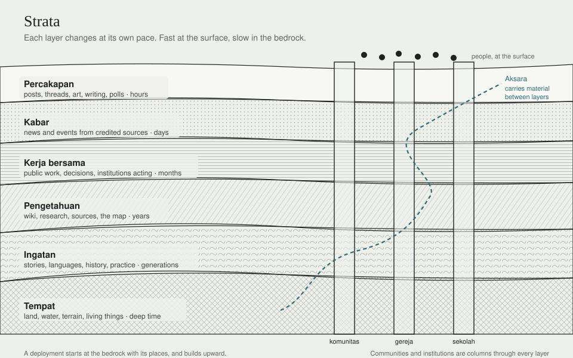

# The Strata model: layers, columns, and a place to start

17 November 2026. A foundation document. It names how everything in Strata fits together, how a deployment grows from nothing, and what the owner decided on 16–17 November. It extends `next-2026-11-16.md` and replaces the three-layer description (surface, sediment, bedrock) in the README.

## 1. Layers

Every deployment describes one place and the people of it. What it holds settles in layers, and each layer changes at its own pace. The idea is close to Stewart Brand's pace layers: fast layers try things, slow layers remember.

| Layer | Holds | Pace | Already in Strata |
| --- | --- | --- | --- |
| **Percakapan** | Posts, threads, art, writing, photos, polls, open calls | Hours | Feed, communities, polls, media |
| **Kabar** | News and events from credited sources | Days | News desk, source feeds |
| **Kerja bersama** | Public work, decisions, consultations, what institutions do | Weeks to months | Public work, polls, offers and requests |
| **Pengetahuan** | Wiki pages, research, sources and the catalogue, Peta wiki | Years | Wiki, source catalogue, the map |
| **Ingatan** | Stories, languages, history, practice | Generations | Cerita, language spaces (planned), the time lens |
| **Tempat** | Land, water, terrain, living things | Deep time | Place labels; the place tree and species are next |

Two things are not layers:

- **People** are at the surface and reach down. A person posts in Percakapan, reads in Pengetahuan, adds a story to Ingatan.
- **Communities and institutions are columns.** A church, a school, a book club or a customary council passes through every layer: its conversation, its news, its work, its knowledge, its memory, and the place it stands on. The community page is a core sample of that column. "Buka inti lapisan" already says this.

**Aksara is groundwater.** It carries material between layers: a news story settles into a wiki change; a wiki fact rises as a post that asks members what they know; a member's story becomes a sourced variant. It never creates a layer on its own, and everything it moves carries its source.

## 2. Building upward from a place

A deployment starts at the bedrock and builds upward. This is how ETNOS should grow in Papua, and how Strata should start anywhere else.

| Step | Layer | What happens | Who confirms |
| --- | --- | --- | --- |
| 1 | Tempat | The place tree is seeded from open data: administrative units down to kampung, with codes; cultural regions as sourced overlays | Operator, then a person from each region |
| 2 | Ingatan, Pengetahuan | Wiki pages per place and language from verified sentences; the source catalogue; Peta wiki | Live, reviewed later |
| 3 | Kabar | News sources per place switched on; stories land on place pages | Operator |
| 4 | Kerja bersama | Institutions listed by kind and place, unclaimed until they claim them; public work templates | Operator |
| 5 | Percakapan | Communities from a catalogue, opened by the first person who wants them; Aksara by place posts a little each day | People |

The honest version of "not a ghost town": a new deployment is full of content (places, pages, news, sources) and empty of fake people. Nothing pretends someone is there who is not. Communities exist as names waiting to be opened, institutions as listings waiting to be claimed, places as pages waiting for their stories. A visitor sees a rich place and an obvious first thing to do.

## 3. A social place first

The layers are the engine. What people see is a social app they already know how to use, with few destinations, as in Instagram and Threads. The layers show up as depth under every post, not as more menus.

**Destinations.** Five on a phone: Beranda, Jelajah, Posting, Aktivitas, Kamu. On a wide screen the sidebar can also show Tempat, Komunitas and Wiki, which are sections of Jelajah on a phone. This revises the research proposal that made Tempat a fifth phone tab; the next point makes that unnecessary.

**Place is a scope, not a destination.** A switcher at the top of Beranda, Jelajah and Wiki reads "Tanah Papua" by default and can be set to a region, a regency or a kampung. Everything below follows it: the feed, the communities listed, the wiki, the map, the news. This makes place the foundation of every screen without adding a sixth tab. It is the pattern of Threads' feed switcher and Nextdoor's neighbourhood, without proof of residence and without inference.

**Communities are like subreddits, not only like Facebook groups.** People gather by interest as much as by kinship or office: writing, art, photography, music, a book club, football, faith, a language, diaspora. The catalogue the engine ships should be weighted toward these, with place and kinship communities alongside. Examples to seed for Papua: Penulis Papua, Seni rupa Papua, Foto Papua, Baca bersama, Musik Papua, Sepak bola Papua, Bahasa Mee, Perantau Papua, Mahasiswa Papua di luar Papua.

**Open calls.** A community can post an open call (Panggilan karya): a theme, a deadline, what to send. Submissions are posts in reply; the community chooses some for a showcase that becomes a page or a printable zine. This is what the Instagram community baku_dengar does with a Google Form and a QR code; here the submissions stay with their authors and the showcase stays in the commons.

**Diaspora.** "Di luar Papua" is not a place in the tree. Diaspora communities are interest communities with a place link to where members come from (Perantau Mee, Mahasiswa Papua di Yogyakarta) and, if they like, where they are now.

## 4. Places: decisions and a cleaner model

### 4.1 Administrative spine, cultural overlays

This revises `next-2026-11-16.md`, which put wilayah adat as the first rung of the tree. Recommendation:

- **The spine is administrative**: country, province, regency or city, district, kampung. Each place has exactly one administrative parent, sourced by government codes (Kemendagri, BPS) and Wikidata. It is unambiguous, maintained by others, and exists in every country, so a deployment in Kalimantan or Aotearoa gets it the same way.
- **Cultural regions are overlays.** Wilayah adat here, iwi rohe in Aotearoa, a deployment's own scheme elsewhere. A place can sit in several overlays. Each membership records whole or part, the reason, and its source.
- **No forced primary.** Breadcrumbs follow the spine because the spine is single: Papua Tengah › Nabire. Overlays appear as equal chips beside the title: Mee Pago, Saireri, each with its reason on hover or tap. The map hatches a place that sits in two overlays.
- **Overlay pages come first in the interface.** The Tempat index opens on the seven wilayah adat, not on provinces, and local names lead. The spine is the filing system; the overlays are how people talk about home.

Why this is cleaner than making wilayah adat the first rung: the overlay scheme is contested at its edges (Nabire, Mimika, Puncak), was formalised for planning, and differs by source; putting it at the root would force a single answer where the honest answer is several. Putting the state's units first has its own cost: it can read as the state's map of Papua. The mitigations are the overlay-first interface, local names first, and the "Wilayah acuan, bukan batas tanah adat" line on every overlay.

### 4.2 Nabire

The owner: Nabire sits on the coast of Cenderawasih Bay with direct access to the central ranges, close to Paniai, Deiyai and Dogiyai; culturally a meeting point of Saireri and Mee Pago peoples with long histories on both sides; people are split; administratively in Papua Tengah, which is often treated as interchangeable with Mee Pago, though Nabire is not its formal capital.

Under the model: Nabire's spine parent is Papua Tengah. Its overlays are Saireri (part: the coast and its peoples) and Mee Pago (part: the inland and its peoples), each with the sources that say so, hatched on the map. Its page has a "Beda versi" section that sets out how sources and people place it, and invites people to add their account. A research note on how Papuan scholars, customary councils and government documents place Nabire and the other boundary regencies is in `research/customary-regions-and-boundaries-2026-11-17.md`. The same treatment applies everywhere: what is public (the literature, the researchers, the documents) is the base, and the platform is where people discuss and correct it.

### 4.3 Provinces: chip or tree

With the administrative spine, provinces are a rung of the tree, not a chip. The earlier question compared two options for a model where wilayah adat was the spine:

| | Province as a chip beside the region | Province as a second tree |
| --- | --- | --- |
| For | One tree to browse; wilayah adat stays first | Government questions (budgets, laws, statistics) answer by province; codes line up |
| Against | Two parents per regency of different kinds anyway; province pages feel second-class | Two trees confuse people; which breadcrumb? |

The spine-plus-overlays model takes the strengths of both: one tree (the administrative one) for filing and breadcrumbs, and overlays for identity, shown first. Provinces get ordinary pages.

### 4.4 Kampung: seed them all

Seed every regency, district and kampung from the government codes, as many as exist, searchable from day one. A place appears in browse lists when something is attached to it, so lists are not a forest of empty pages, but anyone can find their kampung and post about it. A district or kampung missing from the codes (newly formed, or named differently by its people) can be proposed by anyone: "Usulkan tempat". The proposal names the place, its parent, and a source if there is one (a regent's decree, a news story, or "warga setempat"), and a steward accepts it. The scenario to design for: a kid online for the first time finds their regency, does not find their new district, and adds it.

Technical note: context lists cap at 1,000 rows today; seeding kampung needs paged lists and search-first browsing.

### 4.5 What ships with Strata

A deployment starts from a pack the operator picks in setup, and every pack is data, not code:

- **Place pack**: the administrative tree for a country or region, built from Wikidata and the national codes, plus any overlay schemes with their sources.
- **Community catalogue**: interest communities, place communities, community kinds with their admission defaults. The operator ticks which to list; each listed one waits to be opened.
- **Institution kinds**: church, school, health post, customary council, NGO, government office, with places to be claimed.
- **Topic schemes**: the deployment's topic tree, the ten cultural objects of UU 5/2017 for Indonesia, Western disciplines; all kept side by side.
- **Source packs**: news feeds and open data per place.

ETNOS is the first deployment and the flagship. The packs for Papua are the first packs.

## 5. Organisations and their Aksara

An organisation does not need to run an Aksara Node or a PDS to appear. The path:

1. **Listed**: the organisation exists as a listing by kind and place, seeded or added by anyone. Unclaimed.
2. **Claimed**: someone from it fills a short form ("Ajukan organisasi resmi") with a contact, a public proof (an official site, a letter, a known office), and the people who will manage it. The operator verifies. The page gets a verified mark and its own Studio.
3. **Connected**: later, the organisation connects an Aksara Node, bringing its own agent identity, inference and private archive, through Abstraksi's gateway.

Each step is useful on its own; no organisation has to reach step 3 to take part.

## 6. Owner decisions recorded here

- **Biodiversity and museum data**: ETNOS runs on grants for now, so non-commercial terms (IUCN, CC BY-NC datasets, some museum terms) can be used, with their terms shown. Revisit if ETNOS earns revenue.
- **What is sacred**: go live first, so people see what ETNOS is and can say what is right. The owner will ask the Mee kepala suku for the Jayapura and Anim Ha region; that is the first conversation, not a gate. Human remains stay without images (see `next-2026-11-16.md`).
- **Kampung**: seed all, allow proposals for new ones.
- **Diaspora**: as communities, like subreddits.

## 7. What this changes in the build order

1. **Place scope switcher** on Beranda, Jelajah and Wiki, filtering by the existing labels. Small, and it changes how the whole app feels.
2. **Community catalogue with "Buka komunitas ini"**: seeded interest and place communities that the first person opens; open calls as a post kind.
3. **Place pack v1**: administrative spine with codes for Papua's six provinces, regencies and districts; kampung after paged lists; overlays with sources; Nabire as the first two-overlay place; "Usulkan tempat".
4. **Shared map component with a scope** (wiki home, place pages, explore, news), including the Tempat lens.
5. **Organisation listing, claim form and verified mark.**
6. Carried: Bacaan terpandu; the Mee Pago state-of-knowledge report; Aksara's cursor on the map; the classifier with receipts; Studio as one place for every operator setting, with the setup flow ("Mulai dari awal") built on the packs; the model comparison on the seed sentences; Jejak Spesimen and the other biocultural features.

Open: whether the five phone destinations hold up in a usability test with three people in Jayapura; whether the scope switcher should remember the last place (per device only, never inferred).
